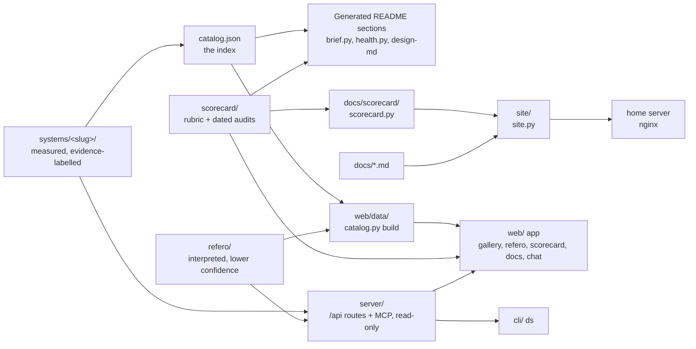

<p align="center">
  
</p>

<h1 align="center">
design-systems
</h1>

<p align="center">
  <strong>Measured tokens, components and screenshots from real products, so any project can say "make it look like Linear".</strong>
</p>

<p align="center">
  <a href="https://github.com/c-wenlong/designs/actions/workflows/check.yml"></a>
  
  
</p>

<p align="center">
  <a href="#setup">Setup</a> ·
  <a href="#quick-start">Quick start</a> ·
  <a href="#catalog">Catalog</a> ·
  <a href="#using-a-style">Using a style</a> ·
  <a href="#for-agents">For agents</a> ·
  <a href="#how-it-works">How it works</a> ·
  <a href="#development">Development</a>
</p>

---

**design-systems** is one library of design styles captured from real
products, so any project (and any coding agent working in it) can say "make
it look like Linear" and find measured tokens, components and screenshots in
one place instead of in whichever project first needed them.

It holds two stores of styles at two confidence levels:

- [systems/](systems): the packages, one per product (50 today), measured
  from real captures. Every value carries an evidence label saying where it
  came from. These are the only values to design from.
- [refero/](refero): a snapshot of [styles.refero.design](https://styles.refero.design)
  (1,342 styles): third-party interpreted data at lower confidence. Breadth
  for inspiration, never the source for a value a package holds.

Each package is self-contained: design tokens, a page that renders them, a
component inventory, screenshots of the real product, and the builders that
produced all of it, so a fix goes through the builders rather than a hand
edit. The library is read three ways: by a person through the gallery app
(`make dev`), by a script or agent through [catalog.json](catalog.json) and
the read-only MCP server, and by a terminal through the `ds` CLI. The repo
(`c-wenlong/designs`) stays private; [docs/RIGHTS.md](docs/RIGHTS.md) says
why.

```
$ python3 tools/catalog.py find dark chat

codex-desktop   4  Desktop coding-agent app (OpenAI's Codex for macOS, Electron): a 52px navigation rail beside a …
                  tags: desktop, electron, macos, coding, ai, agent, chat, sidebar, rail, dense, … | themes: light, dark | systems/codex-desktop/README.md
grokbot-desktop 4  Desktop chat app for AI agents in Electron: a near-black or white window with a darker sidebar of …
                  tags: desktop, electron, macos, coding, ai, agent, chat, sidebar, per-item-colour, … | themes: light, dark | systems/grokbot-desktop/README.md
opencode-desktop 4  Desktop coding agent in Electron: a near-black or white rounded panel under a title bar of session tabs, …
                  tags: desktop, electron, macos, coding, ai, agent, chat, tabs, dense, ramps, … | themes: light, dark | systems/opencode-desktop/README.md
```

## Why a library?

Without one, the same style gets re-measured in every project that wants it:

- Tokens get copied out of whichever repo needed the style first, drift
  included, and the copies never reconcile.
- Screenshots get read as measurements. Most shots here are 256-colour PNGs
  to keep the repo small; none of them is a measurement.
- A value with no provenance cannot be checked later, so nothing can be
  trusted twice.
- An agent asked to "make it look like Linear" guesses from memory instead
  of reading the product's own values.

This repo keeps every captured style in one standard package, keeps the
evidence next to the values, and puts the same front door on it for a
person (the gallery), a script ([catalog.json](catalog.json)) and a coding
agent (the MCP server and `ds`).

## Features

[FEATURES.md](FEATURES.md) is the full inventory of user-facing features,
one line each with its status, surface, entry point and tests.

| Area | What you get |
| --- | --- |
| **Packages** | 50 products under [systems/](systems), all in one layout: `tokens.json` (W3C DTCG, Tokens Studio multi-set), a generated `DESIGN.md`, a `style-guide.html` rendering every token, `components.md`, `patterns.md`, screenshots, and the tools that rebuild it |
| **Evidence** | Every token says where it came from: a measured CSS read, a reconstruction, or a reviewer's call ([docs/EVIDENCE.md](docs/EVIDENCE.md)) |
| **Gallery** | One card per package with cover, icon, colour roles and fonts; per-package pages running Screenshots, Brief, Colors, Type, Spacing, Shape, Components, Icons, Health and Files (sections a package has nothing for are hidden); search over names, uses, tags and themes |
| **Refero** | 1,342 styles labelled by product type and design style, browsed beside the packages but never trusted over them |
| **Scorecard** | Every package graded against the rubric in [docs/DESIGN-SYSTEM.md](docs/DESIGN-SYSTEM.md), in the wording for its platform (web, mobile or desktop), shown as a heatmap with the evidence behind each grade |
| **Agent layer** | Read-only MCP tools over stdio or hosted HTTP, a `ds` terminal client, a chat UI inside the app, and `handoff_prompt` for passing a chosen style to a coding agent |
| **Capture kit** | [tools/kit/](tools/kit): public-web, signed-in-web and native-iOS (iPhone Mirroring) capture pipelines plus the token and style-guide builders a new package starts from |
| **Freshness** | Brief, Health, `DESIGN.md` and the catalog table below are generated; `make check` fails on a stale one, so the docs cannot drift from the data |

## Setup

**Requirements:** Git LFS installed *before* cloning (every image, archive
and font is an LFS object), `python3`, and `uv` for `make setup`. The apps
need Node 22.13+ and pnpm 10. Capturing additionally needs Playwright, a
Chromium browser for the signed-in kit, and an iPhone on the same iCloud
account for the native kit; [docs/CAPTURE.md](docs/CAPTURE.md) has the
detail. Pillow, Markdown, numpy and Node-based linting are only needed by
the builders that ask for them (see `make setup`).

```bash
brew install git-lfs && git lfs install   # once per machine, before the clone
git clone git@github.com:c-wenlong/designs.git design-systems
cd design-systems
make setup                                # .venv with the site builder's and capture tools' deps
cp .env.example .env                      # fill in what you use; .env is gitignored
```

`.env` values and what uses them:

| Variable | Used by |
| --- | --- |
| `ANTHROPIC_API_KEY` | `tools/refero/classify.py`; the gallery chat's fallback provider (stays server-side) |
| `R2_ACCOUNT_ID`, `R2_ACCESS_KEY_ID`, `R2_SECRET_ACCESS_KEY`, `R2_BUCKET` | `tools/refero/upload_r2.py`, the media mirror upload |
| `DS_CHAT_MODEL` | Optional: the model the gallery chat calls when the browser has none saved |
| `DESIGN_SYSTEMS_REPO` | Optional: this checkout's path, when the app cannot find it by itself |
| `DESIGN_SYSTEMS_MEDIA`, `DESIGN_SYSTEMS_MEDIA_BASE` | Optional: where mirrored refero media lives, and the base URL for catalog media absent from the local mirror |

## Quick start

```bash
make dev                     # build web/data/, serve the app on 127.0.0.1:8800, open the gallery and scorecard
make dev PORT=9000           # another port; scripts/dev.sh --no-open skips the browser
make help                    # every target

pnpm --dir app install --frozen-lockfile && pnpm --dir app dev   # the newer research app on :8845

python3 tools/catalog.py find dark dense                 # rank packages by free text
python3 tools/catalog.py export linear                   # every token as CSS custom properties
python3 tools/catalog.py export linear --format json     # or JSON, aliases resolved
python3 tools/catalog.py contrast systems/linear/tokens.json --theme light FG:BG...
python3 tools/catalog.py scan systems/linear --redact ~/.design-systems/cleanup-redact.json
python3 tools/fetch_icon.py linear                       # refresh a package's app icon from its site

make check                   # the freshness gate: catalog, refero stores, Brief, DESIGN.md, scorecard, Health
make grade                   # re-grade scripted criteria, rewrite every Health + the catalog table below
make brief                   # regenerate every package README's Brief
make design-md               # regenerate every package's DESIGN.md (runs make brief first)
make docs                    # build docs/ into the static site/
make test                    # tools' unit tests + every package's own tools/test_*.py
make clean                   # remove generated output

python3 server/mcp.py        # stdio MCP server: the library as tools for a coding agent
ds find "dense sidebar"      # the ds CLI against a hosted /api/mcp (see For agents)
ds export linear -g light    # one token group; also ds doc, ds media, ds handoff, ds status
```

## Browse it

Everything is browsed through the Next.js app under [web/](web): the gallery,
the scorecard and the library docs under `docs/`.

```bash
make dev
```

`make dev` (or [scripts/dev.sh](scripts/dev.sh)) builds the app's data,
installs its `pnpm` dependencies on the first run, serves it at
http://127.0.0.1:8800/ and opens the gallery and the scorecard in the browser.
If the app is already running it only opens the tabs; `--port N` picks
another port and `--no-open` skips the browser. The app has three parts:

- **Gallery**: one card per package with a cover screenshot, its product icon,
  its colour roles and fonts. Each package's page at `/gallery/<slug>` reads
  in the same order, from a rail on the left: Screenshots, Brief, Colors,
  Type, Spacing, Shape (radii and shadows), Components, Icons, Health and
  Files (every Markdown file, rendered). A section the package has nothing
  for is left out of the page and the rail. Each section is an anchor, so
  `/gallery/<slug>#colors` links straight to it. Search on the gallery
  index matches names, uses, tags and themes; press `/` to focus it.
- **Scorecard**: every package graded against the checklist in
  [docs/DESIGN-SYSTEM.md](docs/DESIGN-SYSTEM.md), in the wording for its
  platform (web, mobile or desktop), as a heatmap with the evidence
  behind each grade. The app reads [scorecard/](scorecard) live on each
  request; [tools/scorecard.py](tools/scorecard.py) only writes the
  docs site's copy under `docs/scorecard/`.
- **Docs**: the files under [docs/](docs), rendered.

The library docs, without the gallery, are also built into a static docs
site by [tools/site.py](tools/site.py) (`make docs`), which the home-server
deployment serves. `make help` lists the other targets (`make check` validates
[catalog.json](catalog.json) against the packages).

## Catalog

Ranked by the scorecard. Health counts the criteria in
[docs/DESIGN-SYSTEM.md](docs/DESIGN-SYSTEM.md) each package meets, leaving out
the ones a capture cannot meet; layout gaps are the standard parts from
[docs/PACKAGE.md](docs/PACKAGE.md) it lacks. Each package's README opens with a
Brief to read before designing in its style, then a Health section that lists
what is open, with the evidence.

<!-- catalog:start. Generated by tools/health.py from the newest scorecard snapshot; `make grade` rewrites it. Do not edit. -->

| Icon | Package | Good for | Captured | Themes | Health | Layout gaps |
|---|---|---|---|---|---|---|
|  | [claude](systems/claude/README.md) | A quiet chat shell with a serif model voice: composer, thread, Artifacts, Projects, settings (cds tokens) | 2026-10-17 | light, dark | 22 of 25 met, 3 partly, 0 missing | none |
|  | [deezer](systems/deezer/README.md) | music-streaming design: a declared Tempo token layer (675-step palette scales, per-theme semantic background/text/icon/border roles, spacing/radii/shadow/transition scales) under a light marketing hero (140px Deezer Brand display, #a238ff accent) and a dark signed-out Chakra app shell (243px #141216 sidebar, #0f0d13 canvas, #242326 fields with 2px #ad47ff focus borders, #ad47ff Mix/Sign-up pills with #bb73ff hover, 56px track rows, 24px popovers, a lavender #ead1ff signup banner over an 80px player bar) plus dark account.deezer.com auth forms | 2026-11-13 | light, dark | 20 of 26 met, 6 partly, 0 missing | `icons/` |
|  | [excalidraw](systems/excalidraw/README.md) | whiteboard and canvas-app design: a declared custom-property layer (~191 vars on .excalidraw, ~80 rebound under .theme--dark) under a signed-out editor of floating translucent Islands: a 44px tool island of 36px buttons over an edge-to-edge canvas, 8px radii, Assistant UI text with an Excalifont hand-drawn wordmark, hairline #ebebeb borders, and a single violet #6965db (#a8a5ff dark) for active tools, checked options and every primary action | 2026-11-14 | light, dark | 20 of 26 met, 6 partly, 0 missing | `icons/` |
|  | [brilliant](systems/brilliant/README.md) | Interactive problem-solving lessons, course paths, a calm editorial learning UI (Panda CSS tokens) | 2026-10-17 | light, dark | 20 of 25 met, 5 partly, 0 missing | none |
|  | [doctronic](systems/doctronic/README.md) | AI health-product marketing and chat-adjacent UI with a warm paper-and-ink system: a #fdfdf7 canvas under #1b1b18 ink, Fraunces display headings with dashed underlines, seven eleven-step colour ramps, a single #2463eb blue spent on actions with a signature rgba(36,99,235,.39) brand-glow, a lime #beec4b reserved for prompt tabs and tag pills, 32px and 52px radius pill buttons, dashed-ink dividers, and a real user-selectable dark theme | 2026-11-13 | light, dark | 19 of 25 met, 6 partly, 0 missing | `icons/` |
|  | [esquire](systems/esquire/README.md) | editorial magazine design: a declared Hearst FRE design-token layer (~4,400 resolved custom properties - --_palette/--_size/--_font primitives, --color-*/--type-*/--dim-*/--comp-* scales) under a white editorial surface with a #ff3a30 brand red (the utility strip, a Subscribe pill that inverts to white on hover, Join buttons), Lausanne UI type under PlayFair display headlines and Lora article body text, a ~155px three-band top chrome with a mega-menu and More overflow, story-card section fronts, a ~38,000px article layout with drop cap/pull quote/ad furniture, and a premium membership offers page with plan cards and an FAQ accordion | 2026-11-13 | light | 19 of 25 met, 6 partly, 0 missing | `icons/` |
|  | [polaris](systems/polaris/README.md) | Admin and commerce UI built from a published component library: semantic colour roles, buttons, cards, banners | 2026-10-17 | light, light-mobile, light-high-contrast-experimental, dark-experimental | 19 of 25 met, 6 partly, 0 missing | none |
|  | [superset-desktop](systems/superset-desktop/README.md) | Desktop app for running coding agents in parallel workspaces, in Electron: a warm near-black or near-white window with a slightly darker sidebar of projects and workspaces, one rounded composer with small chips, ink primary buttons instead of a brand hue, shadcn/ui components on Tailwind's scale (8px controls, 10px popovers, a 3px focus ring), foreground-wash hover and selection, and each agent's CLI in a terminal pane inside a tabbed workspace | 2026-10-25 | light, dark | 19 of 25 met, 6 partly, 0 missing | `icons/` |
|  | [delphi](systems/delphi/README.md) | expert-Q&A and AI-clone product design: a full declared token layer (Radix-style 12-step palette scales, a shadcn semantic layer, Delphi --fg-*/--surface-*/--mind-* roles and a Tailwind utility scale) over a white light surface (#21201c ink, #63635e/#82827c mid-low text, #f7f3f0 warm cards, translucent-ink hairlines, #fd5400 brand-orange create actions), Delphi Pythia display + Delphi Inter UI, big ask-field heroes, coloured topic cards, two-sided perspective flip cards, signed-out /search results, public expert profiles and a chat composer, plus Sign-In and onboarding dialogs | 2026-11-14 | light, dark | 18 of 26 met, 8 partly, 0 missing | `icons/` |
|  | [airtable](systems/airtable/README.md) | SaaS marketing: Haas grotesque on white, a 13-hue brand accent system painting 32px-radius pastel tiles, dark ink pill CTAs, a slide-in nav drawer, a plan grid and a lead form | 2026-11-10 | light | 18 of 25 met, 7 partly, 0 missing | none |
|  | [base44](systems/base44/README.md) | AI-app-builder marketing: warm paper ground with Dazzed display type, near-black 38px CTA pills, an orange #ff773c action accent, a hero prompt composer, and a full named token system (shadcn channels + named palette + scales) in the bundle | 2026-11-11 | light, dark (declared) | 18 of 25 met, 7 partly, 0 missing | `icons/` |
|  | [chatgpt](systems/chatgpt/README.md) | The baseline chat UI: thread, composer, sidebar history, menus, dialogs, search, settings pages | 2026-10-17 | light, dark | 18 of 25 met, 7 partly, 0 missing | none |
|  | [faire](systems/faire/README.md) | Wholesale marketplace surfaces: a white field with near-black #333333 fs-buttons at 4px radius against 999px filter pills, a 2px #275ec5 focus ring, Graphik 14/20 UI text under Nantes 52/64 and GT Canon 30/38 serif mastheads, and the declared Slate token layer (--slate-* ramps, roles and the .fs-mode-on-surface inverse scope) readable straight off the bundles | 2026-11-14 | light | 18 of 25 met, 7 partly, 0 missing | `icons/` |
|  | [notebooklm](systems/notebooklm/README.md) | Source-grounded AI workspace: sources panel, chat, studio outputs; near-monochrome surfaces with pill buttons (luminous UI) | 2026-10-17 | light, dark | 18 of 25 met, 7 partly, 0 missing | none |
|  | [tokentracker](systems/tokentracker/README.md) | Local AI usage dashboard: borderless sidebar, rounded content panel, hairline cards, one green accent for money, dense tables, limits bars | 2026-10-17 | light, dark | 18 of 25 met, 7 partly, 0 missing | none |
|  | [gauth](systems/gauth/README.md) | AI tutor learning app: course catalogue, unit pages, lesson players with an Ask Tutor panel | 2026-10-17 | light | 18 of 24 met, 6 partly, 0 missing | none |
|  | [capy-desktop](systems/capy-desktop/README.md) | Desktop app for cloud coding agents in Electron, the capy.ai web app in a desktop frame: an off-white or near-black window with a rounded content panel set into it, browser-like tabs in the title bar, a sidebar of threads by project, one composer with project, Run on and model pickers, 0.5px hairlines and Inter at 13px, muted text mixed from one ink, teal only for starting work and on-states, red only for deletion | 2026-10-25 | light, dark | 17 of 26 met, 9 partly, 0 missing | `icons/` |
|  | [digg](systems/digg/README.md) | news-aggregator and community-feed product design: a real declared shadcn-style token layer (--background/--primary*/--muted*/--accent*/--border/--input/--ring semantics, the --sidebar-* rail set, --chart-1..5, --rank-one/--success roles, the full Tailwind hue scales and a Tailwind utility layer) over a #fdfdff field with #161617 ink, ink@70% muted text, white cards on rgba(0,0,0,0.08) hairlines, #f0f0f5 fills, a single #1c66eb primary blue and #e37b4c rank-one orange; roobert UI + vt323 vote-odometer mono; story cards with vote pills and source clusters, right-rail panels, a story detail layout, Clerk auth - and a real painted dark theme cycled through the sidebar pill | 2026-11-14 | light, dark | 17 of 26 met, 9 partly, 0 missing | `icons/` |
|  | [airbnb](systems/airbnb/README.md) | Public travel marketplace: the capsule Where/When/Who search bar, photo-led listing cards with the stroked wishlist heart, hairline-separated surfaces, one Rausch pink for end-of-flow actions, and a full set of declared-but-unapplied dark values | 2026-11-09 | light, dark | 17 of 25 met, 8 partly, 0 missing | `icons/` |
|  | [coursera](systems/coursera/README.md) | Course catalogue, course and module pages, course cards, a mature enterprise design system (386 --cds-* variables) | 2026-10-17 | light, dark | 17 of 25 met, 8 partly, 0 missing | none |
|  | [endless](systems/endless/README.md) | Multi-model AI creation workspace marketing and free tool pages: a full shadcn-style semantic token layer on a #fcfcfc field with one #01bcff sky accent, TikTok Sans display type at -1.9px tracking, a 20px-radius prompt composer on a floating shadow, 8-16px controls, .dark class theme, and translucent 50% field fills | 2026-11-13 | light, dark | 17 of 25 met, 8 partly, 0 missing | `icons/` |
|  | [expedia](systems/expedia/README.md) | Travel OTA in EGDS/UITK: the multi-product tabbed search card with 48px outlined fields and a pill-radius primary, 16px-radius cards and dialogs, a 57-role colour layer re-bound per data-theme attribute (light-1, marketing-3, dark, bright, loyalty tiers), Centra No2 with Reckless XPD display serif | 2026-11-14 | light, dark, dark2, marketing3, bright1 | 17 of 25 met, 8 partly, 0 missing | `icons/` |
|  | [manus](systems/manus/README.md) | Agent app shell: multi-section sidebar, a Library of agent outputs by type and by day, task threads with deliverables | 2026-10-17 | light, dark | 17 of 25 met, 8 partly, 0 missing | none |
|  | [notion-calendar-desktop](systems/notion-calendar-desktop/README.md) | Desktop calendar app (Notion Calendar for macOS, Electron around the calendar.notion.so web app): a 240px wash sidebar with a mini month, scheduling and per-account calendar lists beside a week grid of 48px hours with two time-zone columns, event chips in each calendar's colour with a left ribbon, a translucent 284px event popover and a centred command menu, hairline edges drawn as 1px inset shadows, 13px medium labels on 30px controls with 6px corners, one blue for primary actions, switches and focus, red only for today, and menus and tooltips that stay dark in both themes | 2026-10-25 | light, dark | 17 of 25 met, 8 partly, 0 missing | `icons/` |
|  | [designstripe](systems/designstripe/README.md) | AI design-agent and asset-library product design: a real declared shadcn-style token layer (--background/--primary*/--muted*/--accent*/--border-*/--ring* semantics, --neutral-50..950 and --green-50..950 scales, Tailwind utility layer, declared .dark block) over a white light surface (#2c2c26 olive ink, #6d6e5e muted mono text, #e8e7d9 cream WAITLIST pill, #aaa674 olive-gold accents, #d0d0c8 hairlines), fontSerif display + fontMono UI, 96px serif heroes, a dark feature-accordion panel, aspect-square asset tiles, bordered tool cards and an ink footer | 2026-11-14 | light, dark | 17 of 26 met, 8 partly, 1 missing | `icons/` |
|  | [researchrabbit](systems/researchrabbit/README.md) | Interactive citation graph beside a list: node and edge styling, canvas interaction (see graph.md) | 2026-10-17 | light | 17 of 24 met, 7 partly, 0 missing | none |
|  | [anthropic](systems/anthropic/README.md) | AI-product marketing pages, pricing pages, sales forms and developer docs; ivory editorial surfaces with serif headlines, pill nav chrome and a restrained clay accent | 2026-11-09 | light, dark | 17 of 25 met, 6 partly, 2 missing | none |
|  | [devin-desktop](systems/devin-desktop/README.md) | Desktop coding-agent app in Electron on a VS Code workbench: a near-black or near-white page shared by the sidebar and the content, two-line session rows, one 20px-radius raised composer with a Cloud / Local segmented control, a right-aligned tinted prompt bubble over plain replies and muted work rows, every neutral one colour at fixed alphas, ink-filled page buttons with blue kept for focus and links, 6px controls and 10px popups and cards | 2026-10-25 | light, dark | 16 of 25 met, 9 partly, 0 missing | `icons/` |
|  | [elevenmusic](systems/elevenmusic/README.md) | Dark, quiet, tool-like music apps: a true-black field with white-alpha surface steps (#131313/#1c1c1c/#262626), white as the action colour (inverted Start-free/Create pills), hairlines at rgba(255,255,255,.08-.12), one #5d88e7 brand blue, a fixed 248px rail + 52px header + inner scroller + 72px player bar, 999px pill controls, waldenburg light display over Inter, and a real warm-paper light theme (#fdfcfb) behind the footer's own System/Light/Dark control | 2026-11-13 | dark, light | 16 of 25 met, 9 partly, 0 missing | `icons/` |
|  | [elevenreader](systems/elevenreader/README.md) | Audiobook-reader marketing pages: near-monochrome ink #000 on white with a #F5F3F1 promo band and #FAF8F8 FAQ tints, a declared --themed-*/--color-* Tailwind v4 token layer that inverts on a .dark scope, the --f-* type scale (Waldenburg display at 60px -1.8px tracking, Inter UI/body), 9999px pill geometry on every button, chip and input, 20-40px card radii, a layered ring shadow on white pills, 2px black focus outlines, and bare 360px sign-in/sign-up cards | 2026-11-13 | light, dark | 16 of 25 met, 9 partly, 0 missing | `icons/` |
|  | [enode](systems/enode/README.md) | energy-tech marketing design: a declared token layer (--color-brand-*/--color-gray-*/--color-enode-green-* palette scales, per-mode --color-background-*/--color-foreground-*/--color-card-*/--color-border-*/--color-line-*/--color-diagram-* semantic roles, --text-*/--leading-*/--tracking-* type ramp, --radius-* 2-10px plus full pills, grid/gutter/breakpoint/blur/ease tokens) under per-page data-mode themes - pale-green #f0fde8 light marketing with a 58px glass header and dark-glass mega-menus, whole-dark /platform pages (#151413 canvas, translucent tiles), scoped dark showcase sections with #b0f87c live-metric green, and a dark-framed platform login with a light panel | 2026-11-13 | light, dark | 16 of 25 met, 9 partly, 0 missing | `icons/` |
|  | [epidemicsound](systems/epidemicsound/README.md) | music-and-SFX-licensing design: a declared --es-* token layer (151 semantic colour roles, es-heading/subheading/text type scales, radii/elevation/grid/trackrow scales, Inter + Sebenta stacks) across two signed-out surfaces - an ecru alternative-light marketing site (pill header, serif display hero, #ff82c2 accent, black pill CTAs) and a dark catalog app (pink #ff82c2 genre banner, 56px track rows with cover-play buttons and icon actions, sticky pill nav) plus dark login.epidemicsound.com Keycloak forms | 2026-11-14 | light, dark | 16 of 25 met, 9 partly, 0 missing | `icons/` |
|  | [refero-design](systems/refero-design/README.md) | Design research app plus a public design-system gallery: research box, rotating screenshot galleries, video-preview style cards, per-style DESIGN.md documentation pages | 2026-11-02 | light, dark | 16 of 25 met, 9 partly, 0 missing | none |
|  | [fal](systems/fal/README.md) | generative-media infrastructure design: three declared token layers (a Tailwind v4-style app layer of 763 names - surface/content/stroke/overlay/badge/accent roles over HSL-triplet ramps - a Webflow marketing palette and a fumadocs docs layer) across three signed-out surfaces - a dark-bronze+cyan Focal Web marketing site (neon-lime CTA), a dark #121216 model catalog and playground (violet #783afb Sign-in-to-run, ghost washes, model cards), and a light Focal/Public-Sans docs - plus an OAuth-only login card and a 390px phone pass | 2026-11-14 | light, dark | 16 of 25 met, 9 partly, 0 missing | `icons/` |
|  | [elektron](systems/elektron/README.md) | Instrument-grade hardware storefronts and product pages: a fully inverted monochrome (#151515 ground, #eeeef2 paper that is text, icon, 2px action stroke and hover fill at once), Neue Haas Grotesk Text/Display typography with digi one v2 button labels and an Analog One V2 search field, square corners on every control, a 7px space rhythm, #333333 gradient underline-sweep link hovers, light #eeeef2 field slabs, right-drawer modals over a 50% scrim and a double (white spread + black outline) focus ring | 2026-11-13 | dark | 16 of 25 met, 8 partly, 1 missing | `icons/` |
|  | [farfetch](systems/farfetch/README.md) | Luxury-fashion marketplace on the pulse token layer: a two-row sticky chrome (department links, 201px letterspaced wordmark, 44px icon hit areas, red Sale link), a 4-up product-card grid (3:4 image, wishlist heart, brand kicker, price), the PDP buy box with a square #222 Add To Bag, ~590 --colors-<family>-<role>-<state>-<slot> semantics, 'Farfetch Basis' UI type with 'Nimbus Roman D' editorial serif, square corners and a 1000px pill | 2026-11-14 | light | 16 of 25 met, 8 partly, 1 missing | `icons/` |
|  | [aboard](systems/aboard/README.md) | AI consultancy marketing: warm editorial Tobias serif on a cream ground, Work Sans UI, pill-everything controls, one loud bright-citrus accent, frosted floating nav, dark content bands inside a single light theme | 2026-11-09 | light | 16 of 25 met, 6 partly, 3 missing | none |
|  | [codex-desktop](systems/codex-desktop/README.md) | Desktop coding-agent app (OpenAI's Codex for macOS, Electron): a 52px navigation rail beside a sidebar of projects and chats on a slightly darker surface, a centred new-chat heading over one raised 22px-radius composer with pill chips, a right-aligned soft prompt bubble over plain replies and folded Worked for rows, menus and cards at 15 to 25px squircle radii, every neutral built from one ink colour at fixed alphas over four theme seeds (surface, ink, accent, contrast), an ink pill for the primary action and the accent kept for switches, focus and links | 2026-10-25 | light, dark | 15 of 25 met, 10 partly, 0 missing | `icons/` |
|  | [cursor-desktop](systems/cursor-desktop/README.md) | Desktop coding-agent app in Electron: a near-black or off-white window with a quiet sidebar of agents and projects, one raised composer, plain-text agent replies under a raised prompt bubble, translucent alpha tiers of one base colour for every text, fill and edge, an accent-blue primary button with ink-filled pill buttons beside it, 8px-radius rows and 12px raised menus and dialogs | 2026-10-25 | light, dark | 15 of 25 met, 10 partly, 0 missing | `icons/` |
|  | [fable](systems/fable/README.md) | book-club and reading-product design: a full declared Tailwind-style token layer (graphite/pearl/forest/olive/royal palette scales, dark/white and per-hue alpha fades, a 12-colour quote-theme reader set, a semantic --color-background/text/border/line layer with a scoped .dark redeclare, radius/shadow/breakpoint scales and reader list fonts) painting two skins signed out - an Emotion marketing skin (cream and deep-forest bands, Heldane Display mastheads, 60px pill controls, #161015 ink, #116ecd focus) and a CSS-module catalog skin (white field, heldane mastheads, 9999px pills and chips, #0064c3 focus) over clubs/books/genre/detail pages, a sign-in panel, support, a blog, and a dark /discover cover wall | 2026-11-14 | light, dark | 15 of 25 met, 10 partly, 0 missing | `icons/` |
|  | [grokbot-desktop](systems/grokbot-desktop/README.md) | Desktop chat app for AI agents in Electron: a near-black or white window with a darker sidebar of coloured agent characters (a pinned grid over groups), one conversation per agent with the owner's bubbles in that agent's colour and neutral raised reply bubbles, a shimmering activity line while it works, pill and circle controls, an ink primary button, surfaces separated by fill rather than borders | 2026-10-25 | light, dark | 15 of 25 met, 10 partly, 0 missing | `icons/` |
|  | [docusign](systems/docusign/README.md) | Agreement-platform marketing plus a live signature tool: inkwell #130032 on white with deep-violet #26065d bands and cobalt #4c00ff actions (#4000cc hover, #330099 pressed), declared --ds-* tokens on the signature generator, DS Indigo weight-300 display type, squared 4-8px radii, 2px cobalt focus rings and a white+cobalt double ring on the ecom storefront | 2026-11-13 | light | 15 of 25 met, 9 partly, 1 missing | `icons/` |
|  | [luma-ios](systems/luma-ios/README.md) | Native iOS events and community apps: full-bleed event lists on pure black or white with square cover thumbnails and faint status pills, grouped settings cards, a floating iOS 26 glass tab bar and round glass nav buttons, one purple accent, ink primary buttons, and event pages tinted from their cover | 2026-10-24 | light, dark | 15 of 25 met, 9 partly, 1 missing | `icons/` |
|  | [doordash](systems/doordash/README.md) | Delivery-marketplace marketing and storefronts: a fully declared prism token layer (base/usage/comp var() chains kept as aliases) on a white field with a #eb1700 DoorDash-red hero, TTNormsProCond campaign headlines, radius-full pills and toggles, 16px menu tiles with round red quick-adds, and an SEO directory of tabbed link columns, plus the careers site as a separate WordPress/Tailwind stack | 2026-11-13 | light | 14 of 25 met, 11 partly, 0 missing | `icons/` |
|  | [exa](systems/exa/README.md) | AI-search developer tooling: three distinct public surfaces - a warm paper marketing site (cream #faf9f7 field, greige ink, charcoal CTAs, #1f40ed brand ramp, ABCDiatype + ABC Arizona Flare display, hover mega-menus, a live search-demo widget with latency/category/output pills), a Mintlify docs app with a real light/dark pair (288px sidebar, Ctrl-K search button, #1840ed primary, Inter + Paper Mono, twoslash code themes) and the auth.exa.ai sign-in card (360px, Google/e-mail buttons, brand focus) | 2026-11-13 | light, dark | 14 of 25 met, 11 partly, 0 missing | none |
|  | [raycast-desktop](systems/raycast-desktop/README.md) | Keyboard-first launcher and command palette for macOS: one floating 750 x 475 pt window with a borderless 64 pt search field, 38 pt result rows inset 8 pt, a footer action bar naming the primary action and Command-K for the rest; Raycast Dark and Raycast Light as declared in the app's own shipped stylesheet and theme definitions, where every fill is the foreground or selection colour at 5, 10, 20, 40 or 60% over a translucent grey window, checked against the window's pixels; a 13/11 Inter type scale, 46 pt settings rows on 2.5% cards, pill buttons and macOS switches in the theme's blue | 2026-10-25 | light, dark | 14 of 25 met, 11 partly, 0 missing | `icons/` |
|  | [allbirds](systems/allbirds/README.md) | Sustainable-footwear retail: storefront chrome, collection grid with filter sheet, product page with size grid, cart drawer | 2026-11-08 | light | 14 of 25 met, 10 partly, 1 missing | `icons/` |
|  | [dropbox](systems/dropbox/README.md) | Cloud-storage/productivity marketing and product landings: a shipped DIG token layer (--dig-color__* roles, --dig-type__* Sharp Grotesk/Atlas Grotesk ramp, 8px spacing, 4-24px radii, --dig-motion__*) over the --DWG__TEMP__color__* brand palette rebound per section by dwg-theme--coconut/graphite/navy: coconut #f7f5f2 fields, #0061fe painted CTAs (#0057e5/#0050d0 states) despite a declared black primary-cta role, 3px #428bff focus-shadow rings, a hover-driven Products mega-menu, and a mixed lucida-grande/Atlas auth sheet on /login and /register | 2026-11-13 | light, dark | 14 of 25 met, 10 partly, 1 missing | `icons/` |
|  | [duolingo](systems/duolingo/README.md) | Gamified learning: lesson flow, streaks, leaderboards, chunky 3D buttons, a mascot-led brand | 2026-10-17 | light, dark | 14 of 24 met, 10 partly, 0 missing | none |
|  | [equals](systems/equals/README.md) | AI-spreadsheet and analytics design: a declared --brand-* marketing palette (cream #faf9f5 field, nine accent hues behind .accent--*/.label--* page themes) in Unica77 and Serrif Condensed with Aeonik Fono eyebrows, 60px-pill CTAs and a mega-menu, the go.equals.com sign-in card on the app's own Tailwind-style --color-* layer (#fcfcfc canvas, #7c3aed purple-600, neue-haas-unica), and a Mintlify docs shell with a real html.dark switch (#7839e5 primary, #0b0a0f canvas, Inter and Paper Mono) | 2026-11-13 | light, dark | 14 of 25 met, 10 partly, 1 missing | `icons/` |
|  | [anam](systems/anam/README.md) | Real-time AI avatar marketing and docs: live video persona cards, frosted-glass controls over video, a single orange accent on black and white, and a Mintlify docs surface with a dark theme | 2026-11-09 | light, dark | 14 of 25 met, 9 partly, 2 missing | none |
|  | [acnestudios](systems/acnestudios/README.md) | Fashion storefront: near-pure monochrome with one electric-blue accent, 12px Helvetica caps labels, hairline rules, 60px rails, 360px side drawers, mono price numerals | 2026-11-09 | light | 14 of 24 met, 8 partly, 2 missing | `icons/` |
|  | [calendly](systems/calendly/README.md) | Scheduling-product marketing plus a real invitee flow: a declared --color-*/--text-ui-* token layer on a #fcfbf8 magnolia field with midnight #071a31 pill buttons and .dark islands, Calendly Sans/Geist/Wulkan Text type, 48px-radius auth cards, and the public booking calendar in a second token system (Proxima Nova, #006bff selected fills, #f4f8ff day wash, #004eba links) | 2026-11-12 | light, dark | 13 of 25 met, 12 partly, 0 missing | `icons/` |
|  | [explore](systems/explore/README.md) | ad-free creative-community design, reconstructed offline from the 2023-02-23 archive build: a signature mid-grey #9d9d9d field (fixed 60px header, hero, auth welcome panel, media placeholders) over white pages, one #ffc60a yellow accent (Sign up free, submits, PRO badge), #262626 dark pill submits, a warm-neutral ramp (#262626 ink to #efefef/#ebebeb hairlines), UntitledSans UI + UntitledSansMedium titles + LabilGrotesk-Medium display, 7-8px card/field radii against 20px category pills and 50px button pills, a 3-up 33.3%-wide post-card feed in a 1640px column, and split-screen auth pages | 2026-11-14 | light | 13 of 25 met, 12 partly, 0 missing | `icons/` |
|  | [opencode-desktop](systems/opencode-desktop/README.md) | Desktop coding agent in Electron: a near-black or white rounded panel under a title bar of session tabs, no sidebar (Home lists projects and sessions), a single transcript column with the prompt as a faint blue bubble and the reply on the page, tool calls folded into one muted line, a raised composer with an ink Send button, Inter at 440 and IBM Plex Mono, grey and hue ramps behind every role | 2026-10-25 | light, dark | 13 of 25 met, 12 partly, 0 missing | `icons/` |
|  | [orca-desktop](systems/orca-desktop/README.md) | Desktop coding-agent harness in Electron on shadcn/ui: white or near-black panes beside a grey sidebar of projects and worktree cards, a tab strip of terminals and agent chats, an inspector on the right and a usage status bar, ink (not a hue) for the primary button and switches, shadcn's 3px focus ring everywhere, 8px controls and 14px bordered cards in Geist, red only for removal | 2026-10-25 | light, dark | 13 of 25 met, 12 partly, 0 missing | `icons/` |
|  | [craftwork](systems/craftwork/README.md) | Marketplace/storefront design: Euclid Circular A 600 headings (68px hero, 40px prices) over a white page, #1e1e1e primary pill fills on white text, a #161616 countdown bar, a real light/dark toggle painting both themes (primary inverts to white, the #cafc00 lime stays put), 8/10px control radii with a 9999px search pill, a 12-hue --category-* taxonomy and --catalog-tint-* chips, 34px library rows with live counts and 'from $N' product cards | 2026-11-12 | light, dark | 13 of 25 met, 11 partly, 1 missing | `icons/` |
|  | [epicgames](systems/epicgames/README.md) | dark game-storefront design: the hashed EDS token layer declared outright (784 resolved custom properties: background/foreground/border/accent roles, size, typography, animation, gradient, navigation, control, input) under a #101014 canvas with #18181c/#202024/#303034 elevation steps, #fffffff2/#ffffffa6 text and a #26bbff/#33bfff accent, a 72px egs-navigation web component + 100px tab bar chrome, a hero carousel with card shelves, a legacy Emotion browse grid with a 240px filters rail, a MUI sign-in dialog, an OpenSans marketing surface and a dark support centre | 2026-11-14 | dark | 13 of 24 met, 11 partly, 0 missing | `icons/` |
|  | [doppler](systems/doppler/README.md) | Secrets-management developer-tools marketing: a warm-black #1c1624 field, the #00f575 fluorescent-green pill CTA recipe, lilac-to-carmine gradient headlines, .interactive-card tiles on a 4% warm-white veil with a diagonal sheen, 22px uppercase labelSm chips that flip to #b997ff light-purple when selected, and Doppler Repro type, all declared in Tailwind named utilities | 2026-11-13 | dark | 13 of 25 met, 10 partly, 2 missing | `icons/` |
|  | [acctual](systems/acctual/README.md) | Fintech marketing: a #fafafa ground, ink text at 70/60% for links, one #0098f2 accent on pills and check bullets, #0d111b capsule buttons on a 1px inner ring, a frosted 80px nav pill, Open Runde type, and dark Selecta panels on landing pages | 2026-11-10 | light | 13 of 25 met, 9 partly, 3 missing | none |
|  | [amie](systems/amie/README.md) | AI-product marketing: cream-ground productivity surface with a blue action CTA, rounded-xl buttons, floating nav bar, segmented billing toggle, Radix FAQ accordions, and the app's own layout metrics in the bundle | 2026-11-11 | light | 13 of 25 met, 9 partly, 3 missing | `icons/` |
|  | [ableton](systems/ableton/README.md) | Music software marketing: restrained black Futura on white, one signature #0000ff blue, zero border radius, full-bleed teaser cells, a black consent card and resting login/register forms | 2026-11-08 | light | 13 of 25 met, 8 partly, 4 missing | none |
|  | [family](systems/family/README.md) | crypto-wallet marketing and product chrome: the marketing role layer (--body/--body-muted/--heading text, --blue/--orange/--beige/--gray-light, a full --graphic-* illustration palette) plus the app's declared product layer (a --family-*/--primary-* violet scale #9896ff, 9-step --danger-*/--valid-*/--warning-* status ramps, 21 named --wallet-* colours, --overlay-*/--input-*/--duration-*/--ease-* values), a white field with #343433 Family-face headings, #f2f0ed hairlines and near-black #171717 CTA pills, blog/support/docs/legal surfaces and the signed-out Aave Account login | 2026-11-14 | light, dark | 12 of 26 met, 14 partly, 0 missing | `icons/` |
|  | [asana](systems/asana/README.md) | SaaS marketing + product surfaces: near-white page, near-black #0d0d0d ink, TWK Lausanne webfont, 3px control radii, near-black primary CTAs lifting to #3d3d3d, #f3f3f3 panels with #cfcfcf hairlines, and a full shipped token layer ; colour ramps, --lightmode-*/--darkmode-* roles, 16px spacing base, --media-* breakpoints, 12-col grid, --shadow-* and --transition-* scales | 2026-11-11 | light, dark | 12 of 25 met, 13 partly, 0 missing | `icons/` |
|  | [cakeequity](systems/cakeequity/README.md) | Startup equity-product marketing with a confident violet system: a declared --plum--*/--blackberry--* Webflow token layer, #4823ff pill buttons on 100px radii with #2b1599 hover, ghost-button twins, Exposure Light 60px display type over Inter, a mint #c6f0dc save pill, white plan cards with a 25%-plum featured border, the #0e0d12 Cake-MCP dark band with lemon eyebrows, and a Kinde-hosted login card on its own #5a38fd scale | 2026-11-11 | light, dark | 12 of 25 met, 13 partly, 0 missing | `icons/` |
|  | [conductor-desktop](systems/conductor-desktop/README.md) | Desktop coding-agent app in Tauri on Tailwind and Base UI: a warm stone palette (a brown-grey ramp, not neutral grey), a 256px sidebar of repositories and workspaces, chat tabs over a conversation whose prompt sits on a rose tint, a right panel of files, changes and run scripts, ink (not a hue) for primary buttons and switches, tan for links, the special accent and input focus, 6px controls and 12px dialogs in Geist and Geist Mono | 2026-10-25 | light, dark | 12 of 25 met, 13 partly, 0 missing | `icons/` |
|  | [dribbble](systems/dribbble/README.md) | Design-community and portfolio pages: Mona Sans in three CSS eras (Rails mini-master, Vite/Shoelace, Algolia vendor), #0d0c22 ink on white with #6e6d7a muted text, the #ea4c89 Dribbble pink reserved for the search circle, hero accent word and PRO badges, 2px #f3afe4 pink focus rings, full-pill dark #0d0c22 action buttons, quiet 8px cards on 1px #f3f3f4 borders, shot grids capped by a sign-up wall, a serif-led jobs board, split-layout auth cards and a horizontally-scrolling category footer | 2026-11-13 | light, dark | 12 of 25 met, 13 partly, 0 missing | `icons/` |
|  | [cartesia](systems/cartesia/README.md) | Voice-AI product marketing with a disciplined warm-neutral system: a declared --cartesia-* palette (verdant #309d4b actions, growth #abd49e tints, forest #004e23) under a shadcn-style semantic layer, PP Kyoto display over ABC Diatype body, a 245px Talk-to-Skylar voice orb ringed by 59px chooser buttons, pill chips, 36px/8px controls, .dark islands that re-bind the roles, a Clerk sign-in boundary and a separate Mintlify docs app kept out of the export | 2026-11-12 | light, dark | 12 of 25 met, 12 partly, 1 missing | `icons/` |
|  | [feedhive](systems/feedhive/README.md) | SaaS marketing design on a thin declared layer: a light-only Next.js/Tailwind v4 site whose real values ride arbitrary-value utilities - Inter UI under Plus Jakarta Sans display and Sometype Mono tracked caps, a #4457ff indigo action ramp (#3347fb hover, #eef2ff/#84a1ff selected tint), warm inks #23252b on white and subtle #f4f3f2/#f6f6f8 surfaces, a 9-20px radius ladder against full pills, an animated .cta-gradient-ring CTA signature (--cta-border-angle 0deg->1turn), nav dropdown panels, dashed-border tab pills, an inverted-indigo featured plan card, and a separate Chakra-UI app sign-in boundary (#3b82f6 submit, 9999px pills, 20px card) that shares no token layer | 2026-11-14 | light | 12 of 26 met, 12 partly, 2 missing | `icons/` |
|  | [grokbot](systems/grokbot/README.md) | Native iOS agent chat: near-black or near-white page, grouped grey cards, iOS 26 glass controls over content, one colour per bot tinting its avatar, switches and the owner's bubbles, ink-coloured primary buttons | 2026-10-23 | light, dark | 12 of 25 met, 12 partly, 1 missing | `icons/` |
|  | [spotify](systems/spotify/README.md) | Native iOS media app: near-black page where artwork carries the colour, dark grey tiles and cards, an artwork-tinted mini player over the tab bar, Spotify green only for what is selected or playable, white and outlined pill buttons, glass chips and bottom sheets | 2026-10-23 | dark | 12 of 25 met, 12 partly, 1 missing | `icons/` |
|  | [substack](systems/substack/README.md) | Native iOS reading and newsletter app: near-black or white page, floating glass tab bar, one orange for the app's own actions, system blue for controls, a publication's colour on its Subscribe buttons, serif post bodies | 2026-10-24 | light, dark | 12 of 25 met, 12 partly, 1 missing | `icons/` |
|  | [acuityscheduling](systems/acuityscheduling/README.md) | Booking-software marketing pages: pastel hero gradients, Clarkson Serif headlines in navy #283849, 12px-radius ink buttons, cream and lavender cards, a Squarespace account gate with square black-ruled OAuth rows | 2026-11-10 | light | 12 of 25 met, 11 partly, 2 missing | `icons/` |
|  | [endlesstools](systems/endlesstools/README.md) | Dark, confident designer-tool marketing pages: #000 and #0a0a0a fields under white/#efefef ink with #959595 muted text, fully-rounded 35-38px pills on the marketing controls (the app shell takes a 10px radius), #121212 33px cards under a #222 hairline ring, a single #ff13b1 pink reserved for the hero CTA and #ff3dae save pill, #2c5cff blue for education, inverted white-pill primary actions and a declared Inter type ramp from 42/46 down to 12/14 | 2026-11-13 | dark | 12 of 25 met, 11 partly, 2 missing | `icons/` |
|  | [appwrite](systems/appwrite/README.md) | Developer-platform marketing: pinned-dark SvelteKit + Tailwind v4 site, brand-pink CTAs and gradient hero text, hairline-bordered cards, docs chrome with sidebar and code blocks, public sign-in form | 2026-11-10 | dark, light | 12 of 25 met, 10 partly, 3 missing | `icons/` |
|  | [linear](systems/linear/README.md) | Dense, keyboard-first product UI in dark and light: issue boards, issue detail, menus, settings tables; plus the public marketing site | 2026-10-17 | dark, light | 12 of 25 met, 10 partly, 3 missing | `patterns.md` |
|  | [descript](systems/descript/README.md) | Video/audio-tool SaaS marketing design: a #fff7fa blush field with a 102px floating nav and a #772a4d maroon Sign up button, a deep-maroon hero band carrying an 88px Gamuth display headline and the 610px Record/Edit/Refine/Share/Multiply workflow tab strip (selected tab #5b142e over muted #c4b5bb), a #f73b3b red accent on 18px Brett eyebrows and secondary CTAs, a 228x50 Monthly/Annual billing toggle on a #f1eaed track, 284x708 plan cards with #390a1a CTAs, 336x381 template cards, and a #110a0d footer | 2026-11-14 | light | 12 of 25 met, 9 partly, 4 missing | `icons/` |
|  | [apollographql](systems/apollographql/README.md) | Dev-tool marketing in a space theme: near-black hero fields and deep navy bands, a conic-ring primary CTA, burnt-orange pill buttons, offwhite segment toggles, 32px cards and Aeonik display type over Inter | 2026-11-10 | light, dark | 12 of 25 met, 8 partly, 5 missing | none |
|  | [aloyoga](systems/aloyoga/README.md) | Fashion e-commerce storefront: monochrome black-on-white Shopify + Builder.io surface, uppercase small-cap chrome, square PDP colour tiles and grid colour dots, member-price hooks, a full --color-* ramp set behind an achromatic surface | 2026-11-11 | light | 11 of 25 met, 14 partly, 0 missing | `icons/` |
|  | [dub](systems/dub/README.md) | Link-attribution marketing pages plus a real docs surface: a declared --bg-*/--content-*/--border-* + shadcn token layer on a #fafafa field with #000 pill buttons that paint a 4px #e5e5e5 hover halo, Satoshi 48/55.2 w500 display over Inter, 38px fields at 6px radius that take a black border plus 1px black ring on focus, and a Mintlify docs surface on a --gray-50..950 ramp with #155dfc accents, oklab color-mix washes and the site's only real dark theme | 2026-11-13 | light, dark | 11 of 25 met, 14 partly, 0 missing | `icons/` |
|  | [claude-ios](systems/claude-ios/README.md) | Native iOS AI chat: serif replies on the page with no bubble, a grey user bubble, a slide-over sidebar instead of a tab bar, iOS 26 glass controls, bottom sheets of grouped cards, one inverse pill for the main action, blue for interactive state and orange only for the brand and send | 2026-10-24 | light, dark | 11 of 25 met, 13 partly, 1 missing | `icons/` |
|  | [cursor-ios](systems/cursor-ios/README.md) | Native iOS coding-agent client: near-black or off-white page, plain-text agent replies with no bubbles, two-line agent rows with status dots and red-green diffstats, a 2x2 grid of rounded Inbox tiles with coloured icons, iOS 26 glass circles and a glass composer over the content, grey-on-grey sheets, one blue accent and an orange chart colour | 2026-10-24 | light, dark | 11 of 25 met, 13 partly, 1 missing | `icons/` |
|  | [fibery](systems/fibery/README.md) | modular work-platform and product-management design: a declared --fibery-* token layer (a culinary named palette - milk/cream/soup/tea/rusty/terracotta/mud -, basic-to-quaternary ramps for eight hues, page/text/menu/gray/form/business semantic roles, one --fibery-shadow-m) on a single warm light theme - soup #faebd6 page field, #fff5e8 menu bar, cream cards, #251d1a ink, dark 40px pill CTAs and the #3b758c form blue - with Suisse Intl UI + Fraunces serif display, hover-opened header dropdowns, pricing plan tiles, a template gallery, the fibery.io sign-up wizard and the login edge | 2026-11-14 | light | 11 of 25 met, 13 partly, 1 missing | none |
|  | [gemini](systems/gemini/README.md) | Native iOS AI assistant: a near-empty black or off-white page with a glow behind a floating glass composer, glass circles for navigation, the owner's messages in bubbles and replies as plain text, rimless grouped settings cards, Material primary blue for filled actions | 2026-10-24 | light, dark | 11 of 25 met, 13 partly, 1 missing | `icons/` |
|  | [github-ios](systems/github-ios/README.md) | Native iOS developer tools: grouped cards on a near-black or pale grey page, full-bleed lists on the card colour, a floating iOS 26 glass tab bar, grey neutral buttons, coloured icon tiles per object type, filled state badges, monospace diffs with line and syntax colours | 2026-10-24 | light, dark | 11 of 25 met, 13 partly, 1 missing | `icons/` |
|  | [grab](systems/grab/README.md) | Native iOS service app: white pages under a coloured service header, Grab green for every primary action, pale mint secondary controls, dark-teal selected chips, capsule buttons, a tab bar with a raised scan button, bottom sheets over a scrim | 2026-10-23 | light | 11 of 25 met, 13 partly, 1 missing | `icons/` |
|  | [notion-ios](systems/notion-ios/README.md) | Native iOS docs and workspace app: a warm navigation grey and a content canvas, top tabs instead of a tab bar, iOS 26 glass floating at the bottom, plain text rows with grouped cards only in sheets, one blue accent, an AI chat that bubbles only the user | 2026-10-24 | light, dark | 11 of 25 met, 13 partly, 1 missing | `icons/` |
|  | [1password](systems/1password/README.md) | Password/security product marketing: announcement strip + white nav chrome, navy gradient hero, segment-selector plan pill, pricing columns, FAQ accordions | 2026-11-08 | light | 11 of 25 met, 12 partly, 2 missing | `icons/` |
|  | [cosmos](systems/cosmos/README.md) | Visual-bookmarking discovery surfaces: cosmosOracle display (72-88px, 700, -3% tracking) on white with a near-black lab(3.6%) ink, a full declared --light-*/--dark-* semantic layer (dark declared, never painted publicly), rounded-full pills on every control (48px CTAs, 56px search/auth, 40px tabs, an 82px hero search), paper-gray element tiles with a 3px --radius-element, 12%/10% ink color-mix hairlines, a masonry explore feed and the disabled->enabled ink inversion on the auth Next | 2026-11-12 | light, dark | 11 of 25 met, 12 partly, 2 missing | `icons/` |
|  | [aboardhr](systems/aboardhr/README.md) | HR product marketing: flat #fafafa ground, OS-ui stack semibold display type, pastel card tints (blue, mint, pink, lavender) with no borders or shadows, full-pill CTAs in a single bright blue | 2026-11-10 | light | 11 of 25 met, 11 partly, 3 missing | none |
|  | [factory](systems/factory/README.md) | AI-dev-tool marketing and docs design: a Tailwind v4-style declared token layer (--font-geist-* stacks, a --color-base-* neutral ramp plus --color-accent-* orange steps and --color-<hue>-* hue scales, a --text-*/--leading-*/--tracking-* type ramp, --radius-* steps, --container-*/--breakpoint-* layout and --blur-*/--ease-*/--animate-* motion) with inverted theme mechanics - :root declares the dark palette and data-theme="light" remaps it, so marketing pages ship light with scoped dark [data-dark-hero]/.invert-color-scheme sections and a dark footer, docs.factory.com carries a real Light/Dark/System toggle, and auth.factory.ai is a separate dark sign-in card outside the shared layer. ~60px uppercase Geist mastheads, paired outline+dark pill CTAs, a mono install-command box, and Geist/Geist Mono self-hosted variable fonts | 2026-11-14 | light, dark | 10 of 25 met, 15 partly, 0 missing | `icons/` |
|  | [byborre](systems/byborre/README.md) | Textile/materials brand marketing with a restrained two-tone system: a cream #f5f5f0 canvas under a single #1b1b1b ink (all text, button fills, footer and marquee panels), the #fae210 yellow every ink button flips to on hover, a declared --color-primary-* green ramp held as Tailwind channel triplets, Helvetica Neue 80px display type, 48px controls on a 10px radius, and a public /collection Textile Room catalogue with colour-chip filters | 2026-11-11 | light, dark | 10 of 25 met, 14 partly, 1 missing | `icons/` |
|  | [chatgpt-ios](systems/chatgpt-ios/README.md) | Native iOS assistant chat: black or near-white page, replies as plain text with only the owner's messages in an accent-tinted bubble, a two-row glass composer, a sidebar instead of a tab bar, iOS grouped settings, one user-chosen accent on send and primary pills | 2026-10-24 | light, dark | 10 of 25 met, 14 partly, 1 missing | `icons/` |
|  | [creativemarket](systems/creativemarket/README.md) | Creative-asset marketplace storefronts: 73px header with a 585px All-Categories search pill and category nav, illustrated hero + 337px product cards with teal price pills and hover Add To Cart, filter-pill category grids, a 450px buy box with 24px license radio rows and teal/outlined purchase buttons, shop cards, membership plan cards and a username/password sign-in card | 2026-11-12 | light | 10 of 25 met, 14 partly, 1 missing | `icons/` |
|  | [elementor](systems/elementor/README.md) | Site-builder and marketing pages: Roobert display at 88px down to 14px lists on a strict #000/#fff two-tone where no colour rests (every action black until it rebounds to #ed01ee Neon-Loop on hover), #fae4fa Syntax-Glow row tints, a floating 24px-radius pill header under one soft shadow, a 4/8/16/24 radius ladder, .dark-mode islands that re-bind the same vars, 2px-outline plan CTAs and the default e-global-color kit declarations | 2026-11-13 | light, dark | 10 of 25 met, 14 partly, 1 missing | `icons/` |
|  | [elevenlabs](systems/elevenlabs/README.md) | Voice-AI marketing and docs shells: Waldenburg 48px display over a #FDFCFC eggshell field, Inter UI text, pure-black 9999px pill CTAs that take one #44403b warm-dark step on hover and pressed, 5% warm-ink washes on ghost controls, #2b7fff blue kept for links, gradients and the 1px focus ring, white cards on #e5e5e5 hairlines, a second 12px-radius auth-card dialect, a working TTS playground on the home page and plan-card pricing | 2026-11-13 | light | 10 of 25 met, 14 partly, 1 missing | `icons/` |
|  | [endel](systems/endel/README.md) | Near-black wellness pages and a signed-out web player: a pure #000 ground, a five-step grey ramp (#191919 cards, #262626 buttons, #808080 borders and hover fills, #bfbfbf muted text, #e0e0e0 faint), white text and strong borders, apercuPro at a 60/44/36/28 display and 22/18/16/14/10 text scale, 12px button corners and 100px pills, a 1280px 12-column grid, and one white-glow CTA | 2026-11-13 | dark | 10 of 25 met, 14 partly, 1 missing | `icons/` |
|  | [telegram](systems/telegram/README.md) | Native iOS messaging: black or white chat list with a grey pinned band, grouped settings cards led by gradient icon tiles, iOS 26 glass nav buttons, folder chips and a floating tab bar, one blue accent, violet-to-blue (dark) or pale green (light) outgoing bubbles over a wallpaper | 2026-10-23 | light, dark | 10 of 25 met, 14 partly, 1 missing | `icons/` |
|  | [aesop](systems/aesop/README.md) | Skincare storefront: one warm ink on a cream ground, a single tannin-amber accent, Suisse Intl sentence-case, 1px keylines (many drawn as box-shadows), 40px fields, 48px bars, 400px side rails | 2026-11-10 | light | 10 of 25 met, 13 partly, 2 missing | `icons/` |
|  | [curater](systems/curater/README.md) | Visual-curation community surfaces: ABCDiatype over a #fff/#f2f2f2 field, a 48px icon rail whose active page fills #f2f2f2, white 9999px pill buttons that fill #f2f2f2 and sink 2px on press, the 9-hue --Curater-selection-* tag palette, 24px-radius media cards, a collapsible 170px search field, the TasteScope WebGL globe teaser and public /feed /curation/<id> /profile grids | 2026-11-12 | light | 10 of 25 met, 13 partly, 2 missing | `icons/` |
|  | [exactly](systems/exactly/README.md) | brand-AI marketing: a Framer light-theme palette (#fb411f accent, #1e1e1e ink, #f7f7f7 canvas, #404040/#7c7c7c washes, on-image translucent whites) with a wght-300 Inter 47px display over a photo hero, inverted white chrome, 1000px pill CTAs (dark #1e1e1e on light, white on image), 40px-radius #f7f7f7 plan cards, a doc-style help rail, an at-rest scheduler embed, and a near-black footer | 2026-11-14 | light | 10 of 25 met, 13 partly, 2 missing | none |
|  | [youtube](systems/youtube/README.md) | Native iOS video feed: near-black or white page, one neutral grey for chips and fields, rounded-rectangle filter chips that invert when selected, ink-coloured capsule buttons, edge-to-edge 16:9 thumbnails with a translucent duration badge, a five-item tab bar with a round Create button, YouTube red kept for progress and badges | 2026-10-24 | light, dark | 10 of 25 met, 13 partly, 2 missing | `icons/` |
|  | [zed-desktop](systems/zed-desktop/README.md) | Native code editor drawn with Metal (GPUI) with an agent panel: Zed's own One Dark and One Light theme keys as declared in its open-source theme file, checked against the window's pixels; a grey title and status bar around a darker panel tier and the darkest editor, one blue accent for links, the cursor and active icons, ghost buttons that change fill on hover, 4/6/8 pt radii, 26 pt tree rows, 28 pt controls, a 610 pt command palette, IBM Plex Sans (Zed's .ZedSans) for the UI and the owner's Menlo 11 for code | 2026-10-25 | light, dark | 10 of 25 met, 13 partly, 2 missing | `icons/` |
|  | [deel](systems/deel/README.md) | SaaS marketing design: a white field with a 64px #1b1b1b promo strip and 80px sticky nav, a 732px #201547 purple hero panel with 4%-white glass action tiles and a 375x51 rounded-full CTA pill, #b1d8fc sky accent chips, #faf4ee cream details and hairlines, BagossCondensed 60-160px display over BagossStandardVF pills and an Inter UI, 459x928 pricing tier cards on elevation-2dp, and a MUI FAQ accordion | 2026-11-13 | light | 10 of 25 met, 12 partly, 3 missing | `icons/` |
|  | [cal](systems/cal/README.md) | Scheduling-product marketing and booking flows: a floating 72%-white glass header bar with a mega-menu, an 80px calSans display, dark #242424 buttons with a white inset top line on 10-18px radii, a declared --color-hp-* marketing palette (#242424 ink, #6a6e78 muted, #e5e7eb/#dee1e6 hairlines, #cc4510 accent, #0f234b-tinted shadows), the declared --cal-* semantic layer on the public booker and auth cards (#3c3e44 text, #d1d5db borders, Inter and fontSans), and the booker's supported dark mode (#0f0f0f canvas, #4d4d4d borders, #d4d4d4 text, #f5f5f5 inverted buttons) | 2026-11-11 | light, dark | 9 of 25 met, 15 partly, 1 missing | `icons/` |
|  | [dona](systems/dona/README.md) | Quiet, friendly to-do marketing pages: ink #19191b on white, a single #008ffd blue carrying the CTA and the 75%-radius swoosh decorations, #eceff2 pill greys and #f4f4f5 tiles, Inter 700 at an 84px display down to 400 at 14px legal, 32px button pills, 20px cards, low-alpha #0c1442 lift shadows and a 40px-radius floating consent card | 2026-11-12 | light | 9 of 25 met, 15 partly, 1 missing | `icons/` |
|  | [arket](systems/arket/README.md) | premium-minimal commerce: a white page with warm #faf8f3 beige bands, everything in the arketSansMono grotesque, 2px outlined controls that invert to black on hover, black 56px CTAs, a 538px drawer for menu/cart/filter/location | 2026-11-11 | light | 9 of 24 met, 14 partly, 1 missing | `icons/` |
|  | [cushion](systems/cushion/README.md) | Async-messaging marketing sites: a #f5f5f5 page under a 72px sticky nav, #00a6f4 -> #0085c3 accent CTAs with a 2% press shrink, Inter Tight display (60px hero, 600) over a system-ui body, the --color-gray-1..-12 ramp (#fafafa panel / #fcfcfc surface / #858585 muted / #1f1f1f ink), rgba(33,33,33,.1) hairlines, 12px CTA and 16px panel radii, a rendered 'Acme Inc' inbox mock, $8/mo/user plan panel and a 72px FAQ accordion | 2026-11-12 | light | 9 of 25 met, 14 partly, 2 missing | `icons/` |
|  | [asos](systems/asos/README.md) | Fashion e-commerce storefront: flat black-on-white chrome, square zero-radius controls, one buy-green action colour, Futura tracked-uppercase labels, hash-named CSS design tokens, mega-menu and mobile side-panel navigation | 2026-11-10 | light | 9 of 25 met, 13 partly, 3 missing | `icons/` |
|  | [craft](systems/craft/README.md) | Docs/notes marketing surfaces: Untitled Serif 400 display (54-70px page titles, 66px hero, 48px mobile) over a #fcf9f7 warm beige with #030302 ink everywhere, a shadcn-style semantic layer (--background/--card/--primary/--accent teal/--border hairlines), a floating 52px white nav pill, rounded-full pills on every CTA and the Yearly/Monthly billing toggle, a 3px 6%-ink focus ring, the black CTA's 75%-ink hover lift, and a 24px-radius black footer panel | 2026-11-12 | light | 9 of 24 met, 13 partly, 2 missing | `icons/` |
|  | [arcade](systems/arcade/README.md) | AI-product marketing: black-on-white Webflow surface, Inter Display hero over a prompt composer with suggestion chips, black 12px pill CTAs, #f4f4f4 24px plan cards, pastel card washes and a #2142e7 blue kept for the demo pages | 2026-11-10 | light | 9 of 25 met, 12 partly, 4 missing | `icons/` |
|  | [dopper](systems/dopper/README.md) | Mission-brand marketing + storefront pages: Dopper display face over Gilroy on cream #fcfaf2 fields, deep-sea #000f2e ink, darkBlue #0067e5 CTAs and bands, a #fed200 yellow mega-menu, sand #f6ecc8 footer, carribean #0abeaa filter accents, a declared 4/8/16/20px radius scale measured on every pill, CTA and card, expo/quint easings, one palette across a Next.js marketing site and a Magento 2 shop with PLP filters, PDP configurator, empty cart and login cards | 2026-11-13 | light | 9 of 24 met, 12 partly, 3 missing | `icons/` |
|  | [dock](systems/dock/README.md) | Sales-collateral / enablement marketing plus a public demo form: a declared --ds-*/--color-* token layer on a white Webflow surface with #0068f9 blue 100px-pill actions (#0060eb hover, #005fe4 pressed), a #002fa6 deep-blue hero band with white-alpha ghost buttons, DockWebflow/Roobert type, 0.5px inset hairline rings, a shadow-DOM mega-menu, and a separate Chakra auth face (#4058ff, 4px radii, #1a202c) | 2026-11-13 | light, dark | 8 of 26 met, 17 partly, 1 missing | `icons/` |
|  | [notion-desktop](systems/notion-desktop/README.md) | Desktop docs, notes and database workspace (Notion for macOS, Electron): a tab strip above a 270px sidebar on a warm secondary grey, a centred 720px page column of blocks (a 40px bold title, three heading levels, 16px body at a 24px line, callouts and code on soft fills), database tables with thin rules and coloured select pills, raised 10px-radius menus with a 1px ring and a soft shadow, ghost buttons everywhere but one blue accent for New, checked boxes and switches, and a docked AI side panel | 2026-10-25 | light, dark | 8 of 25 met, 17 partly, 0 missing | `icons/` |
|  | [arcsearch](systems/arcsearch/README.md) | Native iOS browser and search chrome: the page edge to edge with no address bar, iOS 26 glass toolbar, launcher and page menu at the bottom of the screen, a launcher whose search field sits low with pinned rows under it, Settings as a sheet of inset groups with coloured icon tiles and one neutral grey for every control, a blue-violet accent kept for one confirm button, ticks and the caret, destructive actions as red text in glass menus | 2026-10-24 | light, dark | 8 of 25 met, 16 partly, 1 missing | `icons/` |
|  | [buymeacoffee](systems/buymeacoffee/README.md) | Creator-monetisation marketing plus a real public product surface: a Nuxt marketing site (Circular faces on a #faf8f0 cream field, #222 ink, the #ffdd00 yellow pill CTAs whose ::before grows on hover) and the Vite-built public creator page and login card on white; the support widget with its quantity pills, fields and checkboxes themed per creator by inline --theme-color* vars (#ff813f on /cara.app), plus Tailwind's #2563eb focus ring | 2026-11-11 | light | 8 of 25 met, 16 partly, 1 missing | `icons/` |
|  | [canva](systems/canva/README.md) | Design-tool marketing pages and galleries: Canva Sans 80px display over a white/#0f1015 two-tone, one #8b3dff -> #7630d7 -> #612dae purple ramp for every action, state layers instead of borders (6%/14% ink washes on light, 7%/15% white on the dark hero band), a 1px inset rgba(53,65,90,0.2) hairline ring on secondary controls, 9999px pill tabs next to flat 12px control radii, a dark .theme header+hero band over a gradient media layer, plan-card pricing and a public /templates gallery | 2026-11-12 | light, dark | 8 of 25 met, 16 partly, 1 missing | `icons/` |
|  | [copy](systems/copy/README.md) | AI-SaaS marketing pages and pricing cards: ABC Normal 88px display over a white/#171717 two-tone, one #693ee0 action purple with the signature black-button -> purple hover lift, hairline-divided cards (#e0e0e0/#e4edf1/#ccd9e0), mixed radii (4px nav, 8px CTAs, 5px fields, 40/48px pills), a 389px mega-menu and a full-height mobile menu, a Self-Serve/Enterprise segmented toggle over a #e0e0e0 plan card with a SAVING badge, plus ink banner and #29007a deep-purple bands painted inside the light page | 2026-11-12 | light, dark | 8 of 25 met, 16 partly, 1 missing | `icons/` |
|  | [ballpark](systems/ballpark/README.md) | Product-research marketing: white-ground editorial SaaS surface with Inter Display headlines, one near-black 36px pill CTA recipe, hairline ghost buttons, a coral flame ramp reserved for the NEW chip, and the full Tailwind palette under Framer's --token-* vars | 2026-11-11 | light | 8 of 25 met, 15 partly, 2 missing | `icons/` |
|  | [cron](systems/cron/README.md) | Calendar-product marketing and changelog pages: a dark #161412 home over a #0f0d0a footer with #ccc text and the #ff4700 chronos Sign up pill glowing under --glow, 140px Helvetica Neue -3px-tracked hero (80px mobile), light Next.js blog/changelog/post pages with the declared 14-step --gray10..--gray900 ramp, --eclipse/--snow/--dieter/--urushi/--ratio named set, --elevation-* levels and a 676px article column | 2026-11-12 | light, dark | 8 of 25 met, 15 partly, 2 missing | `icons/` |
|  | [drinkdouze](systems/drinkdouze/README.md) | A French DTC Shopify storefront built on one idea: boxed 45px-radius sections floating on a sable #f6f2e9 field with 25px air, dusk #301816 ink for text/borders/fills, Boogy 300 display (52-128px with italic accents) over Robin Regular 500 body, square 0px buttons and pack-size swatches, per-flavour accents (#f26554 orange-piment) re-binding each card's quick-add, and a 50px scrolling claim banner between sections | 2026-11-13 | light | 8 of 25 met, 15 partly, 2 missing | `icons/` |
|  | [dailyartmagazine](systems/dailyartmagazine/README.md) | Editorial/magazine design: a white field crossed by #19191c dark bands (65px fixed nav, ~799px home hero, donation sections), #c6002f crimson chips/tags/footer links and ghost buttons (transparent + 1px accent border, filling on hover), #f3003a inline links, RoslindaleCondensed 56px display over RoslindaleNarrow card titles and a Basier UI, a white mega-menu under a drop shadow, and article/newsletter/contact surfaces on WordPress | 2026-11-13 | light | 8 of 25 met, 13 partly, 4 missing | `icons/` |
|  | [adidas](systems/adidas/README.md) | Sportswear storefront in strict monochrome: black on white, grey steps, bold 14/20 button labels, Adihaus DIN, square corners, 48px controls | 2026-11-10 | light | 8 of 25 met, 13 partly, 4 missing | `icons/` |
|  | [aaply](systems/aaply/README.md) | Playful product-marketing pages: floating pill nav, Poppins display with inline emoji atoms, lime/black CTA pairs, chat-annotation bubbles, pricing rail with lime plan card, black footer band | 2026-11-08 | light | 8 of 24 met, 12 partly, 4 missing | `icons/` |
|  | [untitled-stream](systems/untitled-stream/README.md) | Music-collaboration product marketing: bracketed chrome, black-gradient pill CTAs, iridescent disc artwork, frosted bottom pill bar, pricing rail with plan cards | 2026-11-08 | light, dark | 8 of 25 met, 11 partly, 6 missing | `icons/` |
|  | [care](systems/care/README.md) | Marketplace and category landing pages with a warm high-trust system: a strict deep-green #025747 / lime #d0f5a3 brand pair (the pills go #e4ffb8 on hover and #8ae718 on press), capsule CTAs, 27-32px cards, NaN Druid Sans 64px display over Oceanic Grotesk UI text, the public /babysitters caregiver listing, and the deep-green footer panel | 2026-11-12 | light, dark | 7 of 27 met, 18 partly, 2 missing | `icons/` |
|  | [boords](systems/boords/README.md) | Pre-production tooling marketing: a floating white pill header, ink #121212 on white, a #f3f3e9 cream card field, an amber #e8aa42 CTA border, 9999px buttons, 24px cards and the single matter face from 64px display to 10px legal | 2026-11-11 | light | 7 of 25 met, 17 partly, 1 missing | `icons/` |
|  | [editorx](systems/editorx/README.md) | Pro-site-builder marketing pages and galleries: Madefor display 60-157px at 1.0 line-height with -0.03em tracking over pure #000 ink on white, sharp 0px corners with stadium pills where a control is meant to be pushed, one #3910ed purple reserved for the Start Creating actions, a #deff00 lime closing band, #0e0e0e near-black chrome (the footer) with #f6f6f6 links dimming to #828282, double box-shadow focus rings per surface, a plans card grid with navy accent edges and mint RECOMMENDED badges, and inspiration/templates galleries | 2026-11-13 | light, dark | 7 of 25 met, 17 partly, 1 missing | `icons/` |
|  | [bezi](systems/bezi/README.md) | AI game-dev tooling marketing: a #0d0d0d starfield ground, a floating translucent 144px-radius pill header, one #f84503 orange CTA recipe, corner-tick index chips, pastel accents and the Framer --token-* palette | 2026-11-11 | dark | 7 of 25 met, 16 partly, 2 missing | `icons/` |
|  | [bloomberg](systems/bloomberg/README.md) | Financial news surface: an all-black chrome stack (utility strip, logo bar, section nav), a live ticker of #1c1c1c pills, BWHaasGrotesk headlines on a hairline story grid, the #3523ff CTA blue on offer pages, and honest paywall furniture measured at rest | 2026-11-10 | light | 7 of 25 met, 16 partly, 2 missing | `icons/` |
|  | [hevy](systems/hevy/README.md) | Native iOS workout logging: dense set table, one blue accent, pale grey fills, small corners, iOS 26 glass chrome, rest timer | 2026-10-10 | light, dark | 7 of 25 met, 16 partly, 2 missing | `patterns.md`, `components/`, `icons/` |
|  | [biosites](systems/biosites/README.md) | Link-in-bio marketing: monochrome Clarkson surface on a black hero collage, 40px-radius nav pills and an 80px black CTA pill that inverts to white on hover, slate persona cards in a moving carousel, giant 70px marquee links, and a 50px-radius claim field on the signed-out editor | 2026-11-11 | light | 7 of 25 met, 15 partly, 3 missing | `icons/` |
|  | [metabase](systems/metabase/README.md) | Visual query notebooks, searchable field filters, chart inspectors, analytics dashboards and drill-through tables. Official interactive Edumation demo with custom purple light branding; not the default Metabase theme. Expanded interaction evidence includes selected Dark screens; exported tokens remain Light-only. | 2026-10-31 | light | 7 of 25 met, 14 partly, 4 missing | `icons/` |
|  | [artboardstudio](systems/artboardstudio/README.md) | design-tool marketing + library surfaces: white page, near-black olive ink #0d1400, Vend Sans display lines, 42px near-black buttons, 8px control radii / 12px cards, pill tab bars, an inner-scrolled mockup grid, #aaff00 brand green kept for highlights | 2026-11-11 | light | 7 of 24 met, 13 partly, 4 missing | `icons/` |
|  | [clerk](systems/clerk/README.md) | Developer administration: settings screens, authentication forms, searchable tables, compact menus and confirmation dialogs | 2026-10-30 | dark, light | 6 of 25 met, 19 partly, 0 missing | `icons/` |
|  | [busuu](systems/busuu/README.md) | Language-learning marketing and signup flow: a purple #6e00f8-to-#116eee gradient hero under a simplified header, one green #11ee92 Learn-for-free pill, the #116eee action blue riding on text and 1px borders, 16px flag cards, an indigo #221658 paywall surface with #5438dc pill CTAs, and two served faces (Nista on marketing, NistaFonts on the app-shell pages) | 2026-11-11 | light | 6 of 25 met, 18 partly, 1 missing | `icons/` |
|  | [butter](systems/butter/README.md) | Video-editor product marketing with a restrained greyscale system: a declared --butter-* token layer, a floating #ededed header island, dark #1e1e1e pill buttons hiding a #4dc5e5 cyan accent layer, a 107px DieGrotesk display, 32px #ededed pricing cards, and a dark-only MUI app shell (#0a0909 canvas, #151515 cards, #f5f5f5 inverted buttons) that is public on /explore, /blocks and /templates | 2026-11-11 | light, dark | 6 of 25 met, 18 partly, 1 missing | `icons/` |
|  | [cloudflare](systems/cloudflare/README.md) | Security dashboards, condition builders, configuration tables, analytics filters and dialogs | 2026-10-31 | light, dark | 6 of 25 met, 18 partly, 1 missing | `icons/` |
|  | [sentry](systems/sentry/README.md) | Dense monitoring dashboards, trace waterfalls, diagnostic tables, query builders and filters | 2026-10-31 | light, dark | 6 of 25 met, 15 partly, 4 missing | `components/`, `icons/` |
|  | [attio](systems/attio/README.md) | Dense CRM tables, configurable views, record panels and progressive onboarding with quiet neutral chrome and blue primary actions. | 2026-10-31 | light, dark | 5 of 25 met, 19 partly, 1 missing | `icons/` |
|  | [supabase](systems/supabase/README.md) | Developer dashboards, code editors, member tables, settings, log filters, invitations and responsive navigation; database editing gaps documented | 2026-10-31 | dark, light | 5 of 25 met, 18 partly, 2 missing | `icons/` |
|  | [blueapron](systems/blueapron/README.md) | Editorial and recipe surfaces: a #002856 navy promo strip and footer around a #f2f0e5 cream field, one #2959e0 action blue on 300px pill buttons, blue Ovo serif headlines over Almarai body text, and a chrome-free masonry guide grid | 2026-11-11 | light | 5 of 25 met, 17 partly, 3 missing | `icons/` |
|  | [awwwards](systems/awwwards/README.md) | Web-awards directory and curated gallery: near-achromatic ink-on-white chrome, Inter Tight at declared weights 300-800, six category accent triads plus a measured award gold, 8/14/72px radius steps, filter-bar dropdowns and site-card grids, hand-named CSS design tokens on :root | 2026-11-11 | light | 4 of 25 met, 17 partly, 4 missing | `icons/` |
|  | [designmodo](systems/designmodo/README.md) | design-tool SaaS marketing and email-builder app design: two systems on one domain - an InterVariable marketing surface over dark #071c26 hero bands (56px display, #f49a40 orange Sign Up pill, #27ae60 green Open App CTA, #0d1d24 near-black product CTAs that flip #fb754b coral on hover) and a Fira Sans Postcards app shell (60px navy header, #2198ed blue actions, #485f6b slate, 241px sidebar, 266x592 template cards with 9px FREE/NEW badges) gated by a measured Welcome-back modal | 2026-11-13 | light | 4 of 24 met, 16 partly, 4 missing | `icons/` |
|  | [b150](systems/b150/README.md) | Gen-AI builders' network marketing site: Tailwind v4 with a declared @layer theme token layer (warm creams on near-black chrome, coral-to-lime accents, --text-* scale, --radius-*), Fragment Mono labels under 120px Geist display, fully-round pill CTAs, marketing sections for Vibeathon, Talent, Free Resources and a contact form | 2026-11-11 | light | 3 of 25 met, 18 partly, 4 missing | `icons/` |
|  | [avnier](systems/avnier/README.md) | Fashion e-commerce storefront: achromatic black-on-white Shopify chrome, Space Mono tracked-uppercase labels, licensed display titles, square zero-radius controls, mega-menu and side-drawer navigation, scheme-name CSS design tokens | 2026-11-11 | light | 3 of 25 met, 17 partly, 5 missing | `icons/` |

<!-- catalog:end -->

[catalog.json](catalog.json) holds the same list in a form a script or an
agent can read: the entry file, the tokens file, the style guide, the themes,
search tags, how it was captured, and where it was copied from.

## Using a style

1. Read the package's `README.md` (for example
   [systems/claude/README.md](systems/claude/README.md)), starting with its
   Brief: the principles, the colour roles and scales, where the components
   are, and the contrast and focus values, all generated from the package's
   own data. The rest says what was captured, how, and what to distrust, and
   its Health section says which parts of the checklist the package does not
   cover yet.
2. Take values from the tokens file, never from a screenshot. Screenshots
   are mostly stored as 256-colour PNGs to keep the repo small (Hevy's,
   Polaris's and Linear's public-site shots are full colour), and none of
   them is a measurement.
3. Open the package's `style-guide.html` to see every token and component
   rendered with the real values. Most open straight from disk; Polaris's
   fetches data, so open it through `make dev`.
4. Check the evidence label before copying a value: a measured CSS value and
   a reconstruction are not the same thing ([docs/EVIDENCE.md](docs/EVIDENCE.md)).

To point a coding agent in another project at a style, give it the package
path and tell it to read the entry file and `tokens.json` first, or connect
it to the library directly (see [For agents](#for-agents)). To build a
design system for an app of your own, start from
[docs/DESIGN-SYSTEM.md](docs/DESIGN-SYSTEM.md): it lists the five layers a
complete system needs and how the captures here compare. The tokens
are W3C DTCG in Tokens Studio's multi-set layout, which Figma (through Tokens
Studio) and Style Dictionary both read.

## For agents

One read-only tool layer, [server/library.py](server/library.py), backs
every agent surface, so an agent sees the library exactly as the gallery
does:

| Tool | What it returns |
| --- | --- |
| `search_styles` | Styles ranked by free-text words across both stores (measured `systems/` preferred, `refero/` for breadth), with platform and design-style filters |
| `get_style` | One style's distilled catalog entry: what it is for, its themes, palette preview, which files hold the detail |
| `get_tokens` | A `systems/` package's resolved token values, one group at a time |
| `read_doc` | A text file inside a package: its README, `components.md`, `tokens.json` |
| `list_media` | A package's screenshots, component crops, icons and boards with renderable URLs |
| `view_media` | One image as an MCP image block, for the questions tags cannot answer: density, layout, mood |
| `handoff_prompt` | The apply-style prompt that hands a chosen style to a coding agent |

Three ways in:

- **MCP, stdio:** `python3 server/mcp.py` from this checkout, for a client
  that spawns a process.
- **MCP, remote:** `POST <site>/api/mcp` on a hosted deployment; the same
  tools over streamable HTTP.
- **`ds` CLI:** `curl -fsSL <site>/api/install.sh | sh` installs the
  stdlib-only terminal client. `ds find`, `ds style`, `ds export`,
  `ds doc`, `ds media`, `ds handoff`, `ds tools`, `ds status`; it takes the
  server from `--url`, `DESIGNS_URL`, or its saved config.

Inside the app, Settings > Model provider turns the gallery home into a chat
over the same tools (`ANTHROPIC_API_KEY` in `.env` is the fallback; the key
stays server-side behind `/api/chat`). The app's Settings > For agents
section prints the MCP and `ds` instructions. The `design-systems` plugin in
quiver-hub wraps all of this: its `apply-style` skill follows the steps
above, `extract-style` drives the capture pipeline in
[docs/CAPTURE.md](docs/CAPTURE.md), and `author-system` builds an app's own
system against [docs/DESIGN-SYSTEM.md](docs/DESIGN-SYSTEM.md); all find this
repository through `DESIGN_SYSTEMS_HOME`.

## How it works



- **A package stands alone.** Everything under `systems/<slug>/` is evidence
  plus the tools that rebuild it. A fix goes through the package's builders
  (its `tools/`), and the builders' output is committed with the input that
  changed it; a rebuild that changes nothing is the check.
- **Tokens carry provenance.** `tokens.json` is W3C DTCG in Tokens Studio's
  multi-set layout (`core` scales, `light`/`dark` semantic sets, `$themes`),
  and every token's `$extensions.source` says where it was read. Polaris is
  the exception: its Tokens Studio file uses `value`, `type` and
  `description`, and the description names the source. `DESIGN.md`
  is the generated one-theme export for tools that read Google's spec.
- **Generated, not edited.** Every package README's Brief
  ([tools/brief.py](tools/brief.py)) and Health
  ([tools/health.py](tools/health.py)), each `DESIGN.md`
  (`tools/catalog.py design-md`), this file's catalog table, `web/data/`,
  `docs/scorecard/` and `site/` are all regenerated from their sources.
  `make check` is the freshness gate: catalog shape, the three refero stores
  agreeing, and every generated section matching a fresh write.
- **The scorecard grades against the platform's wording.**
  [scorecard/criteria.json](scorecard/criteria.json) words each criterion
  per platform (web, mobile, desktop); each audit is a dated snapshot under
  `scorecard/audits/`. `make grade` re-checks the scripted criteria (F15
  contrast, F16 provenance, K2 Do-and-don't, K3 DESIGN.md), refreshes
  package details and carries the reviewed grades forward; a human
  `tools/grade.py --review` merges the rest.
- **Refero is a separate store.** `refero/refero.db` (sqlite, LFS) is
  canonical; the `refero/<slug>/` folders and `refero/catalog.json` are
  materialised from it, and `tools/refero/check.py` (inside `make check`)
  fails when the three disagree. Screenshots and videos live outside git in
  a host-side media mirror.
- **One deployment.** The home-server deployment
  ([scripts/redeploy.sh](scripts/redeploy.sh),
  [scripts/deploy_trigger.py](scripts/deploy_trigger.py)) serves the app and
  the `/api/` routes behind nginx, with the refero media mirror at
  `~/services/design-systems/media/`.
- **The agent layer is read-only.** [server/library.py](server/library.py)
  holds the tool specs once; `chat.py` maps them onto the Anthropic and
  OpenAI wire shapes, `routes.py` serves `/api/*`, `mcp.py` speaks JSON-RPC
  over stdio, and `api.py` is the home-server entry point. Nothing in the
  layer writes to a package.

## Layout

| Path | What it is |
|---|---|
| [systems/](systems) | One folder per product, all in the same layout ([docs/PACKAGE.md](docs/PACKAGE.md)). Each README opens with a file table, a generated Brief and a generated Health section |
| [refero/](refero) | The second store: a snapshot of styles.refero.design (1,342 styles), interpreted data at lower confidence. `refero.db` (sqlite, LFS) is canonical; the `<slug>/` folders and `catalog.json` are materialised from it. [refero/README.md](refero/README.md) has the layout and refresh commands |
| [catalog.json](catalog.json) | The machine-readable index, and the source the gallery is built from |
| [Makefile](Makefile) | `make setup`, `make dev`, `make docs`, `make check`, `make test`, `make clean` and more (`make help`) |
| [tools/catalog.py](tools/catalog.py) | Checks the catalog, builds the app's `web/data/`, ranks packages for a query (`find`), exports any token file as CSS variables (`export`), checks WCAG contrast between token pairs (`contrast`), finds private text left in a package (`scan`), and writes each package's generated `DESIGN.md` (`design-md`) |
| [tools/redact_images.py](tools/redact_images.py) | Paints private regions out of finished screenshots and crops from a rectangle table per screenshot family, then OCR-checks every image against the redaction patterns. Rules live in [tools/redact-rules/](tools/redact-rules) |
| [tools/kit/](tools/kit) | The capture kit a new package starts from: web (public and signed-in), native iOS through iPhone Mirroring, and the token and style-guide builders |
| [tools/refero/](tools/refero) | The refero pipeline: `fetch.py` (fetch and re-export), `classify.py` (product_type / design_style / tags labels), `check.py` (the three stores agree; part of `make check`), `mirror_media.py` (host-side media mirror), `upload_r2.py`, and `generators.js`, Refero's own export code |
| [web/](web) | The Next.js app the library is browsed through: gallery, refero, scorecard and docs. Its `web/data/` (`data.json`, `thumbs/`, `refero/`, `export/`) is generated by `tools/catalog.py build` and gitignored |
| [app/](app) | The newer design research app beside `web/` (Next.js, port 8845): research, browsing, styles, collections and AI answers over the same two stores. [app/README.md](app/README.md) has its own setup |
| [server/](server) | The agent layer: a read-only tool layer over the two stores, the chat adapters, and the same tools over MCP for coding agents — stdio (`python3 server/mcp.py`) or remote (`POST /api/mcp`) |
| [cli/](cli) | `ds`, the stdlib-only terminal client for the remote MCP endpoint, and the `install.sh` that `/api/install.sh` serves |
| [scripts/](scripts) | Ops, not library: `dev.sh` behind `make dev`, and the home-server deployment and media mirror scripts (`deploy_trigger.py`, `redeploy.sh`, `studio-deploy.sh`) |
| [example/](example) | Shallow clones of public design-system repos, gitignored except [example/README.md](example/README.md). References, never a source of values |
| [docs/](docs) | The docs site's source: the library docs below, the home page, and the scorecard pages (generated into `docs/scorecard/`, gitignored) |
| [site/](site) | The built docs site (`make docs` writes it), gitignored; the home-server deployment serves it |
| [scorecard/](scorecard) | The scorecard's rubric (`criteria.json`) and one dated file per audit (`audits/<date>.json`, `<date>-2.json` for a second run that day). `make grade` writes a new one with the scripted criteria re-checked ([tools/grade.py](tools/grade.py)) |
| [tools/make_icons.py](tools/make_icons.py) | The site has two app icons, picked under Settings > Preferences. Flat, the default, is the prism mark in [docs/assets/favicon.svg](docs/assets/favicon.svg) with its renders in [docs/assets/icons/](docs/assets/icons), committed as drawn. This script derives the Glass set ([docs/assets/icons/glass/](docs/assets/icons/glass)) from its master render, [docs/assets/logo/hero-ai.png](docs/assets/logo/hero-ai.png). Every docs page's template head links the Flat favicon, the touch icon, the web app manifest ([docs/site.webmanifest](docs/site.webmanifest)) and [docs/assets/app-icon.js](docs/assets/app-icon.js), which swaps in the chosen set before first paint |
| [tools/scorecard.py](tools/scorecard.py) | Writes the scorecard pages from [scorecard/](scorecard) |
| [tools/site.py](tools/site.py) | Builds the docs site into `site/`: every `docs/**.md` page rendered with the site's own chrome |
| [tools/brief.py](tools/brief.py) | Writes the Brief section near the top of every package README: the page to read before designing in that style, generated from the package's catalog entry, tokens and README. `make brief` and `make design-md` run it; `make check` fails when one is stale |
| [tools/health.py](tools/health.py) | Writes the Health section at the top of every package README and the catalog table above, from the newest scorecard snapshot and each package's folder. `make grade` runs it; `make check` fails when one is stale |
| [docs/DESIGN-SYSTEM.md](docs/DESIGN-SYSTEM.md) | What a complete design system for your own app contains, layer by layer |
| [docs/PACKAGE.md](docs/PACKAGE.md) | What a package contains, file by file |
| [docs/EVIDENCE.md](docs/EVIDENCE.md) | How every value says where it came from |
| [docs/CAPTURE.md](docs/CAPTURE.md) | How to capture a new product, and the traps that cost time before |
| [docs/RIGHTS.md](docs/RIGHTS.md) | Why this repo stays private, and what is not ours |
| [docs/decisions/](docs/decisions) | Decision records: why the library does what it does (0001: motion as tokens plus a reduced-motion probe) |
| [AGENTS.md](AGENTS.md) | Instructions for coding agents working here |

## Where the packages came from

The nine "reference" packages were built in
[self-learn](https://github.com/c-wenlong/self-learn) under
`docs/design/reference/` for its redesign, and copied here byte for byte at
self-learn commit `84a260ac`. The Linear and Polaris audits were built
alongside a work project's designs and copied the same way, minus
their zip bundles and `node_modules`. [catalog.json](catalog.json) records each
source path. The packages' own prose still mentions the project they were
made for; that is history, and it is left as written.

## Development

```bash
make check   # the freshness gate; run before every commit
make test    # tools' unit tests, then every systems/*/tools/test_*.py in its own interpreter
make grade   # after changing a package: re-grade scripted criteria, refresh every Health section
```

`make test` reports a package test that needs Pillow as skipped when the
interpreter lacks it; `make test PYTHON=<a python3 with Pillow>` covers
those too. `make lint-design-md` runs Google's pinned DESIGN.md linter
through `npx` in a temp dir.

CI runs three workflows:

| Workflow | What it gates |
| --- | --- |
| [check.yml](.github/workflows/check.yml) | `make check` on every push to `main` and every pull request |
| [app.yml](.github/workflows/app.yml) | Format check, media taxonomy check, typecheck, tests and a production build for `app/` when `app/**`, `systems/**`, `catalog.json`, `refero/catalog.json` or `tools/catalog.py` changes |
| [web.yml](.github/workflows/web.yml) | Typecheck and a production build for `web/` when `web/**`, `tools/catalog.py` or `catalog.json` changes |

Rules that bite: Brief, Health, `DESIGN.md`, `web/data/`,
`docs/scorecard/` and `site/` are regenerated, never hand-edited; every
binary type goes through Git LFS ([.gitattributes](.gitattributes));
`systems/`, screenshots and the gallery are never published; `.env` is never
committed. [AGENTS.md](AGENTS.md) is the full brief for agents working here,
including the pre-commit checks.

## The docs

| Document | What it covers |
| --- | --- |
| [FEATURES.md](FEATURES.md) | Every user-facing feature by area: status, surface, entry point and tests |
| [docs/DESIGN-SYSTEM.md](docs/DESIGN-SYSTEM.md) | The five layers a complete design system needs; the rubric the scorecard grades against |
| [docs/PACKAGE.md](docs/PACKAGE.md) | What a package contains, file by file |
| [docs/EVIDENCE.md](docs/EVIDENCE.md) | How every value says where it came from |
| [docs/CAPTURE.md](docs/CAPTURE.md) | How to capture a new product, and the traps that cost time before |
| [docs/RIGHTS.md](docs/RIGHTS.md) | Why this repo stays private, and what is not ours |
| [docs/decisions/](docs/decisions) | Decision records: why the library does what it does (0001: motion as tokens plus a reduced-motion probe) |
| [docs/TODO.md](docs/TODO.md) | Open work, newest first |
| [refero/README.md](refero/README.md) | The refero snapshot: layout, provenance, refresh and the media mirror |
| [example/README.md](example/README.md) | The public reference clones and the rules for using them |
| [app/README.md](app/README.md) | The research app: running it, provider keys, its boundaries |
| [AGENTS.md](AGENTS.md) | The brief for coding agents working here, or reading the library from another project |

## Private

This repository stays private and is not pushed anywhere but
`c-wenlong/designs`. The captures include signed-in pages and products' own
artwork; [docs/RIGHTS.md](docs/RIGHTS.md) says what may leave the repo and
what may not. Borrow structure and proportions from a package; never ship a
product's logo, icons, illustrations or brand colours.
