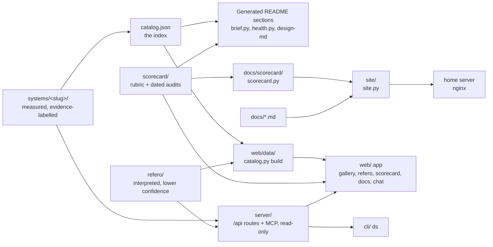

<p align="center">
  
</p>

<h1 align="center">
design-systems
</h1>

<p align="center">
  <strong>Measured tokens, components and screenshots from real products, so any project can say "make it look like Linear".</strong>
</p>

<p align="center">
  <a href="https://github.com/starship-terminal/constellations/actions/workflows/check.yml"></a>
  
  
</p>

<p align="center">
  <a href="#setup">Setup</a> ·
  <a href="#quick-start">Quick start</a> ·
  <a href="#catalog">Catalog</a> ·
  <a href="#using-a-style">Using a style</a> ·
  <a href="#for-agents">For agents</a> ·
  <a href="#how-it-works">How it works</a> ·
  <a href="#development">Development</a>
</p>

---

**design-systems** is one library of design styles captured from real
products, so any project (and any coding agent working in it) can say "make
it look like Linear" and find measured tokens, components and screenshots in
one place instead of in whichever project first needed them.

It holds two stores of styles at two confidence levels:

- [systems/](systems): the packages, one per product, measured
  from real captures. Every value carries an evidence label saying where it
  came from. These are the only values to design from.
- [refero/](refero): a snapshot of [styles.refero.design](https://styles.refero.design)
  (1,342 styles): third-party interpreted data at lower confidence. Breadth
  for inspiration, never the source for a value a package holds.

Each package is self-contained: design tokens, a page that renders them, a
component inventory, screenshots of the real product, and the builders that
produced all of it, so a fix goes through the builders rather than a hand
edit. The library is read three ways: by a person through the gallery app
(`make dev`), by a script or agent through [catalog.json](catalog.json) and
the read-only MCP server, and by a terminal through the `ds` CLI. The repo
(`starship-terminal/constellations`) is public on GitHub; the products'
assets stay their owners', and [docs/RIGHTS.md](docs/RIGHTS.md) says how to
ask for a removal.

```
$ python3 tools/catalog.py find dark chat

codex-desktop   4  Desktop coding-agent app (OpenAI's Codex for macOS, Electron): a 52px navigation rail beside a …
                  tags: desktop, electron, macos, coding, ai, agent, chat, sidebar, rail, dense, … | themes: light, dark | systems/codex-desktop/README.md
grokbot-desktop 4  Desktop chat app for AI agents in Electron: a near-black or white window with a darker sidebar of …
                  tags: desktop, electron, macos, coding, ai, agent, chat, sidebar, per-item-colour, … | themes: light, dark | systems/grokbot-desktop/README.md
opencode-desktop 4  Desktop coding agent in Electron: a near-black or white rounded panel under a title bar of session tabs, …
                  tags: desktop, electron, macos, coding, ai, agent, chat, tabs, dense, ramps, … | themes: light, dark | systems/opencode-desktop/README.md
```

## Why a library?

Without one, the same style gets re-measured in every project that wants it:

- Tokens get copied out of whichever repo needed the style first, drift
  included, and the copies never reconcile.
- Screenshots get read as measurements. Most shots here are 256-colour PNGs
  to keep the repo small; none of them is a measurement.
- A value with no provenance cannot be checked later, so nothing can be
  trusted twice.
- An agent asked to "make it look like Linear" guesses from memory instead
  of reading the product's own values.

This repo keeps every captured style in one standard package, keeps the
evidence next to the values, and puts the same front door on it for a
person (the gallery), a script ([catalog.json](catalog.json)) and a coding
agent (the MCP server and `ds`).

## Features

[FEATURES.md](FEATURES.md) is the full inventory of user-facing features,
one line each with its status, surface, entry point and tests.

| Area | What you get |
| --- | --- |
| **Packages** | One package per product under [systems/](systems), all in one layout: `tokens.json` (W3C DTCG, Tokens Studio multi-set), a generated `DESIGN.md`, a `style-guide.html` rendering every token, `components.md`, `patterns.md`, screenshots, and the tools that rebuild it |
| **Evidence** | Every token says where it came from: a measured CSS read, a reconstruction, or a reviewer's call ([docs/EVIDENCE.md](docs/EVIDENCE.md)) |
| **Gallery** | One card per package with cover, icon, colour roles and fonts; per-package pages running Screenshots, Brief, Colors, Type, Spacing, Shape, Components, Icons, Health and Files (sections a package has nothing for are hidden); search over names, uses, tags and themes |
| **Refero** | 1,342 styles labelled by product type and design style, browsed beside the packages but never trusted over them |
| **Scorecard** | Every package graded against the rubric in [docs/DESIGN-SYSTEM.md](docs/DESIGN-SYSTEM.md), in the wording for its platform (web, mobile or desktop), shown as a heatmap with the evidence behind each grade |
| **Agent layer** | Read-only MCP tools over stdio or hosted HTTP, a `ds` terminal client, a chat UI inside the app, and `handoff_prompt` for passing a chosen style to a coding agent |
| **Capture kit** | [tools/kit/](tools/kit): public-web, signed-in-web and native-iOS (iPhone Mirroring) capture pipelines plus the token and style-guide builders a new package starts from |
| **Freshness** | Brief, Health, `DESIGN.md` and the catalog table below are generated; `make check` fails on a stale one, so the docs cannot drift from the data |

## Setup

**Requirements:** Git LFS installed *before* cloning (every image, archive
and font is an LFS object), `python3`, and `uv` for `make setup`. The apps
need Node 22.13+ and pnpm 10. Capturing additionally needs Playwright, a
Chromium browser for the signed-in kit, and an iPhone on the same iCloud
account for the native kit; [docs/CAPTURE.md](docs/CAPTURE.md) has the
detail. Pillow, Markdown, numpy and Node-based linting are only needed by
the builders that ask for them (see `make setup`).

```bash
brew install git-lfs && git lfs install   # once per machine, before the clone
git clone git@github.com:starship-terminal/constellations.git design-systems
cd design-systems
make setup                                # .venv with the site builder's and capture tools' deps
cp .env.example .env                      # fill in what you use; .env is gitignored
```

`.env` values and what uses them:

| Variable | Used by |
| --- | --- |
| `ANTHROPIC_API_KEY` | `tools/refero/classify.py`; the gallery chat's provider while none is saved under Settings (stays server-side) |
| `R2_ACCOUNT_ID`, `R2_ACCESS_KEY_ID`, `R2_SECRET_ACCESS_KEY`, `R2_BUCKET` | `tools/refero/upload_r2.py`, the media mirror upload |
| `DS_CHAT_MODEL` | Optional: the model the gallery chat calls with `ANTHROPIC_API_KEY` |
| `DESIGN_SYSTEMS_CONFIG_DIR` | Optional: where the provider saved under Settings > Model provider is kept (default `~/.config/design-systems/`, outside the checkout); see [web/README.md](web/README.md) |
| `DESIGN_SYSTEMS_REPO` | Optional: this checkout's path, when the app cannot find it by itself |
| `DESIGN_SYSTEMS_MEDIA`, `DESIGN_SYSTEMS_MEDIA_BASE` | Optional: where mirrored refero media lives, and the base URL for catalog media absent from the local mirror |
| `DESIGN_SYSTEMS_ALLOWED_HOSTS` | Optional: extra Host names (`name` or `name:port`, comma-separated) the Python `/api/` server (`server/api.py`) answers to; loopback, IP literals and `*.ts.net` already pass |

## Quick start

```bash
make dev                     # build web/data/, serve the app on 127.0.0.1:8800, open the gallery and scorecard
make dev PORT=9000           # another port; scripts/dev.sh --no-open skips the browser
make help                    # every target

pnpm --dir app install --frozen-lockfile && pnpm --dir app dev   # the newer research app on :8845

python3 tools/catalog.py find dark dense                 # rank packages by free text
python3 tools/catalog.py export linear                   # every token as CSS custom properties
python3 tools/catalog.py export linear --format json     # or JSON, aliases resolved
python3 tools/catalog.py contrast systems/linear/tokens.json --theme light FG:BG...
python3 tools/catalog.py scan systems/linear --redact ~/.design-systems/cleanup-redact.json
python3 tools/fetch_icon.py linear                       # refresh a package's app icon from its site

make check                   # the freshness gate: catalog, refero stores, Brief, DESIGN.md, scorecard, Health
make grade                   # re-grade scripted criteria, rewrite every Health + the catalog table below
make brief                   # regenerate every package README's Brief
make design-md               # regenerate every package's DESIGN.md (runs make brief first)
make docs                    # build docs/ into the static site/
make test                    # tools' unit tests + every package's own tools/test_*.py
make clean                   # remove generated output

python3 server/mcp.py        # stdio MCP server: the library as tools for a coding agent
ds find "dense sidebar"      # the ds CLI against a hosted /api/mcp (see For agents)
ds export linear -g light    # one token group; also ds doc, ds media, ds handoff, ds status
```

## Browse it

Everything is browsed through the Next.js app under [web/](web): the gallery,
the scorecard and the library docs under `docs/`.

```bash
make dev
```

`make dev` (or [scripts/dev.sh](scripts/dev.sh)) builds the app's data,
installs its `pnpm` dependencies on the first run, serves it at
http://127.0.0.1:8800/ and opens the gallery and the scorecard in the browser.
If the app is already running it only opens the tabs; `--port N` picks
another port and `--no-open` skips the browser. The app has three parts:

- **Gallery**: one card per package with a cover screenshot, its product icon,
  its colour roles and fonts. Each package's page at `/gallery/<slug>` reads
  in the same order, from a rail on the left: Screenshots, Brief, Colors,
  Type, Spacing, Shape (radii and shadows), Components, Icons, Health and
  Files (every Markdown file, rendered). A section the package has nothing
  for is left out of the page and the rail. Each section is an anchor, so
  `/gallery/<slug>#colors` links straight to it. Search on the gallery
  index matches names, uses, tags and themes; press `/` to focus it.
- **Scorecard**: every package graded against the checklist in
  [docs/DESIGN-SYSTEM.md](docs/DESIGN-SYSTEM.md), in the wording for its
  platform (web, mobile or desktop), as a heatmap with the evidence
  behind each grade. The app reads [scorecard/](scorecard) live on each
  request; [tools/scorecard.py](tools/scorecard.py) only writes the
  docs site's copy under `docs/scorecard/`.
- **Docs**: the files under [docs/](docs), rendered.

The library docs, without the gallery, are also built into a static docs
site by [tools/site.py](tools/site.py) (`make docs`), which the home-server
deployment serves. `make help` lists the other targets (`make check` validates
[catalog.json](catalog.json) against the packages).

## Catalog

Ranked by the scorecard. Health counts the criteria in
[docs/DESIGN-SYSTEM.md](docs/DESIGN-SYSTEM.md) each package meets, leaving out
the ones a capture cannot meet; layout gaps are the standard parts from
[docs/PACKAGE.md](docs/PACKAGE.md) it lacks. Each package's README opens with a
Brief to read before designing in its style, then a Health section that lists
what is open, with the evidence.

<!-- catalog:start. Generated by tools/health.py from the newest scorecard snapshot; `make grade` rewrites it. Do not edit. -->

| Icon | Package | Good for | Captured | Themes | Health | Layout gaps |
|---|---|---|---|---|---|---|
|  | [claude](systems/claude/README.md) | A quiet chat shell with a serif model voice: composer, thread, Artifacts, Projects, settings (cds tokens) | 2026-10-17 | light, dark | 22 of 25 met, 3 partly, 0 missing | none |
|  | [column](systems/column/README.md) | developer-banking marketing: a Gatsby + styled-components build shipping a real named token layer in its sheets - ten --color-<family>-<step> ramps (blue-800 #111a4a navy the brand ink, blue-600 #1e4199 links, cyan-900 #011821 the dark band, gray-50/100 grounds), a 71-step --space-* scale, --text-*/--lh-*/--letter-spacing-* type scales, --font-* stacks (SuisseIntl, SuisseIntlMono, Inter) and weights, --radii-*/--screen-*/--cols-* layers and the five-layer --shadow-product; a semantic --bg-color-*/--text-color-*/--btn-*/--form-*/--link-* layer that .color-palette--primary binds for the light theme and .color-palette-inverted--* rebinds on the dark infrastructure island | 2026-11-17 | light | 22 of 25 met, 3 partly, 0 missing | `icons/` |
|  | [deezer](systems/deezer/README.md) | music-streaming design: a declared Tempo token layer (675-step palette scales, per-theme semantic background/text/icon/border roles, spacing/radii/shadow/transition scales) under a light marketing hero (140px Deezer Brand display, #a238ff accent) and a dark signed-out Chakra app shell (243px #141216 sidebar, #0f0d13 canvas, #242326 fields with 2px #ad47ff focus borders, #ad47ff Mix/Sign-up pills with #bb73ff hover, 56px track rows, 24px popovers, a lavender #ead1ff signup banner over an 80px player bar) plus dark account.deezer.com auth forms | 2026-11-13 | light, dark | 20 of 26 met, 6 partly, 0 missing | `icons/` |
|  | [excalidraw](systems/excalidraw/README.md) | whiteboard and canvas-app design: a declared custom-property layer (~191 vars on .excalidraw, ~80 rebound under .theme--dark) under a signed-out editor of floating translucent Islands: a 44px tool island of 36px buttons over an edge-to-edge canvas, 8px radii, Assistant UI text with an Excalifont hand-drawn wordmark, hairline #ebebeb borders, and a single violet #6965db (#a8a5ff dark) for active tools, checked options and every primary action | 2026-11-14 | light, dark | 20 of 26 met, 6 partly, 0 missing | `icons/` |
|  | [brilliant](systems/brilliant/README.md) | Interactive problem-solving lessons, course paths, a calm editorial learning UI (Panda CSS tokens) | 2026-10-17 | light, dark | 20 of 25 met, 5 partly, 0 missing | none |
|  | [coinbase](systems/coinbase/README.md) | crypto exchange marketing: a styled-components build shipping the Coinbase Design System (CDS) almost verbatim - the declared theme lives inline on div.coinbase.light (~830 vars) and div.coinbase.dark (~210): eleven primitive ramps (blue60 #0052ff the brand, the gray neutral ramp, status green/orange/red and six accent families), the 54-role --color-* semantic layer (fg/bg/washes/lines/elevations/accents), space/radius/border-width/type/icon/avatar/control scales, the shadow-elevation ladder and the CoinbaseDisplay/Sans/Text/Mono/Condensed faces; one light scheme with a .coinbase.dark asset-band island and radius-1000 pill controls | 2026-11-17 | light | 20 of 25 met, 5 partly, 0 missing | `icons/` |
|  | [doctronic](systems/doctronic/README.md) | AI health-product marketing and chat-adjacent UI with a warm paper-and-ink system: a #fdfdf7 canvas under #1b1b18 ink, Fraunces display headings with dashed underlines, seven eleven-step colour ramps, a single #2463eb blue spent on actions with a signature rgba(36,99,235,.39) brand-glow, a lime #beec4b reserved for prompt tabs and tag pills, 32px and 52px radius pill buttons, dashed-ink dividers, and a real user-selectable dark theme | 2026-11-13 | light, dark | 19 of 25 met, 6 partly, 0 missing | `icons/` |
|  | [esquire](systems/esquire/README.md) | editorial magazine design: a declared Hearst FRE design-token layer (~4,400 resolved custom properties - --_palette/--_size/--_font primitives, --color-*/--type-*/--dim-*/--comp-* scales) under a white editorial surface with a #ff3a30 brand red (the utility strip, a Subscribe pill that inverts to white on hover, Join buttons), Lausanne UI type under PlayFair display headlines and Lora article body text, a ~155px three-band top chrome with a mega-menu and More overflow, story-card section fronts, a ~38,000px article layout with drop cap/pull quote/ad furniture, and a premium membership offers page with plan cards and an FAQ accordion | 2026-11-13 | light | 19 of 25 met, 6 partly, 0 missing | `icons/` |
|  | [fourmula](systems/fourmula/README.md) | AI product-photography design across two systems: a Webflow marketing site with two inverted paints (the isDarkMode toggle flips `dark` on <body> - .body.dark paints light, plain .body dark), a fluid --_fonts---* rem ramp, a five-step --fonts-* alpha ink scale and Sf Pro Display; plus a dark-only Next.js/Tailwind v4 app edge with a declared @theme ramp (base-100..900 neutrals, #ff6b02 accent, --text-* 9-52px, --radius-* 4-40px), a 384px/28px-radius sign-in card, accent/20% tint pills and the signed-out PDP generator | 2026-11-15 | light, dark | 19 of 27 met, 6 partly, 2 missing | `icons/` |
|  | [grok](systems/grok/README.md) | developer-docs design: a declared Tailwind v4 token layer of --neutral2..98, the solar --solar/--darksolar accents (#ff640a), semantic --bg-*/--fg-*/--primary/--border-*/--sidebar-*/--chart-* roles re-pointed under html.dark by a real header theme button (15 names declared under .dark only), proprietary xVf/xMono variable faces on a --text-xs..5xl ramp, a fixed 80px header with a 208px cmdK search pill over a 272px sidebar and an inner-scrolling article, dark-tinted --bg-codeblock panels in both themes, shiki syntax colours, Radix SDK tabs, pricing tables, a 1000px cmdk search dialog, a full-screen 390px nav sheet | 2026-11-17 | light, dark | 19 of 26 met, 6 partly, 1 missing | none |
|  | [polaris](systems/polaris/README.md) | Admin and commerce UI built from a published component library: semantic colour roles, buttons, cards, banners | 2026-10-17 | light, light-mobile, light-high-contrast-experimental, dark-experimental | 19 of 25 met, 6 partly, 0 missing | none |
|  | [superset-desktop](systems/superset-desktop/README.md) | Desktop app for running coding agents in parallel workspaces, in Electron: a warm near-black or near-white window with a slightly darker sidebar of projects and workspaces, one rounded composer with small chips, ink primary buttons instead of a brand hue, shadcn/ui components on Tailwind's scale (8px controls, 10px popovers, a 3px focus ring), foreground-wash hover and selection, and each agent's CLI in a terminal pane inside a tabbed workspace | 2026-10-25 | light, dark | 19 of 25 met, 6 partly, 0 missing | `icons/` |
|  | [delphi](systems/delphi/README.md) | expert-Q&A and AI-clone product design: a full declared token layer (Radix-style 12-step palette scales, a shadcn semantic layer, Delphi --fg-*/--surface-*/--mind-* roles and a Tailwind utility scale) over a white light surface (#21201c ink, #63635e/#82827c mid-low text, #f7f3f0 warm cards, translucent-ink hairlines, #fd5400 brand-orange create actions), Delphi Pythia display + Delphi Inter UI, big ask-field heroes, coloured topic cards, two-sided perspective flip cards, signed-out /search results, public expert profiles and a chat composer, plus Sign-In and onboarding dialogs | 2026-11-14 | light, dark | 18 of 26 met, 8 partly, 0 missing | `icons/` |
|  | [airtable](systems/airtable/README.md) | SaaS marketing: Haas grotesque on white, a 13-hue brand accent system painting 32px-radius pastel tiles, dark ink pill CTAs, a slide-in nav drawer, a plan grid and a lead form | 2026-11-10 | light | 18 of 25 met, 7 partly, 0 missing | none |
|  | [base44](systems/base44/README.md) | AI-app-builder marketing: warm paper ground with Dazzed display type, near-black 38px CTA pills, an orange #ff773c action accent, a hero prompt composer, and a full named token system (shadcn channels + named palette + scales) in the bundle | 2026-11-11 | light, dark (declared) | 18 of 25 met, 7 partly, 0 missing | `icons/` |
|  | [chatgpt](systems/chatgpt/README.md) | The baseline chat UI: thread, composer, sidebar history, menus, dialogs, search, settings pages | 2026-10-17 | light, dark | 18 of 25 met, 7 partly, 0 missing | none |
|  | [faire](systems/faire/README.md) | Wholesale marketplace surfaces: a white field with near-black #333333 fs-buttons at 4px radius against 999px filter pills, a 2px #275ec5 focus ring, Graphik 14/20 UI text under Nantes 52/64 and GT Canon 30/38 serif mastheads, and the declared Slate token layer (--slate-* ramps, roles and the .fs-mode-on-surface inverse scope) readable straight off the bundles | 2026-11-14 | light | 18 of 25 met, 7 partly, 0 missing | `icons/` |
|  | [flutterflow](systems/flutterflow/README.md) | visual app builder marketing site: prompt-composer hero, pricing plans, enterprise contact form, Studio agency pages, light + dark | 2026-03-01 | light, dark | 18 of 25 met, 7 partly, 0 missing | none |
|  | [notebooklm](systems/notebooklm/README.md) | Source-grounded AI workspace: sources panel, chat, studio outputs; near-monochrome surfaces with pill buttons (luminous UI) | 2026-10-17 | light, dark | 18 of 25 met, 7 partly, 0 missing | none |
|  | [gofundme](systems/gofundme/README.md) | crowdfunding/fundraising design: a real shipped token layer - ~700 semantic --hrt-* custom properties on :root (brand greens #4A9D44/#274A34/#CCF88E, neutral ramps, blue/pink/purple/yellow accents, size/spacing/radius/type/motion/z-index scales) - white chrome with a #CCF88E promo banner, header mega-dropdowns (Donate/Fundraise/About), the centred hero with a dark-green 'Start a GoFundMe' pill, discover/search fundraiser cards with media tags and progress bars, a public /f/<slug> fundraiser page (raised line, progress meter, Donate now/Share/Message), the /create wizard at rest and the /sign-in auth boundary - plus the separate /c/* WordPress content stack measured as a second public system | 2026-11-17 | light | 18 of 25 met, 7 partly, 0 missing | `icons/` |
|  | [tokentracker](systems/tokentracker/README.md) | Local AI usage dashboard: borderless sidebar, rounded content panel, hairline cards, one green accent for money, dense tables, limits bars | 2026-10-17 | light, dark | 18 of 25 met, 7 partly, 0 missing | none |
|  | [cohere](systems/cohere/README.md) | enterprise AI platform marketing: a Next.js/Tailwind v3/Sanity build painting one light theme (pureWhite ground, volcanic-900 ink) whose declared layer lives in utility rules - the named palette (volcanic/coral/mushroom/marble/quartz/onyx/neutral), the web3-* type scale and custom radii (rounded-xl 22px, rounded-2xl 30px) - with dark islands (pureBlack promo banner, neutral-15 footer, #355146 green CTA band), 9999px pill CTAs carrying a ::before quartz-500-to-coral-500 gradient sweep, and CohereText/Unica77/CohereMono type | 2026-11-17 | light | 18 of 25 met, 6 partly, 1 missing | `icons/` |
|  | [gauth](systems/gauth/README.md) | AI tutor learning app: course catalogue, unit pages, lesson players with an Ask Tutor panel | 2026-10-17 | light | 18 of 24 met, 6 partly, 0 missing | none |
|  | [capy-desktop](systems/capy-desktop/README.md) | Desktop app for cloud coding agents in Electron, the capy.ai web app in a desktop frame: an off-white or near-black window with a rounded content panel set into it, browser-like tabs in the title bar, a sidebar of threads by project, one composer with project, Run on and model pickers, 0.5px hairlines and Inter at 13px, muted text mixed from one ink, teal only for starting work and on-states, red only for deletion | 2026-10-25 | light, dark | 17 of 26 met, 9 partly, 0 missing | `icons/` |
|  | [digg](systems/digg/README.md) | news-aggregator and community-feed product design: a real declared shadcn-style token layer (--background/--primary*/--muted*/--accent*/--border/--input/--ring semantics, the --sidebar-* rail set, --chart-1..5, --rank-one/--success roles, the full Tailwind hue scales and a Tailwind utility layer) over a #fdfdff field with #161617 ink, ink@70% muted text, white cards on rgba(0,0,0,0.08) hairlines, #f0f0f5 fills, a single #1c66eb primary blue and #e37b4c rank-one orange; roobert UI + vt323 vote-odometer mono; story cards with vote pills and source clusters, right-rail panels, a story detail layout, Clerk auth - and a real painted dark theme cycled through the sidebar pill | 2026-11-14 | light, dark | 17 of 26 met, 9 partly, 0 missing | `icons/` |
|  | [airbnb](systems/airbnb/README.md) | Public travel marketplace: the capsule Where/When/Who search bar, photo-led listing cards with the stroked wishlist heart, hairline-separated surfaces, one Rausch pink for end-of-flow actions, and a full set of declared-but-unapplied dark values | 2026-11-09 | light, dark | 17 of 25 met, 8 partly, 0 missing | `icons/` |
|  | [coursera](systems/coursera/README.md) | Course catalogue, course and module pages, course cards, a mature enterprise design system (386 --cds-* variables) | 2026-10-17 | light, dark | 17 of 25 met, 8 partly, 0 missing | none |
|  | [endless](systems/endless/README.md) | Multi-model AI creation workspace marketing and free tool pages: a full shadcn-style semantic token layer on a #fcfcfc field with one #01bcff sky accent, TikTok Sans display type at -1.9px tracking, a 20px-radius prompt composer on a floating shadow, 8-16px controls, .dark class theme, and translucent 50% field fills | 2026-11-13 | light, dark | 17 of 25 met, 8 partly, 0 missing | `icons/` |
|  | [expedia](systems/expedia/README.md) | Travel OTA in EGDS/UITK: the multi-product tabbed search card with 48px outlined fields and a pill-radius primary, 16px-radius cards and dialogs, a 57-role colour layer re-bound per data-theme attribute (light-1, marketing-3, dark, bright, loyalty tiers), Centra No2 with Reckless XPD display serif | 2026-11-14 | light, dark, dark2, marketing3, bright1 | 17 of 25 met, 8 partly, 0 missing | `icons/` |
|  | [forhers](systems/forhers/README.md) | women's telehealth storefront and marketing: forhers.com (the Hims & Hers women's arm) paints a near-black rgba(0,0,0,.89) ink on white with sage (#e4eee6-#f5faf6) and cream (#faf8f2/#f4f1e6) washes, the #338585 Hers teal ramp, the #d5ff5d promo lime and a black radius-full action pill pinned to the phone viewport; CareSans fluid display type (letter-spacing -0.0625em) over sofia-pro/SofiaProWeb UI type (IvarSoft declared but unused), a promo strip over a 57px header and the #e8eae8 footer slab, bento/treatment/product cards with three CTA weights, a BMI calculator with a #b6dd64 submit, an editorial blog and an A-Z drug index in #0077ab link blue; the styled-components sheets ship no colour token layer beyond the /shop --unit-u*/--spacing-s*/--grid-* scales, so the palette is measured | 2026-11-17 | light | 17 of 25 met, 8 partly, 0 missing | none |
|  | [fresha](systems/fresha/README.md) | beauty and wellness booking-marketplace design: one Panda CSS token system (--made-with-panda) shared across four signed-out stacks with two parallel vocabularies (hashed Panda vars mapped back to readable colors.*/spacing.* names through the atomic classes, plus the partner app's readable --color-*/--typography-*/--sizing-* layer declared per data-theme); a 72px shell header, a giant Roobert hero with the signature split search pill (treatment/location/time fields + a round black search button), venue cards with 5.0 rating badges, a venue profile with bookable service rows and a 444x756 booking cart at the wizard boundary, black 48px CTA pills across /pricing and /for-business, the legacy /lp microsite (its own literal-value stylesheet, 16px-radius venue cards, 'from S$' price lines), a help-center search page, and the partners.fresha.com sign-in - the one painted dark theme (data-theme=auto under prefers-color-scheme: dark) | 2026-11-15 | light, dark | 17 of 25 met, 8 partly, 0 missing | `icons/` |
|  | [gladia](systems/gladia/README.md) | developer-audio-AI product and marketing design: a declared :root token layer of --color-neutral-0..1000 and --color-purple/blue/green/red/yellow/orange/pink ramps (brand purple #947afc) behind a dark-by-default glass surface (black --bg-primary, rgba glass nav, hairline translucent borders, purple #925bff brand CTAs), a 4px --space-* scale, --radius-* pill geometry, --font-size-10..80 ramp in 'Suisse Intl' with 'Geist Mono' code, --duration-*/--ease-* motion, and the semantic --text-*/--bg-*/--border-* roles re-pointed under body.light-mode on /library and .section--white on white sections; a hover-intent mega-menu header, an Async/Real-time pricing grid with a calculator, a demo-request form, a Mintlify docs site with a real light/dark preference, app-shell auth cards and a 390px pass | 2026-11-16 | dark, light | 17 of 25 met, 8 partly, 0 missing | none |
|  | [grammarly](systems/grammarly/README.md) | AI writing assistant marketing site: Matter/Inter type, GDS + Origin token layers, three-column plans, free grammar checker tool, light only | 2026-11-16 | light, dark (declared) | 17 of 25 met, 8 partly, 0 missing | none |
|  | [manus](systems/manus/README.md) | Agent app shell: multi-section sidebar, a Library of agent outputs by type and by day, task threads with deliverables | 2026-10-17 | light, dark | 17 of 25 met, 8 partly, 0 missing | none |
|  | [notion-calendar-desktop](systems/notion-calendar-desktop/README.md) | Desktop calendar app (Notion Calendar for macOS, Electron around the calendar.notion.so web app): a 240px wash sidebar with a mini month, scheduling and per-account calendar lists beside a week grid of 48px hours with two time-zone columns, event chips in each calendar's colour with a left ribbon, a translucent 284px event popover and a centred command menu, hairline edges drawn as 1px inset shadows, 13px medium labels on 30px controls with 6px corners, one blue for primary actions, switches and focus, red only for today, and menus and tooltips that stay dark in both themes | 2026-10-25 | light, dark | 17 of 25 met, 8 partly, 0 missing | `icons/` |
|  | [designstripe](systems/designstripe/README.md) | AI design-agent and asset-library product design: a real declared shadcn-style token layer (--background/--primary*/--muted*/--accent*/--border-*/--ring* semantics, --neutral-50..950 and --green-50..950 scales, Tailwind utility layer, declared .dark block) over a white light surface (#2c2c26 olive ink, #6d6e5e muted mono text, #e8e7d9 cream WAITLIST pill, #aaa674 olive-gold accents, #d0d0c8 hairlines), fontSerif display + fontMono UI, 96px serif heroes, a dark feature-accordion panel, aspect-square asset tiles, bordered tool cards and an ink footer | 2026-11-14 | light, dark | 17 of 26 met, 8 partly, 1 missing | `icons/` |
|  | [district](systems/district/README.md) | Event/venue booking apps: category tab pills, movie and venue card grids, artist headshot rails, filter chips, rupee price lines and inverted-ink Book CTAs | 2026-11-15 | light, dark | 17 of 25 met, 7 partly, 1 missing | `icons/` |
|  | [hbomax](systems/hbomax/README.md) | Video streaming signed-out marketing: a pure-black single dark theme, the monochrome Max action palette (white primary button on black), a hero title carousel, subscription plan cards with a monthly/yearly billing toggle, an FAQ accordion, horizontal content rails and title detail pages, Max Sans type, and the site's own generated --color_*/--spacer-*/--border-* token sheet | 2026-11-17 | dark | 17 of 24 met, 7 partly, 0 missing | none |
|  | [researchrabbit](systems/researchrabbit/README.md) | Interactive citation graph beside a list: node and edge styling, canvas interaction (see graph.md) | 2026-10-17 | light | 17 of 24 met, 7 partly, 0 missing | none |
|  | [anthropic](systems/anthropic/README.md) | AI-product marketing pages, pricing pages, sales forms and developer docs; ivory editorial surfaces with serif headlines, pill nav chrome and a restrained clay accent | 2026-11-09 | light, dark | 17 of 25 met, 6 partly, 2 missing | none |
|  | [dji](systems/dji/README.md) | product-marketing and hardware-brand design: a declared token layer in the v3 bundles (--grey-0..12, --black-1..8/--white-1..8 + role names, --bg-0..7, --background-0..2, --brand-1..10 with --brand-primary-*/--brand-text-* roles, --green-*/--orange-*/--red-* status scales, --spacing-xs..xl, --radius, --grid-*/--col-width/--column-count, a --zindex-* ladder and --font-*/--line-height-*), section-scoped theming (:root .light-theme / :root .dark-theme re-declare the semantic roles and sections opt in by class - nav/listings/support light, hero/product/footer dark), the #0070d5 DJI blue Store pill with a 1408px radius, atom-design Buy Now/ghost CTA pairs (60px radius, 0.3s transitions), Open Sans + PingFang SC UI text, hero-vertical-card product grids, and two header generations (legacy dui-navbar over the hero, official-site-header on inner pages) plus a separate /sg/mobile site | 2026-11-15 | light, dark | 17 of 25 met, 6 partly, 2 missing | `icons/` |
|  | [gumroad](systems/gumroad/README.md) | marketplace design: a declared Tailwind v4 token layer of --pink/--purple/--green/--orange/--red/--yellow brand colours, semantic roles as RGB channel triplets (--accent #ff90e8, --primary, --filled, --success/--warning/--danger/--info and --contrast-* partners), a real prefers-color-scheme:dark theme (--body-bg #f4f4f0->#242423, --border-alpha 1->0.35, no in-page toggle), 1px black borders with 4px-radius cards and hard 4px offset shadows, --spacer-1..8, ABC Favorit on a --text-xs..9xl ramp, a bordered hero header with category pills, a Discover grid of bordered product cards with pink price flags and a featured carousel, a product page with tier card and billing-term select, auth cards and a public checkout form | 2026-11-17 | light, dark | 16 of 26 met, 10 partly, 0 missing | none |
|  | [devin-desktop](systems/devin-desktop/README.md) | Desktop coding-agent app in Electron on a VS Code workbench: a near-black or near-white page shared by the sidebar and the content, two-line session rows, one 20px-radius raised composer with a Cloud / Local segmented control, a right-aligned tinted prompt bubble over plain replies and muted work rows, every neutral one colour at fixed alphas, ink-filled page buttons with blue kept for focus and links, 6px controls and 10px popups and cards | 2026-10-25 | light, dark | 16 of 25 met, 9 partly, 0 missing | `icons/` |
|  | [elevenmusic](systems/elevenmusic/README.md) | Dark, quiet, tool-like music apps: a true-black field with white-alpha surface steps (#131313/#1c1c1c/#262626), white as the action colour (inverted Start-free/Create pills), hairlines at rgba(255,255,255,.08-.12), one #5d88e7 brand blue, a fixed 248px rail + 52px header + inner scroller + 72px player bar, 999px pill controls, waldenburg light display over Inter, and a real warm-paper light theme (#fdfcfb) behind the footer's own System/Light/Dark control | 2026-11-13 | dark, light | 16 of 25 met, 9 partly, 0 missing | `icons/` |
|  | [elevenreader](systems/elevenreader/README.md) | Audiobook-reader marketing pages: near-monochrome ink #000 on white with a #F5F3F1 promo band and #FAF8F8 FAQ tints, a declared --themed-*/--color-* Tailwind v4 token layer that inverts on a .dark scope, the --f-* type scale (Waldenburg display at 60px -1.8px tracking, Inter UI/body), 9999px pill geometry on every button, chip and input, 20-40px card radii, a layered ring shadow on white pills, 2px black focus outlines, and bare 360px sign-in/sign-up cards | 2026-11-13 | light, dark | 16 of 25 met, 9 partly, 0 missing | `icons/` |
|  | [enode](systems/enode/README.md) | energy-tech marketing design: a declared token layer (--color-brand-*/--color-gray-*/--color-enode-green-* palette scales, per-mode --color-background-*/--color-foreground-*/--color-card-*/--color-border-*/--color-line-*/--color-diagram-* semantic roles, --text-*/--leading-*/--tracking-* type ramp, --radius-* 2-10px plus full pills, grid/gutter/breakpoint/blur/ease tokens) under per-page data-mode themes - pale-green #f0fde8 light marketing with a 58px glass header and dark-glass mega-menus, whole-dark /platform pages (#151413 canvas, translucent tiles), scoped dark showcase sections with #b0f87c live-metric green, and a dark-framed platform login with a light panel | 2026-11-13 | light, dark | 16 of 25 met, 9 partly, 0 missing | `icons/` |
|  | [epidemicsound](systems/epidemicsound/README.md) | music-and-SFX-licensing design: a declared --es-* token layer (151 semantic colour roles, es-heading/subheading/text type scales, radii/elevation/grid/trackrow scales, Inter + Sebenta stacks) across two signed-out surfaces - an ecru alternative-light marketing site (pill header, serif display hero, #ff82c2 accent, black pill CTAs) and a dark catalog app (pink #ff82c2 genre banner, 56px track rows with cover-play buttons and icon actions, sticky pill nav) plus dark login.epidemicsound.com Keycloak forms | 2026-11-14 | light, dark | 16 of 25 met, 9 partly, 0 missing | `icons/` |
|  | [hashnode](systems/hashnode/README.md) | developer-blogging product design across two surfaces on one Tailwind v4 token layer: hashnode.com's signed-out app shell (a bg-sidebar rail with peer/menu-button nav, Search Ctrl+K, a real Light/Dark/System Theme menu, a solid 'Start your blog' CTA and the feed's post-card grammar with ghost upvote/bookmark actions) plus townhall.hashnode.com, the hosted blog engine (sticky header with a bg-surface pill nav, post cards, a text-article-title/text-reading prose layer with a TOC rail and dark-tinted --code-block panels). Semantic roles --background/--foreground, --primary/-secondary/-accent/-muted/-card/-popover(+foregrounds), --destructive/-success/-warning wash families, --brand/--link #2962ff, --sidebar-*, --chart-1..5, --code-block, --selection, --scrim; scene palettes --pro-* gold, --buildful green, --ai-*, --landing-*, the 36-name --tod-* time-of-day hero; --elevation-* shadow stacks; system-stack --font-app + next/font --font-inter on a --text-xs..6xl ramp with --text-body/-reading/-title-* prose roles; --radius .5rem; --command dark-only | 2026-11-17 | light, dark | 16 of 25 met, 9 partly, 0 missing | none |
|  | [refero-design](systems/refero-design/README.md) | Design research app plus a public design-system gallery: research box, rotating screenshot galleries, video-preview style cards, per-style DESIGN.md documentation pages | 2026-11-02 | light, dark | 16 of 25 met, 9 partly, 0 missing | none |
|  | [fal](systems/fal/README.md) | generative-media infrastructure design: three declared token layers (a Tailwind v4-style app layer of 763 names - surface/content/stroke/overlay/badge/accent roles over HSL-triplet ramps - a Webflow marketing palette and a fumadocs docs layer) across three signed-out surfaces - a dark-bronze+cyan Focal Web marketing site (neon-lime CTA), a dark #121216 model catalog and playground (violet #783afb Sign-in-to-run, ghost washes, model cards), and a light Focal/Public-Sans docs - plus an OAuth-only login card and a 390px phone pass | 2026-11-14 | light, dark | 16 of 25 met, 9 partly, 0 missing | `icons/` |
|  | [elektron](systems/elektron/README.md) | Instrument-grade hardware storefronts and product pages: a fully inverted monochrome (#151515 ground, #eeeef2 paper that is text, icon, 2px action stroke and hover fill at once), Neue Haas Grotesk Text/Display typography with digi one v2 button labels and an Analog One V2 search field, square corners on every control, a 7px space rhythm, #333333 gradient underline-sweep link hovers, light #eeeef2 field slabs, right-drawer modals over a 50% scrim and a double (white spread + black outline) focus ring | 2026-11-13 | dark | 16 of 25 met, 8 partly, 1 missing | `icons/` |
|  | [farfetch](systems/farfetch/README.md) | Luxury-fashion marketplace on the pulse token layer: a two-row sticky chrome (department links, 201px letterspaced wordmark, 44px icon hit areas, red Sale link), a 4-up product-card grid (3:4 image, wishlist heart, brand kicker, price), the PDP buy box with a square #222 Add To Bag, ~590 --colors-<family>-<role>-<state>-<slot> semantics, 'Farfetch Basis' UI type with 'Nimbus Roman D' editorial serif, square corners and a 1000px pill | 2026-11-14 | light | 16 of 25 met, 8 partly, 1 missing | `icons/` |
|  | [discord](systems/discord/README.md) | chat-community and server-discovery product design: Discord ships its real design-token layer - :root hue scales (--neutral-*, --blurple-*, --plum-*, the --*-new-* families, --illo-*, --opacity-*) plus class-scoped .theme-light/.theme-darker semantic blocks carrying --background-base-*/--background-surface-*/--background-mod-*, --text-*, --border-*, --badge-*, --button-* and --input-* - over a gg-sans + ABC-Ginto app that paints .theme-dark.theme-darker (#121214/#202024 bases, #efeff1 ink, #5865f2 blurple actions, rgba(151,151,159,0.16) selected fills, #43b581 online green, 2px #6aa8f4 focus rings) next to a Ggsans Webflow marketing shell (blurple gradients, 56px Nord display, pill CTAs); signed-out server discovery, a searchable category-tab card grid with member counts and verified badges, a /servers/<slug> detail with Join/Share, and the login/register auth cards | 2026-11-15 | light, dark | 16 of 25 met, 7 partly, 2 missing | `icons/` |
|  | [aboard](systems/aboard/README.md) | AI consultancy marketing: warm editorial Tobias serif on a cream ground, Work Sans UI, pill-everything controls, one loud bright-citrus accent, frosted floating nav, dark content bands inside a single light theme | 2026-11-09 | light | 16 of 25 met, 6 partly, 3 missing | none |
|  | [joinhandshake](systems/joinhandshake/README.md) | marketing-site and auth-gate design: a floating transparent-over-hero pill nav that inverts to ink-on-white under scroll (nav top-offset swaps to --desktop-nav-top-offset-with-banner when the notification band shows), a lime #d3fb52 'Sign up' pill (hover #a1dd3b), ink #14151c headline/footer and the blue #2e6aff CTA utility ramp (--cta/-hover/-active/-visited), proprietary NoiGrotesk + SansPlomb faces, a 160px uppercase hero (86px on the phone) over a 920x88 rounded-3xl job-search field, a 12-col grid of 116px tracks inside --container-*/--content-max-width, alternating bg-neutral-0/-10 section bands, segment switchers, FAQ and department accordions, Marketo lead forms, pricing tables, plus the consumer app's signed-out /access card painted by the Rosetta --rosetta-* layer (bg.primary #fff, fg.primary #121212, interactive.primary #04191b) | 2026-11-17 | light, access | 15 of 26 met, 11 partly, 0 missing | none |
|  | [codex-desktop](systems/codex-desktop/README.md) | Desktop coding-agent app (OpenAI's Codex for macOS, Electron): a 52px navigation rail beside a sidebar of projects and chats on a slightly darker surface, a centred new-chat heading over one raised 22px-radius composer with pill chips, a right-aligned soft prompt bubble over plain replies and folded Worked for rows, menus and cards at 15 to 25px squircle radii, every neutral built from one ink colour at fixed alphas over four theme seeds (surface, ink, accent, contrast), an ink pill for the primary action and the accent kept for switches, focus and links | 2026-10-25 | light, dark | 15 of 25 met, 10 partly, 0 missing | `icons/` |
|  | [cofounder](systems/cofounder/README.md) | AI agent-orchestration marketing: a Next.js/Tailwind v4 build painting one light theme (warm paper #f5f5f2) with a pixel-art landscape hero, a glass fixed header with light-pill CTA, a saturated #1a6fd1 tools band with aria-pressed tabs, two button fills (light hairline pill + dark gradient CTA), 16px-radius whole-card pricing anchors that reveal a chip CTA on hover, and TT Neoris/Inter/IBM Plex Mono/Departure Mono type | 2026-11-17 | light | 15 of 25 met, 10 partly, 0 missing | `icons/` |
|  | [cursor-desktop](systems/cursor-desktop/README.md) | Desktop coding-agent app in Electron: a near-black or off-white window with a quiet sidebar of agents and projects, one raised composer, plain-text agent replies under a raised prompt bubble, translucent alpha tiers of one base colour for every text, fill and edge, an accent-blue primary button with ink-filled pill buttons beside it, 8px-radius rows and 12px raised menus and dialogs | 2026-10-25 | light, dark | 15 of 25 met, 10 partly, 0 missing | `icons/` |
|  | [fable](systems/fable/README.md) | book-club and reading-product design: a full declared Tailwind-style token layer (graphite/pearl/forest/olive/royal palette scales, dark/white and per-hue alpha fades, a 12-colour quote-theme reader set, a semantic --color-background/text/border/line layer with a scoped .dark redeclare, radius/shadow/breakpoint scales and reader list fonts) painting two skins signed out - an Emotion marketing skin (cream and deep-forest bands, Heldane Display mastheads, 60px pill controls, #161015 ink, #116ecd focus) and a CSS-module catalog skin (white field, heldane mastheads, 9999px pills and chips, #0064c3 focus) over clubs/books/genre/detail pages, a sign-in panel, support, a blog, and a dark /discover cover wall | 2026-11-14 | light, dark | 15 of 25 met, 10 partly, 0 missing | `icons/` |
|  | [glassnode](systems/glassnode/README.md) | crypto-analytics product and marketing design across five public stacks: the marketing site's --base_grey_*/--base_ultramarine_* ramps and --light_*/--button-* roles (ultramarine #4559dc, green accent #16cc8c, fraktion display + Inter), the studio shell's declared --gds-* design system (painted light; a full html[data-theme=dark-theme] + Ant Design --ant-* layer that no public control reaches, kept as declared-not-painted tokens), the Ghost research publication's --rf-* roles in both painted themes, the GitBook docs platform layer kept as component.docs.*, and the dark-by-default tokenization registry's --color-* roles plus --c1--c7 chart palette; a Products mega-dropdown, a Vector pricing page, studio pricing/charts/dashboards signed-out views, the Auth0 login card and a 390px pass | 2026-11-16 | light, dark | 15 of 25 met, 10 partly, 0 missing | `icons/` |
|  | [glossgenius](systems/glossgenius/README.md) | Salon and spa business software across three public surfaces: a Webflow marketing site declaring a --_x---* variable layer (gloss-black #17150e ink on gloss-white #f0f7f6, a 16-hue --_color---super--* accent family, pill buttons, Basel/Fraunces serif display) with mega-menu nav, an annual-default pricing grid and a two-step demo form; the Next.js glossDS auth surfaces (/login, /signup, /forgot-password, --content-*/--surface-*/--brand-* ramps, 1000px pill radius); and a real published booking website (honeyhivesalon.glossgenius.com) re-skinning its own .tokens_glossDS__* family, service list, professional select and the public /book date-picker | 2026-11-16 | light | 15 of 25 met, 10 partly, 0 missing | `icons/` |
|  | [grokbot-desktop](systems/grokbot-desktop/README.md) | Desktop chat app for AI agents in Electron: a near-black or white window with a darker sidebar of coloured agent characters (a pinned grid over groups), one conversation per agent with the owner's bubbles in that agent's colour and neutral raised reply bubbles, a shimmering activity line while it works, pill and circle controls, an ink primary button, surfaces separated by fill rather than borders | 2026-10-25 | light, dark | 15 of 25 met, 10 partly, 0 missing | `icons/` |
|  | [jace](systems/jace/README.md) | AI email assistant marketing plus a dark product shell: a Next.js/Tailwind v4 cream site (sand #fffefd, ink #2d2d2d, Geist Sans, Gelica display, 9999px pills, lemon #ffdc61 and ember #ff7d55) whose product token layer is a separate custom-property theme (bare :root dark #333437 / #fff2e7, light overrides only under html.light), Inter Variable and Instrument Serif in the product tokens, and a sign-in card of Google, Outlook and SSO | 2026-11-18 | light, dark | 15 of 25 met, 10 partly, 0 missing | none |
|  | [kickstarter](systems/kickstarter/README.md) | crowdfunding marketplace design: a shipped KDS token layer (--kds-color, elevation, radius) on a white page, green wordmark #05CE78, near-black actions, a deeper green pledge button, category mega-menu, project cards with a funding bar, Discover filters, and a signed-out login card | 2026-11-18 | light | 15 of 25 met, 10 partly, 0 missing | none |
|  | [klarna](systems/klarna/README.md) | Shopper marketing in Klarna UI: a white page, ink #0b051d, brand pink #ffa8cd on pills and the QR card, pill radius 99999px, Klarna Title on display and Klarna Text on nav and buttons. Tokens are inline custom properties on :root / .klarna-ui-DEFAULT-light, with a declared .klarna-ui-DEFAULT-dark sheet the public pages do not paint. | 2026-11-18 | light, dark | 15 of 25 met, 10 partly, 0 missing | none |
|  | [lemonsqueezy](systems/lemonsqueezy/README.md) | A merchant-of-record marketing site winding down onto Stripe: Webflow Client-First, a purple-600 hero (#5423e7), a yellow shutdown banner (#ffc233), 40px white pills, Circular Pro Book display and Inter UI, plus an 8px-radius auth card in the same purple | 2026-11-18 | light | 15 of 25 met, 10 partly, 0 missing | none |
|  | [docusign](systems/docusign/README.md) | Agreement-platform marketing plus a live signature tool: inkwell #130032 on white with deep-violet #26065d bands and cobalt #4c00ff actions (#4000cc hover, #330099 pressed), declared --ds-* tokens on the signature generator, DS Indigo weight-300 display type, squared 4-8px radii, 2px cobalt focus rings and a white+cobalt double ring on the ecom storefront | 2026-11-13 | light | 15 of 25 met, 9 partly, 1 missing | `icons/` |
|  | [glorify](systems/glorify/README.md) | design-tool marketing and signed-out product design across two hosts: a light-only Framer marketing site (hashed --token-* colour layer, Inter UI with PolySans display type, 64px floating nav, 838px hero measure, #455eed blue CTAs, three ~230px plan cards behind a Monthly/Yearly billing switch, a draggable /templates marquee, /template-marketplace cards and the /learn article hub) plus the dark app.glorify.com chrome its own :root vocabulary declares (--light-*/--dark-*/--active-*/--field-*/--cta-300 ramps and --glori-gradient): the signed-out login/register cards and the anonymous editor's upload onboarding, Craft dialog, 56px header, 48px tool rail and 280px inspector | 2026-11-17 | light, dark | 15 of 25 met, 9 partly, 1 missing | `icons/` |
|  | [luma-ios](systems/luma-ios/README.md) | Native iOS events and community apps: full-bleed event lists on pure black or white with square cover thumbnails and faint status pills, grouped settings cards, a floating iOS 26 glass tab bar and round glass nav buttons, one purple accent, ink primary buttons, and event pages tinted from their cover | 2026-10-24 | light, dark | 15 of 25 met, 9 partly, 1 missing | `icons/` |
|  | [doordash](systems/doordash/README.md) | Delivery-marketplace marketing and storefronts: a fully declared prism token layer (base/usage/comp var() chains kept as aliases) on a white field with a #eb1700 DoorDash-red hero, TTNormsProCond campaign headlines, radius-full pills and toggles, 16px menu tiles with round red quick-adds, and an SEO directory of tabbed link columns, plus the careers site as a separate WordPress/Tailwind stack | 2026-11-13 | light | 14 of 25 met, 11 partly, 0 missing | `icons/` |
|  | [exa](systems/exa/README.md) | AI-search developer tooling: three distinct public surfaces - a warm paper marketing site (cream #faf9f7 field, greige ink, charcoal CTAs, #1f40ed brand ramp, ABCDiatype + ABC Arizona Flare display, hover mega-menus, a live search-demo widget with latency/category/output pills), a Mintlify docs app with a real light/dark pair (288px sidebar, Ctrl-K search button, #1840ed primary, Inter + Paper Mono, twoslash code themes) and the auth.exa.ai sign-in card (360px, Google/e-mail buttons, brand focus) | 2026-11-13 | light, dark | 14 of 25 met, 11 partly, 0 missing | none |
|  | [httpie](systems/httpie/README.md) | API-client product design across two surfaces on one compact hand-written token layer: httpie.io's marketing and docs site (a 1440px site-container frame on a 12-col site-grid, dark-boot html.dark with a real LIGHT/AUTO/DARK ThemeToggle radio stack in the footer, the Pie Headline/PolyPie/Pie Monospace proprietary faces, and fenced code panels painted by a ten-colour code-* syntax palette) plus /app, the HTTPie-for-Web client running signed out in its 'Incognito space' (a 49px icon rail, a Drafts shelf with a real empty state, request cards in a tab strip, the method/URL/Send request line, Params/Headers/Auth/Body panel tabs, a resting 'Not sent' response pane and the environments manager as another tab). Semantic roles --color-bg-z0..z3, --color-primary/-secondary/-tertiary ink, --color-accent green #73dc8c dark / #52ab66 light, --color-alt-accent blue, --color-warning red, --color-focus, --color-borders(-subtle), --color-selection, --color-backdrop, --color-shadows and --color-code-* - declared on :root, re-pointed under .dark:root, and persisted through localStorage.theme; everything else literal rgb() on old-Tailwind + CSS Modules classes harvested into core.palette.* | 2026-11-17 | dark, light | 14 of 25 met, 11 partly, 0 missing | none |
|  | [raycast-desktop](systems/raycast-desktop/README.md) | Keyboard-first launcher and command palette for macOS: one floating 750 x 475 pt window with a borderless 64 pt search field, 38 pt result rows inset 8 pt, a footer action bar naming the primary action and Command-K for the rest; Raycast Dark and Raycast Light as declared in the app's own shipped stylesheet and theme definitions, where every fill is the foreground or selection colour at 5, 10, 20, 40 or 60% over a translucent grey window, checked against the window's pixels; a 13/11 Inter type scale, 46 pt settings rows on 2.5% cards, pill buttons and macOS switches in the theme's blue | 2026-10-25 | light, dark | 14 of 25 met, 11 partly, 0 missing | `icons/` |
|  | [allbirds](systems/allbirds/README.md) | Sustainable-footwear retail: storefront chrome, collection grid with filter sheet, product page with size grid, cart drawer | 2026-11-08 | light | 14 of 25 met, 10 partly, 1 missing | `icons/` |
|  | [dropbox](systems/dropbox/README.md) | Cloud-storage/productivity marketing and product landings: a shipped DIG token layer (--dig-color__* roles, --dig-type__* Sharp Grotesk/Atlas Grotesk ramp, 8px spacing, 4-24px radii, --dig-motion__*) over the --DWG__TEMP__color__* brand palette rebound per section by dwg-theme--coconut/graphite/navy: coconut #f7f5f2 fields, #0061fe painted CTAs (#0057e5/#0050d0 states) despite a declared black primary-cta role, 3px #428bff focus-shadow rings, a hover-driven Products mega-menu, and a mixed lucida-grande/Atlas auth sheet on /login and /register | 2026-11-13 | light, dark | 14 of 25 met, 10 partly, 1 missing | `icons/` |
|  | [duolingo](systems/duolingo/README.md) | Gamified learning: lesson flow, streaks, leaderboards, chunky 3D buttons, a mascot-led brand | 2026-10-17 | light, dark | 14 of 24 met, 10 partly, 0 missing | none |
|  | [equals](systems/equals/README.md) | AI-spreadsheet and analytics design: a declared --brand-* marketing palette (cream #faf9f5 field, nine accent hues behind .accent--*/.label--* page themes) in Unica77 and Serrif Condensed with Aeonik Fono eyebrows, 60px-pill CTAs and a mega-menu, the go.equals.com sign-in card on the app's own Tailwind-style --color-* layer (#fcfcfc canvas, #7c3aed purple-600, neue-haas-unica), and a Mintlify docs shell with a real html.dark switch (#7839e5 primary, #0b0a0f canvas, Inter and Paper Mono) | 2026-11-13 | light, dark | 14 of 25 met, 10 partly, 1 missing | `icons/` |
|  | [anam](systems/anam/README.md) | Real-time AI avatar marketing and docs: live video persona cards, frosted-glass controls over video, a single orange accent on black and white, and a Mintlify docs surface with a dark theme | 2026-11-09 | light, dark | 14 of 25 met, 9 partly, 2 missing | none |
|  | [grow](systems/grow/README.md) | program and certificate marketing pages in Google's glue marketing style: a light-only white surface, Google Sans Flex display ramp (60/72 hero, 48/56 catalog, 36/24 home headline), the declared --glue-* colour ramps, the painted #3186ff accent on filled 48px-radius pills and links, #185abc hover, #eff2f7 footer band, a 120px jumplinks pill bar, #dadce0 hairline FAQ rows, the full-bleed 1440px mega-menu and the #18191d editorial dark hero on certificate pages; plus the US/APAC regional split the root route serves by request characteristics | 2026-11-17 | light | 14 of 25 met, 9 partly, 2 missing | none |
|  | [acnestudios](systems/acnestudios/README.md) | Fashion storefront: near-pure monochrome with one electric-blue accent, 12px Helvetica caps labels, hairline rules, 60px rails, 360px side drawers, mono price numerals | 2026-11-09 | light | 14 of 24 met, 8 partly, 2 missing | `icons/` |
|  | [calendly](systems/calendly/README.md) | Scheduling-product marketing plus a real invitee flow: a declared --color-*/--text-ui-* token layer on a #fcfbf8 magnolia field with midnight #071a31 pill buttons and .dark islands, Calendly Sans/Geist/Wulkan Text type, 48px-radius auth cards, and the public booking calendar in a second token system (Proxima Nova, #006bff selected fills, #f4f8ff day wash, #004eba links) | 2026-11-12 | light, dark | 13 of 25 met, 12 partly, 0 missing | `icons/` |
|  | [explore](systems/explore/README.md) | ad-free creative-community design, reconstructed offline from the 2023-02-23 archive build: a signature mid-grey #9d9d9d field (fixed 60px header, hero, auth welcome panel, media placeholders) over white pages, one #ffc60a yellow accent (Sign up free, submits, PRO badge), #262626 dark pill submits, a warm-neutral ramp (#262626 ink to #efefef/#ebebeb hairlines), UntitledSans UI + UntitledSansMedium titles + LabilGrotesk-Medium display, 7-8px card/field radii against 20px category pills and 50px button pills, a 3-up 33.3%-wide post-card feed in a 1640px column, and split-screen auth pages | 2026-11-14 | light | 13 of 25 met, 12 partly, 0 missing | `icons/` |
|  | [kraken](systems/kraken/README.md) | Crypto-exchange marketing: purple #7132f5 primary on a lavender page, Kraken-Brand headlines, 12px controls, a magic-light / magic-dark pair, and a market table with green and red change figures | 2026-11-18 | light, dark | 13 of 25 met, 12 partly, 0 missing | `icons/` |
|  | [opencode-desktop](systems/opencode-desktop/README.md) | Desktop coding agent in Electron: a near-black or white rounded panel under a title bar of session tabs, no sidebar (Home lists projects and sessions), a single transcript column with the prompt as a faint blue bubble and the reply on the page, tool calls folded into one muted line, a raised composer with an ink Send button, Inter at 440 and IBM Plex Mono, grey and hue ramps behind every role | 2026-10-25 | light, dark | 13 of 25 met, 12 partly, 0 missing | `icons/` |
|  | [orca-desktop](systems/orca-desktop/README.md) | Desktop coding-agent harness in Electron on shadcn/ui: white or near-black panes beside a grey sidebar of projects and worktree cards, a tab strip of terminals and agent chats, an inspector on the right and a usage status bar, ink (not a hue) for the primary button and switches, shadcn's 3px focus ring everywhere, 8px controls and 14px bordered cards in Geist, red only for removal | 2026-10-25 | light, dark | 13 of 25 met, 12 partly, 0 missing | `icons/` |
|  | [craftwork](systems/craftwork/README.md) | Marketplace/storefront design: Euclid Circular A 600 headings (68px hero, 40px prices) over a white page, #1e1e1e primary pill fills on white text, a #161616 countdown bar, a real light/dark toggle painting both themes (primary inverts to white, the #cafc00 lime stays put), 8/10px control radii with a 9999px search pill, a 12-hue --category-* taxonomy and --catalog-tint-* chips, 34px library rows with live counts and 'from $N' product cards | 2026-11-12 | light, dark | 13 of 25 met, 11 partly, 1 missing | `icons/` |
|  | [epicgames](systems/epicgames/README.md) | dark game-storefront design: the hashed EDS token layer declared outright (784 resolved custom properties: background/foreground/border/accent roles, size, typography, animation, gradient, navigation, control, input) under a #101014 canvas with #18181c/#202024/#303034 elevation steps, #fffffff2/#ffffffa6 text and a #26bbff/#33bfff accent, a 72px egs-navigation web component + 100px tab bar chrome, a hero carousel with card shelves, a legacy Emotion browse grid with a 240px filters rail, a MUI sign-in dialog, an OpenSans marketing surface and a dark support centre | 2026-11-14 | dark | 13 of 24 met, 11 partly, 0 missing | `icons/` |
|  | [doppler](systems/doppler/README.md) | Secrets-management developer-tools marketing: a warm-black #1c1624 field, the #00f575 fluorescent-green pill CTA recipe, lilac-to-carmine gradient headlines, .interactive-card tiles on a 4% warm-white veil with a diagonal sheen, 22px uppercase labelSm chips that flip to #b997ff light-purple when selected, and Doppler Repro type, all declared in Tailwind named utilities | 2026-11-13 | dark | 13 of 25 met, 10 partly, 2 missing | `icons/` |
|  | [acctual](systems/acctual/README.md) | Fintech marketing: a #fafafa ground, ink text at 70/60% for links, one #0098f2 accent on pills and check bullets, #0d111b capsule buttons on a 1px inner ring, a frosted 80px nav pill, Open Runde type, and dark Selecta panels on landing pages | 2026-11-10 | light | 13 of 25 met, 9 partly, 3 missing | none |
|  | [amie](systems/amie/README.md) | AI-product marketing: cream-ground productivity surface with a blue action CTA, rounded-xl buttons, floating nav bar, segmented billing toggle, Radix FAQ accordions, and the app's own layout metrics in the bundle | 2026-11-11 | light | 13 of 25 met, 9 partly, 3 missing | `icons/` |
|  | [flowmapp](systems/flowmapp/README.md) | blue-pill SaaS marketing and signed-out product design: the Webflow marketing site ships a legacy flat palette (--dodger-blue #0080ff, --primary-blue #0050ff, --bg #f6f8fa, --alice-blue #e8edf2) plus the Webflow _apps--- layer (typography, a 20px radius, chart ramps, declared-but-unpainted -dark twins), 72-96px Inter mastheads, and 1600px-radius dodger-blue CTA pills ringed by a translucent halo over white cards and an inverted black featured pricing card; plus the app's own ramp (--primary-basic-blue, --secondary-*, --neutral-gray-*) on the signed-out signin/signup/restore forms and the published read-only sitemap/user-flow demo viewers | 2026-11-16 | light | 13 of 25 met, 9 partly, 3 missing | `icons/` |
|  | [ableton](systems/ableton/README.md) | Music software marketing: restrained black Futura on white, one signature #0000ff blue, zero border radius, full-bleed teaser cells, a black consent card and resting login/register forms | 2026-11-08 | light | 13 of 25 met, 8 partly, 4 missing | none |
|  | [homerun](systems/homerun/README.md) | Homerun's hiring/ATS marketing: a Webflow build whose :root carries two palette layers at once - the current --_updated-colors-v2---* set (beige grounds, the #4f75fe brand-blue ramp, the warm-brown ink scale, secondary/tertiary accents) plus the legacy named layer it replaced - over a single light theme with #2d2323 dark bands, GT Walsheim 900 display + GT America UI type, 12px-radius blue/dark button pairs, and the same system running through the jobs.homerun.co careers app (#466af6 accent), the Angular app.homerun.co/login card (its own --ui-* token layer) and the .NET app.homerun.hr sign-in (#00b16b green) | 2026-11-17 | light | 13 of 25 met, 8 partly, 4 missing | none |
|  | [family](systems/family/README.md) | crypto-wallet marketing and product chrome: the marketing role layer (--body/--body-muted/--heading text, --blue/--orange/--beige/--gray-light, a full --graphic-* illustration palette) plus the app's declared product layer (a --family-*/--primary-* violet scale #9896ff, 9-step --danger-*/--valid-*/--warning-* status ramps, 21 named --wallet-* colours, --overlay-*/--input-*/--duration-*/--ease-* values), a white field with #343433 Family-face headings, #f2f0ed hairlines and near-black #171717 CTA pills, blog/support/docs/legal surfaces and the signed-out Aave Account login | 2026-11-14 | light, dark | 12 of 26 met, 14 partly, 0 missing | `icons/` |
|  | [asana](systems/asana/README.md) | SaaS marketing + product surfaces: near-white page, near-black #0d0d0d ink, TWK Lausanne webfont, 3px control radii, near-black primary CTAs lifting to #3d3d3d, #f3f3f3 panels with #cfcfcf hairlines, and a full shipped token layer ; colour ramps, --lightmode-*/--darkmode-* roles, 16px spacing base, --media-* breakpoints, 12-col grid, --shadow-* and --transition-* scales | 2026-11-11 | light, dark | 12 of 25 met, 13 partly, 0 missing | `icons/` |
|  | [cakeequity](systems/cakeequity/README.md) | Startup equity-product marketing with a confident violet system: a declared --plum--*/--blackberry--* Webflow token layer, #4823ff pill buttons on 100px radii with #2b1599 hover, ghost-button twins, Exposure Light 60px display type over Inter, a mint #c6f0dc save pill, white plan cards with a 25%-plum featured border, the #0e0d12 Cake-MCP dark band with lemon eyebrows, and a Kinde-hosted login card on its own #5a38fd scale | 2026-11-11 | light, dark | 12 of 25 met, 13 partly, 0 missing | `icons/` |
|  | [conductor-desktop](systems/conductor-desktop/README.md) | Desktop coding-agent app in Tauri on Tailwind and Base UI: a warm stone palette (a brown-grey ramp, not neutral grey), a 256px sidebar of repositories and workspaces, chat tabs over a conversation whose prompt sits on a rose tint, a right panel of files, changes and run scripts, ink (not a hue) for primary buttons and switches, tan for links, the special accent and input focus, 6px controls and 12px dialogs in Geist and Geist Mono | 2026-10-25 | light, dark | 12 of 25 met, 13 partly, 0 missing | `icons/` |
|  | [dribbble](systems/dribbble/README.md) | Design-community and portfolio pages: Mona Sans in three CSS eras (Rails mini-master, Vite/Shoelace, Algolia vendor), #0d0c22 ink on white with #6e6d7a muted text, the #ea4c89 Dribbble pink reserved for the search circle, hero accent word and PRO badges, 2px #f3afe4 pink focus rings, full-pill dark #0d0c22 action buttons, quiet 8px cards on 1px #f3f3f4 borders, shot grids capped by a sign-up wall, a serif-led jobs board, split-layout auth cards and a horizontally-scrolling category footer | 2026-11-13 | light, dark | 12 of 25 met, 13 partly, 0 missing | `icons/` |
|  | [figma](systems/figma/README.md) | design-tool product and marketing design: a complete declared token layer (--fig-theme-* semantic roles redeclared under :root[data-theme="dark"], a --fig-typography-* variable-font ramp 12-88px with unitless line-heights, negative display tracking and font-variation-settings axes, --fig-space-* on a 4px base, --fig-radius-* 2-28px plus the 9999px pill, --fig-grid-* and the --f-* page frame, --fig-elevation-*, --fig-section-* block padding, --fig-animation-* durations) behind a white marketing surface (black ink, black CTA pills, translucent-ink hairlines, a black footer field, figmaSans/figmaMono self-hosted variable faces), header mega-dropdowns, a pricing grid with seat controls, community/resource-card index grids, login/signup app shells and a 390px pass with the nav drawer | 2026-11-14 | light, dark | 12 of 25 met, 13 partly, 0 missing | `icons/` |
|  | [fingerprint](systems/fingerprint/README.md) | developer-security product and marketing design: a declared FPDS palette of --fpds-color-* HSL-triplet ramps (ten steps across gray, blue, green, orange, pink, purple, red, teal and yellow plus black/white and a syntax set) aliased through Tailwind --color-*/--text-*/--radius-*/--spacing/--shadow-*/--ease-* variables and a small semantic layer (--primary, --border, --surface-raised), behind a white marketing surface (orange #f35820 primary CTAs and focus rings, near-white #fafaf8 raised surfaces, hairline borders, Inter/Petrona/JetBrains Mono/Geist Pixel self-hosted faces), header mega-dropdowns, a volume-slider pricing grid, a live /demo surface, a Mintlify docs site with a real light/dark theme preference, dashboard auth shells and a 390px pass | 2026-11-15 | light, dark | 12 of 25 met, 13 partly, 0 missing | `icons/` |
|  | [fourthwall](systems/fourthwall/README.md) | creator-commerce marketing, product-catalogue, docs and help design: four design systems on four hosts - the Webflow marketing site (--_primitives---*/--_surface---*/--_rhythm---* layers with .on-ink dark-section scopes, flat --gs*/--b*/--g*/--r*/--y*/--twitch* ramps, #0a0a0a ink on #ffffff and the inverted white Start-now pill on ink bands), the styled-components product catalogue (--color*/--bg*/--text*/--border*/--input*/--radius*/--motion-* DS where every colour is a declared light-dark() pair, #161712 ink, #0042ff link blue, #b5b3b0 hairlines, the declared-not-painted catalogDark branch), the Keycloak auth shell at /get-started carrying the same catalogue DS in light, Mintlify docs (--gray-* ramp, --color-primary black, Inter + Paper Mono, a real html.dark paint through its own theme menu) and Docusaurus help (--ifm-* with #161712 primary-equals-ink, Saans display, a real data-theme=dark toggle); Suisse Int'l + PP Telegraf + Saans VF voices | 2026-11-15 | light, ink, catalog, catalogDark, signup, docs, docsDark, help, helpDark | 12 of 25 met, 13 partly, 0 missing | `icons/` |
|  | [headspace](systems/headspace/README.md) | Meditation, sleep and mental-health product across four public surfaces: the Next.js marketing site (generated Emotion classes, no custom-property layer, Headspace Apercu 200-700, blue #0061ef primary pills and dark #2d2c2b secondary pills on a warm #f9f4f2 ground, hover mega-menu, topic pages with pastel tints), the /content free-preview library and /articles hub, the /subscriptions plans block (billing switch, seat slider), the signed-out Auth0 universal login/signup cards on auth.headspace.com, the checkout.headspace.com self-serve shell, and the organizations.headspace.com B2B surface (yellow #ffce00 cards, white pill CTA going #ff7e1d orange on hover) | 2026-11-17 | light | 12 of 25 met, 13 partly, 0 missing | none |
|  | [cartesia](systems/cartesia/README.md) | Voice-AI product marketing with a disciplined warm-neutral system: a declared --cartesia-* palette (verdant #309d4b actions, growth #abd49e tints, forest #004e23) under a shadcn-style semantic layer, PP Kyoto display over ABC Diatype body, a 245px Talk-to-Skylar voice orb ringed by 59px chooser buttons, pill chips, 36px/8px controls, .dark islands that re-bind the roles, a Clerk sign-in boundary and a separate Mintlify docs app kept out of the export | 2026-11-12 | light, dark | 12 of 25 met, 12 partly, 1 missing | `icons/` |
|  | [clearful](systems/clearful/README.md) | guided-journal marketing: a Webflow site that declares a real design-token palette (ten-step #1953ff blue ramp, grey ramp, radius steps, full semantic layer) over a single light theme - white ground, #f7f7f7 secondary bands, #d6e0ff brand-light sections, Literatatt display with Manrope UI, 999px blue pills with a 6px #adc2ff CTA halo, plus a Tailwind/Mulish /library sibling and a Flutter sign-in canvas | 2026-11-16 | light | 12 of 25 met, 12 partly, 1 missing | `icons/` |
|  | [feedhive](systems/feedhive/README.md) | SaaS marketing design on a thin declared layer: a light-only Next.js/Tailwind v4 site whose real values ride arbitrary-value utilities - Inter UI under Plus Jakarta Sans display and Sometype Mono tracked caps, a #4457ff indigo action ramp (#3347fb hover, #eef2ff/#84a1ff selected tint), warm inks #23252b on white and subtle #f4f3f2/#f6f6f8 surfaces, a 9-20px radius ladder against full pills, an animated .cta-gradient-ring CTA signature (--cta-border-angle 0deg->1turn), nav dropdown panels, dashed-border tab pills, an inverted-indigo featured plan card, and a separate Chakra-UI app sign-in boundary (#3b82f6 submit, 9999px pills, 20px card) that shares no token layer | 2026-11-14 | light | 12 of 26 met, 12 partly, 2 missing | `icons/` |
|  | [getfernand](systems/getfernand/README.md) | calm editorial SaaS marketing design: a flat :root palette (--white/--grey*/--black/--blue*/--orange*/--red*/--green*/--border*) declared on three public hosts with honest per-host resolutions - white marketing pages with #131e40 navy ink, near-black #1a2035 buttons and #00a0ff links, 38px mastheads under dated changelog eyebrow pills, product-mock feature cards and a live widget playground; plus the signed-out app login/signup forms on the SPA's own grey family and the Nuxt docs site with a real dark-mode toggle remapping the whole palette | 2026-11-14 | light, dark | 12 of 25 met, 12 partly, 1 missing | `icons/` |
|  | [grokbot](systems/grokbot/README.md) | Native iOS agent chat: near-black or near-white page, grouped grey cards, iOS 26 glass controls over content, one colour per bot tinting its avatar, switches and the owner's bubbles, ink-coloured primary buttons | 2026-10-23 | light, dark | 12 of 25 met, 12 partly, 1 missing | `icons/` |
|  | [hume](systems/hume/README.md) | Voice-AI product marketing and docs in Hume's post-pivot Audio Decision Model system: a Next.js + Tailwind v4 site whose :root declares warm off-white #fdfdfc ground, an eleven-pastel --accent-* ramp that paints the question/answer chip grammar (Pick One / Yes/No / Scale rubric rows beside a customer-call player), --gradient-* wash stops, Martina Plantijn serif display scaled by a --k viewport factor over Inter UI and PP Fraktion Mono code; a Fern docs build on dev.hume.ai with the only real theme control (header Light/Dark/System menu repaints html.dark onto a #1c1917 warm near-black, Fellix body + Fraktion code, 93px header + 272px sidebar + sticky TOC, 528px prose/code reference columns); plus the demo.hume.ai invitation gate and the app.hume.ai/log-in card, each on its own light layer - all signed out, the playground and platform never entered | 2026-11-18 | light, dark | 12 of 25 met, 12 partly, 1 missing | none |
|  | [intercom](systems/intercom/README.md) | customer-service platform marketing design across three surfaces on one Tailwind v4 token layer: the signed-out i2y4 marketing site (a Fin 4 promo strip + white shared-header with the Product mega-menu, cream --body-bg ground, Saans hero, off-black primary CTAs that repaint helpdesk-blue #0007cb on hover, feature cards at 14px radius, the pricing billing toggle + helpdesk-tint savings badge + plan columns + FAQ accordion, and the contact-sales first-step form with quiet 2px-radius fields on an off-white fill), plus the help center's white IvoryLL shell and the changelog's older header__lite MediumLL surface. Declared layer: warm neutral ramp --color-white/-off-white/-cream/-chalk/-canvas/-linen/-clay, blueprint blues, product accents --color-fin #ff5600 / --color-helpdesk / --color-sales / --color-ecom / --color-voice-*, responsive --text-{style}-{breakpoint} scale with --font-sans/-serif/-mono stacks (Saans, Serrif, SaansMono + campaign faces), --radius-*/--container-*/--z-index-*, the full --ease-* Penner set, the unlayered --button-* state matrix and .theme-light nav roles; scoped .brand-i2y4 and .intercom-legacy palettes | 2026-11-17 | light | 12 of 24 met, 12 partly, 0 missing | none |
|  | [limitless](systems/limitless/README.md) | A quiet light marketing site after an acquisition: white page, slate 900 display at 60px with tight tracking, Greycliff, purple-500 used only on the star and one filled action, pill nav, a 24px letter card, and a sign-in card that opens Sign Up Unavailable for a new email | 2026-11-18 | light | 12 of 25 met, 12 partly, 1 missing | none |
|  | [spotify](systems/spotify/README.md) | Native iOS media app: near-black page where artwork carries the colour, dark grey tiles and cards, an artwork-tinted mini player over the tab bar, Spotify green only for what is selected or playable, white and outlined pill buttons, glass chips and bottom sheets | 2026-10-23 | dark | 12 of 25 met, 12 partly, 1 missing | `icons/` |
|  | [substack](systems/substack/README.md) | Native iOS reading and newsletter app: near-black or white page, floating glass tab bar, one orange for the app's own actions, system blue for controls, a publication's colour on its Subscribe buttons, serif post bodies | 2026-10-24 | light, dark | 12 of 25 met, 12 partly, 1 missing | `icons/` |
|  | [acuityscheduling](systems/acuityscheduling/README.md) | Booking-software marketing pages: pastel hero gradients, Clarkson Serif headlines in navy #283849, 12px-radius ink buttons, cream and lavender cards, a Squarespace account gate with square black-ruled OAuth rows | 2026-11-10 | light | 12 of 25 met, 11 partly, 2 missing | `icons/` |
|  | [endlesstools](systems/endlesstools/README.md) | Dark, confident designer-tool marketing pages: #000 and #0a0a0a fields under white/#efefef ink with #959595 muted text, fully-rounded 35-38px pills on the marketing controls (the app shell takes a 10px radius), #121212 33px cards under a #222 hairline ring, a single #ff13b1 pink reserved for the hero CTA and #ff3dae save pill, #2c5cff blue for education, inverted white-pill primary actions and a declared Inter type ramp from 42/46 down to 12/14 | 2026-11-13 | dark | 12 of 25 met, 11 partly, 2 missing | `icons/` |
|  | [appwrite](systems/appwrite/README.md) | Developer-platform marketing: pinned-dark SvelteKit + Tailwind v4 site, brand-pink CTAs and gradient hero text, hairline-bordered cards, docs chrome with sidebar and code blocks, public sign-in form | 2026-11-10 | dark, light | 12 of 25 met, 10 partly, 3 missing | `icons/` |
|  | [linear](systems/linear/README.md) | Dense, keyboard-first product UI in dark and light: issue boards, issue detail, menus, settings tables; plus the public marketing site | 2026-10-17 | dark, light | 12 of 25 met, 10 partly, 3 missing | `patterns.md` |
|  | [descript](systems/descript/README.md) | Video/audio-tool SaaS marketing design: a #fff7fa blush field with a 102px floating nav and a #772a4d maroon Sign up button, a deep-maroon hero band carrying an 88px Gamuth display headline and the 610px Record/Edit/Refine/Share/Multiply workflow tab strip (selected tab #5b142e over muted #c4b5bb), a #f73b3b red accent on 18px Brett eyebrows and secondary CTAs, a 228x50 Monthly/Annual billing toggle on a #f1eaed track, 284x708 plan cards with #390a1a CTAs, 336x381 template cards, and a #110a0d footer | 2026-11-14 | light | 12 of 25 met, 9 partly, 4 missing | `icons/` |
|  | [apollographql](systems/apollographql/README.md) | Dev-tool marketing in a space theme: near-black hero fields and deep navy bands, a conic-ring primary CTA, burnt-orange pill buttons, offwhite segment toggles, 32px cards and Aeonik display type over Inter | 2026-11-10 | light, dark | 12 of 25 met, 8 partly, 5 missing | none |
|  | [aloyoga](systems/aloyoga/README.md) | Fashion e-commerce storefront: monochrome black-on-white Shopify + Builder.io surface, uppercase small-cap chrome, square PDP colour tiles and grid colour dots, member-price hooks, a full --color-* ramp set behind an achromatic surface | 2026-11-11 | light | 11 of 25 met, 14 partly, 0 missing | `icons/` |
|  | [calm](systems/calm/README.md) | Meditation-app marketing with a calm blue system: photographic lake/mountain heroes under a navy scrim header, white pill actions, a dark-only signed-out /app/* preview shell with an indigo canvas, icon rail nav, white selected pills and content tiles, gradient upsell bars, a modal login card, and a light-blue WordPress B2B surface on health.calm.com | 2026-11-16 | light, dark | 11 of 25 met, 14 partly, 0 missing | `icons/` |
|  | [dub](systems/dub/README.md) | Link-attribution marketing pages plus a real docs surface: a declared --bg-*/--content-*/--border-* + shadcn token layer on a #fafafa field with #000 pill buttons that paint a 4px #e5e5e5 hover halo, Satoshi 48/55.2 w500 display over Inter, 38px fields at 6px radius that take a black border plus 1px black ring on focus, and a Mintlify docs surface on a --gray-50..950 ramp with #155dfc accents, oklab color-mix washes and the site's only real dark theme | 2026-11-13 | light, dark | 11 of 25 met, 14 partly, 0 missing | `icons/` |
|  | [front](systems/front/README.md) | customer-operations SaaS marketing and product chrome: a Next.js + Tailwind marketing site whose design layer is compiled into bespoke classes - hue-utility ramps (.bg-violet-50..1000, citron, blue, gray), a .surface-l0..l3 semantic scale, a .text-display1 type ramp and a .button-* state layer - redeclared under three section themes ([data-theme=theme-dark-violet] plum, theme-white, theme-gray); plus three more public stacks: app.frontapp.com's auth shell painting the real Froyo --color-* token layer (light and a genuine data-theme=dark pass), help.front.com's Knowledge Base product, and dev.frontapp.com's ReadMe portal with the embedded Companion/Froyo token sheet; self-hosted Suisse Intl/Intl Mono/Suisse Works voices; mega-menu navigation, a billing-switch pricing grid and FAQ disclosures; a 390px pass | 2026-11-16 | light, dark | 11 of 25 met, 14 partly, 0 missing | `icons/` |
|  | [krisp](systems/krisp/README.md) | Voice-AI marketing plus a signed-in notes app: indigo pills, Plus Jakarta Sans on the site, Inter in the app, a light/dark auto theme, empty notes and a Core paywall | 2026-11-18 | light, dark | 11 of 25 met, 14 partly, 0 missing | none |
|  | [claude-ios](systems/claude-ios/README.md) | Native iOS AI chat: serif replies on the page with no bubble, a grey user bubble, a slide-over sidebar instead of a tab bar, iOS 26 glass controls, bottom sheets of grouped cards, one inverse pill for the main action, blue for interactive state and orange only for the brand and send | 2026-10-24 | light, dark | 11 of 25 met, 13 partly, 1 missing | `icons/` |
|  | [cursor-ios](systems/cursor-ios/README.md) | Native iOS coding-agent client: near-black or off-white page, plain-text agent replies with no bubbles, two-line agent rows with status dots and red-green diffstats, a 2x2 grid of rounded Inbox tiles with coloured icons, iOS 26 glass circles and a glass composer over the content, grey-on-grey sheets, one blue accent and an orange chart colour | 2026-10-24 | light, dark | 11 of 25 met, 13 partly, 1 missing | `icons/` |
|  | [fibery](systems/fibery/README.md) | modular work-platform and product-management design: a declared --fibery-* token layer (a culinary named palette - milk/cream/soup/tea/rusty/terracotta/mud -, basic-to-quaternary ramps for eight hues, page/text/menu/gray/form/business semantic roles, one --fibery-shadow-m) on a single warm light theme - soup #faebd6 page field, #fff5e8 menu bar, cream cards, #251d1a ink, dark 40px pill CTAs and the #3b758c form blue - with Suisse Intl UI + Fraunces serif display, hover-opened header dropdowns, pricing plan tiles, a template gallery, the fibery.io sign-up wizard and the login edge | 2026-11-14 | light | 11 of 25 met, 13 partly, 1 missing | none |
|  | [frame](systems/frame/README.md) | video-collaboration product and marketing design: a complete declared token layer on one painted dark theme (the 19-step --color-grey-00..100 neutral ramp from #000 field to #fcfcfc ink, five brand hues --color-cobalt/iris/coral/electric/turquoise-triumph with steps, per-hue alpha tints like --color-cobalt-20, the --color-alpha-* ladders, --color-accent, --overlay-* scrims, three font roles --font-main/-secondary/-tertiary, a --spacer-* scale, the --grid-* 12-column/1080px frame, --nav-height, --duration-*/--ease-*, --card-hover-* and a --z-index-* map) behind a dark marketing surface (near-black field, #fcfcfc ink, white CTA pills with near-black ink, translucent-ink hairlines, FrameGothic/NeueMachinaInktrap/Inter self-hosted variable faces), click-opened header mega-menus, a pricing grid with billing toggle and feature-comparison accordions, a contact form, index surfaces for customers/integrations/what's-new, the light accounts.frame.io sign-in card and a 390px pass with the nav overlay | 2026-11-15 | dark | 11 of 25 met, 13 partly, 1 missing | `icons/` |
|  | [gemini](systems/gemini/README.md) | Native iOS AI assistant: a near-empty black or off-white page with a glow behind a floating glass composer, glass circles for navigation, the owner's messages in bubbles and replies as plain text, rimless grouped settings cards, Material primary blue for filled actions | 2026-10-24 | light, dark | 11 of 25 met, 13 partly, 1 missing | `icons/` |
|  | [github-ios](systems/github-ios/README.md) | Native iOS developer tools: grouped cards on a near-black or pale grey page, full-bleed lists on the card colour, a floating iOS 26 glass tab bar, grey neutral buttons, coloured icon tiles per object type, filled state badges, monospace diffs with line and syntax colours | 2026-10-24 | light, dark | 11 of 25 met, 13 partly, 1 missing | `icons/` |
|  | [grab](systems/grab/README.md) | Native iOS service app: white pages under a coloured service header, Grab green for every primary action, pale mint secondary controls, dark-teal selected chips, capsule buttons, a tab bar with a raised scan button, bottom sheets over a scrim | 2026-10-23 | light | 11 of 25 met, 13 partly, 1 missing | `icons/` |
|  | [huddlekit](systems/huddlekit/README.md) | design-feedback / website-annotation product design across two surfaces on one Tailwind v4 + shadcn-style token layer: huddlekit.com's signed-out marketing site (announcement bar, sticky header with hover-open Solutions/Resources fly-outs, a warm --color-page wash #f6f3f2, hero + feature-tab demos, a dark testimonial wall behind a Show-more toggle, plan-card pricing with a billing switch, FAQ accordions, a giant-wordmark dark footer) plus app.huddlekit.com/login, the only anonymous app surface (a square login card, orange 'Continue with Google', the 'Continue with email' reveal, a pill email field). Semantic roles --background/--foreground, --card/-popover/-primary/-secondary/-muted/-accent(+foregrounds), --destructive, --border/--input/--ring #ff6900, --upgrade #7357ff pro purple, --sidebar-*, --chart-1..5, --canvas, --mode-glow-strength, --color-primary-dark, --scroll-mask-*; --radius .75rem + --radius-xs..2xl, --spacing, --container-*, --section-*/--card-gap; the --text-xs..7xl ramp with --leading-*/--tracking-*; next/font --font-sans Inter + --font-geist-mono; --ease-*/--animate-*/--default-transition-* motion vars. Light-only site with nested .dark panels; the app paints html.dark under prefers-color-scheme | 2026-11-18 | light, dark | 11 of 25 met, 13 partly, 1 missing | none |
|  | [jasper](systems/jasper/README.md) | enterprise marketing-site design: a Webflow build with declared --swatch--* ramps and --_theme---* roles rebound by .u-theme-light and .u-theme-dark, page #ffffff, brand ink #00063d, flame primary #fa4028, ABC ROM UI type and Feature display type, dark islands rather than a page-wide theme switch | 2026-11-18 | light | 11 of 25 met, 13 partly, 1 missing | `icons/` |
|  | [jetbrains](systems/jetbrains/README.md) | Developer-tool marketing: a dark 72px header, a purple announcement strip, 40px pills (near-black on the campaign home, #6b57ff on the store), JetBrains Sans, and a light pricing page of audience tabs and price cards | 2026-11-18 | light, dark | 11 of 25 met, 13 partly, 1 missing | `icons/` |
|  | [kit](systems/kit/README.md) | Creator marketing: blue announcement strip, soft-black hero, warm-white interior pages, 8px trial pills, KitSansFont display | 2026-11-18 | light | 11 of 25 met, 13 partly, 1 missing | `icons/` |
|  | [notion-ios](systems/notion-ios/README.md) | Native iOS docs and workspace app: a warm navigation grey and a content canvas, top tabs instead of a tab bar, iOS 26 glass floating at the bottom, plain text rows with grouped cards only in sheets, one blue accent, an AI chat that bubbles only the user | 2026-10-24 | light, dark | 11 of 25 met, 13 partly, 1 missing | `icons/` |
|  | [1password](systems/1password/README.md) | Password/security product marketing: announcement strip + white nav chrome, navy gradient hero, segment-selector plan pill, pricing columns, FAQ accordions | 2026-11-08 | light | 11 of 25 met, 12 partly, 2 missing | `icons/` |
|  | [cosmos](systems/cosmos/README.md) | Visual-bookmarking discovery surfaces: cosmosOracle display (72-88px, 700, -3% tracking) on white with a near-black lab(3.6%) ink, a full declared --light-*/--dark-* semantic layer (dark declared, never painted publicly), rounded-full pills on every control (48px CTAs, 56px search/auth, 40px tabs, an 82px hero search), paper-gray element tiles with a 3px --radius-element, 12%/10% ink color-mix hairlines, a masonry explore feed and the disabled->enabled ink inversion on the auth Next | 2026-11-12 | light, dark | 11 of 25 met, 12 partly, 2 missing | `icons/` |
|  | [aboardhr](systems/aboardhr/README.md) | HR product marketing: flat #fafafa ground, OS-ui stack semibold display type, pastel card tints (blue, mint, pink, lavender) with no borders or shadows, full-pill CTAs in a single bright blue | 2026-11-10 | light | 11 of 25 met, 11 partly, 3 missing | none |
|  | [factory](systems/factory/README.md) | AI-dev-tool marketing and docs design: a Tailwind v4-style declared token layer (--font-geist-* stacks, a --color-base-* neutral ramp plus --color-accent-* orange steps and --color-<hue>-* hue scales, a --text-*/--leading-*/--tracking-* type ramp, --radius-* steps, --container-*/--breakpoint-* layout and --blur-*/--ease-*/--animate-* motion) with inverted theme mechanics - :root declares the dark palette and data-theme="light" remaps it, so marketing pages ship light with scoped dark [data-dark-hero]/.invert-color-scheme sections and a dark footer, docs.factory.com carries a real Light/Dark/System toggle, and auth.factory.ai is a separate dark sign-in card outside the shared layer. ~60px uppercase Geist mastheads, paired outline+dark pill CTAs, a mono install-command box, and Geist/Geist Mono self-hosted variable fonts | 2026-11-14 | light, dark | 10 of 25 met, 15 partly, 0 missing | `icons/` |
|  | [byborre](systems/byborre/README.md) | Textile/materials brand marketing with a restrained two-tone system: a cream #f5f5f0 canvas under a single #1b1b1b ink (all text, button fills, footer and marquee panels), the #fae210 yellow every ink button flips to on hover, a declared --color-primary-* green ramp held as Tailwind channel triplets, Helvetica Neue 80px display type, 48px controls on a 10px radius, and a public /collection Textile Room catalogue with colour-chip filters | 2026-11-11 | light, dark | 10 of 25 met, 14 partly, 1 missing | `icons/` |
|  | [chatgpt-ios](systems/chatgpt-ios/README.md) | Native iOS assistant chat: black or near-white page, replies as plain text with only the owner's messages in an accent-tinted bubble, a two-row glass composer, a sidebar instead of a tab bar, iOS grouped settings, one user-chosen accent on send and primary pills | 2026-10-24 | light, dark | 10 of 25 met, 14 partly, 1 missing | `icons/` |
|  | [creativemarket](systems/creativemarket/README.md) | Creative-asset marketplace storefronts: 73px header with a 585px All-Categories search pill and category nav, illustrated hero + 337px product cards with teal price pills and hover Add To Cart, filter-pill category grids, a 450px buy box with 24px license radio rows and teal/outlined purchase buttons, shop cards, membership plan cards and a username/password sign-in card | 2026-11-12 | light | 10 of 25 met, 14 partly, 1 missing | `icons/` |
|  | [elementor](systems/elementor/README.md) | Site-builder and marketing pages: Roobert display at 88px down to 14px lists on a strict #000/#fff two-tone where no colour rests (every action black until it rebounds to #ed01ee Neon-Loop on hover), #fae4fa Syntax-Glow row tints, a floating 24px-radius pill header under one soft shadow, a 4/8/16/24 radius ladder, .dark-mode islands that re-bind the same vars, 2px-outline plan CTAs and the default e-global-color kit declarations | 2026-11-13 | light, dark | 10 of 25 met, 14 partly, 1 missing | `icons/` |
|  | [elevenlabs](systems/elevenlabs/README.md) | Voice-AI marketing and docs shells: Waldenburg 48px display over a #FDFCFC eggshell field, Inter UI text, pure-black 9999px pill CTAs that take one #44403b warm-dark step on hover and pressed, 5% warm-ink washes on ghost controls, #2b7fff blue kept for links, gradients and the 1px focus ring, white cards on #e5e5e5 hairlines, a second 12px-radius auth-card dialect, a working TTS playground on the home page and plan-card pricing | 2026-11-13 | light | 10 of 25 met, 14 partly, 1 missing | `icons/` |
|  | [endel](systems/endel/README.md) | Near-black wellness pages and a signed-out web player: a pure #000 ground, a five-step grey ramp (#191919 cards, #262626 buttons, #808080 borders and hover fills, #bfbfbf muted text, #e0e0e0 faint), white text and strong borders, apercuPro at a 60/44/36/28 display and 22/18/16/14/10 text scale, 12px button corners and 100px pills, a 1280px 12-column grid, and one white-glow CTA | 2026-11-13 | dark | 10 of 25 met, 14 partly, 1 missing | `icons/` |
|  | [lemni](systems/lemni/README.md) | Quiet AI-agent marketing: a dark home and light inner pages, TWK Lausanne display with tight tracking, black pills, a glass Continue control, and a separate system-ui sign-in card | 2026-11-18 | light, dark | 10 of 25 met, 14 partly, 1 missing | `icons/` |
|  | [clay-earth](systems/clay-earth/README.md) | Black-ground product pages with glass chrome and a warm-cream pricing route: a floating #000-page nav pill under a 3%-white sheen, #fefef7 VerlagCondensed display type over an animated counter, inverted #fdfcfa CTAs ringed by a blue-violet-amber gradient in a white glow, the #f2b98b tan wordmark accent, #f9f8f6 pricing cards with #fb7232 popular rings and Chronicle prices, and an SF Pro sign-in card in a second orange (#ff6821) | 2026-11-16 | dark, light | 10 of 25 met, 14 partly, 1 missing | `icons/` |
|  | [telegram](systems/telegram/README.md) | Native iOS messaging: black or white chat list with a grey pinned band, grouped settings cards led by gradient icon tiles, iOS 26 glass nav buttons, folder chips and a floating tab bar, one blue accent, violet-to-blue (dark) or pale green (light) outgoing bubbles over a wallpaper | 2026-10-23 | light, dark | 10 of 25 met, 14 partly, 1 missing | `icons/` |
|  | [aesop](systems/aesop/README.md) | Skincare storefront: one warm ink on a cream ground, a single tannin-amber accent, Suisse Intl sentence-case, 1px keylines (many drawn as box-shadows), 40px fields, 48px bars, 400px side rails | 2026-11-10 | light | 10 of 25 met, 13 partly, 2 missing | `icons/` |
|  | [curater](systems/curater/README.md) | Visual-curation community surfaces: ABCDiatype over a #fff/#f2f2f2 field, a 48px icon rail whose active page fills #f2f2f2, white 9999px pill buttons that fill #f2f2f2 and sink 2px on press, the 9-hue --Curater-selection-* tag palette, 24px-radius media cards, a collapsible 170px search field, the TasteScope WebGL globe teaser and public /feed /curation/<id> /profile grids | 2026-11-12 | light | 10 of 25 met, 13 partly, 2 missing | `icons/` |
|  | [exactly](systems/exactly/README.md) | brand-AI marketing: a Framer light-theme palette (#fb411f accent, #1e1e1e ink, #f7f7f7 canvas, #404040/#7c7c7c washes, on-image translucent whites) with a wght-300 Inter 47px display over a photo hero, inverted white chrome, 1000px pill CTAs (dark #1e1e1e on light, white on image), 40px-radius #f7f7f7 plan cards, a doc-style help rail, an at-rest scheduler embed, and a near-black footer | 2026-11-14 | light | 10 of 25 met, 13 partly, 2 missing | none |
|  | [foodnoms](systems/foodnoms/README.md) | nutrition-tracker marketing: a Framer site declaring ~90 --token-* custom properties in display-P3 (the #ff5406 accent ramp, a neutral ramp, #2f2f2f ink alphas and a per-nutrient hue set) with a real authored prefers-color-scheme dark theme, uploaded Aquawax Pro in three weights (56px hero ticker down to 15px nav), 40px/20px pill buttons, 18.8px #f2f2f2 feature cards, a Framer-composed pricing comparison table, help-center accordions with a Framer search modal, a newsletter capsule and an accent-orange footer panel | 2026-11-16 | light, dark | 10 of 24 met, 13 partly, 1 missing | none |
|  | [helloivy](systems/helloivy/README.md) | project-management product design across three signed-out surfaces on two unrelated token layers: www.helloivy's Framer marketing build (cream #faf6f0 ground, black ink, Unbounded display headings, a 116px nav strip with a black pill 'Start for free' CTA, a full-screen Framer menu overlay, and a real footer 'Change theme' control that repaints html[toggle-theme=dark]) plus app.helloivy.co, the Vue product seen at the /login boundary and the public share route (a 242px sidebar / 66px header shell around a document canvas on the app's own warm-grey semantic layer, the #3F40F2 indigo as --main-color/--link-color/--checkbox, Inter everywhere, 10px control radius), and the hosted /docs platform (General Sans, its own chrome). Marketing theme is five hashed --token-* body vars re-pointed per theme; app roles arrive as the share page's inline section.main_section theme | 2026-11-17 | light, dark | 10 of 25 met, 13 partly, 2 missing | none |
|  | [youtube](systems/youtube/README.md) | Native iOS video feed: near-black or white page, one neutral grey for chips and fields, rounded-rectangle filter chips that invert when selected, ink-coloured capsule buttons, edge-to-edge 16:9 thumbnails with a translucent duration badge, a five-item tab bar with a round Create button, YouTube red kept for progress and badges | 2026-10-24 | light, dark | 10 of 25 met, 13 partly, 2 missing | `icons/` |
|  | [zed-desktop](systems/zed-desktop/README.md) | Native code editor drawn with Metal (GPUI) with an agent panel: Zed's own One Dark and One Light theme keys as declared in its open-source theme file, checked against the window's pixels; a grey title and status bar around a darker panel tier and the darkest editor, one blue accent for links, the cursor and active icons, ghost buttons that change fill on hover, 4/6/8 pt radii, 26 pt tree rows, 28 pt controls, a 610 pt command palette, IBM Plex Sans (Zed's .ZedSans) for the UI and the owner's Menlo 11 for code | 2026-10-25 | light, dark | 10 of 25 met, 13 partly, 2 missing | `icons/` |
|  | [deel](systems/deel/README.md) | SaaS marketing design: a white field with a 64px #1b1b1b promo strip and 80px sticky nav, a 732px #201547 purple hero panel with 4%-white glass action tiles and a 375x51 rounded-full CTA pill, #b1d8fc sky accent chips, #faf4ee cream details and hairlines, BagossCondensed 60-160px display over BagossStandardVF pills and an Inter UI, 459x928 pricing tier cards on elevation-2dp, and a MUI FAQ accordion | 2026-11-13 | light | 10 of 25 met, 12 partly, 3 missing | `icons/` |
|  | [lego](systems/lego/README.md) | toy retail and brand shop design: a declared Skroll token layer (--ds-color-*, --ds-layout-spacing-*, --ds-layout-radius-*, --ds-shadow-*), a yellow header on a white page, pill search, emphasis-orange Add to Bag (#e96f14) beside primary blue (#005ad2), Cera Pro type, and product-leaf cards | 2026-11-18 | light | 9 of 25 met, 16 partly, 0 missing | none |
|  | [cal](systems/cal/README.md) | Scheduling-product marketing and booking flows: a floating 72%-white glass header bar with a mega-menu, an 80px calSans display, dark #242424 buttons with a white inset top line on 10-18px radii, a declared --color-hp-* marketing palette (#242424 ink, #6a6e78 muted, #e5e7eb/#dee1e6 hairlines, #cc4510 accent, #0f234b-tinted shadows), the declared --cal-* semantic layer on the public booker and auth cards (#3c3e44 text, #d1d5db borders, Inter and fontSans), and the booker's supported dark mode (#0f0f0f canvas, #4d4d4d borders, #d4d4d4 text, #f5f5f5 inverted buttons) | 2026-11-11 | light, dark | 9 of 25 met, 15 partly, 1 missing | `icons/` |
|  | [clipchamp](systems/clipchamp/README.md) | Microsoft's video-editor marketing: a server-rendered React/Fluent-UI build carrying two declared token layers at once - the marketing --color-* ramps (purple brand, blue and pink accents, grey inks) and the full Fluent v9 set on .fui-FluentProvider themed to purple-80 #6453e4 - over a single light theme with #313242 dark bands, Segoe UI Variable type, 10px-radius buttons that scale 1.05 on hover, white-pill CTAs on purple bands and a Fluent sign-in card boundary | 2026-11-17 | light | 9 of 25 met, 15 partly, 1 missing | `icons/` |
|  | [dona](systems/dona/README.md) | Quiet, friendly to-do marketing pages: ink #19191b on white, a single #008ffd blue carrying the CTA and the 75%-radius swoosh decorations, #eceff2 pill greys and #f4f4f5 tiles, Inter 700 at an 84px display down to 400 at 14px legal, 32px button pills, 20px cards, low-alpha #0c1442 lift shadows and a 40px-radius floating consent card | 2026-11-12 | light | 9 of 25 met, 15 partly, 1 missing | `icons/` |
|  | [flask](systems/flask/README.md) | video-review and collaboration product marketing in a complete dark-only token layer (--ds-* channel-list roles: surface/fg/line/brand/danger/warning/success/info/live/flair ramps, glass/glow/metal/showcase/control/marker/media/scrim families, interaction-opacity roles, --ds-radius and the 9999px control pill, --ds-font-sans, --ease-* easings), a product demo embedded in the marketing hero (version chip, Context/Feedback tabs, share scope, folder rows), a pricing page with FAQ accordions and a billed-yearly/quarterly switch, an /mcp documentation page, and the signed-out login boundary | 2026-11-15 | dark | 9 of 25 met, 15 partly, 1 missing | `icons/` |
|  | [krea](systems/krea/README.md) | dark generative-media app design: a Tailwind v4 token layer (primary grey ramp, #006eff action blue, Suisse Intl) painted only as html.dark, a 255px sidebar shell with a white Sign in pill, a prompt composer, and a marketing pricing page with white plan pills | 2026-11-18 | dark | 9 of 25 met, 15 partly, 1 missing | `icons/` |
|  | [leonardo](systems/leonardo/README.md) | creator-first generative media: a black marketing canvas with a violet #6e60ee wordmark and a white Start now pill, a signed-out #0a0a0a app shell (white display heading, prompt bar, muted Generate, icon rail) and a dark ReadMe docs page whose light color mode is declared, not painted | 2026-11-18 | dark, light | 9 of 25 met, 15 partly, 1 missing | `icons/` |
|  | [arket](systems/arket/README.md) | premium-minimal commerce: a white page with warm #faf8f3 beige bands, everything in the arketSansMono grotesque, 2px outlined controls that invert to black on hover, black 56px CTAs, a 538px drawer for menu/cart/filter/location | 2026-11-11 | light | 9 of 24 met, 14 partly, 1 missing | `icons/` |
|  | [cushion](systems/cushion/README.md) | Async-messaging marketing sites: a #f5f5f5 page under a 72px sticky nav, #00a6f4 -> #0085c3 accent CTAs with a 2% press shrink, Inter Tight display (60px hero, 600) over a system-ui body, the --color-gray-1..-12 ramp (#fafafa panel / #fcfcfc surface / #858585 muted / #1f1f1f ink), rgba(33,33,33,.1) hairlines, 12px CTA and 16px panel radii, a rendered 'Acme Inc' inbox mock, $8/mo/user plan panel and a 72px FAQ accordion | 2026-11-12 | light | 9 of 25 met, 14 partly, 2 missing | `icons/` |
|  | [hitchd](systems/hitchd/README.md) | Honeymoon-registry and cash-gifting design: a Foundation marketing stack (self-hosted DDNR hairline serif + Inter Variable on warm paper #f6f3ef with a near-black ink) that is currently a one-viewport closure notice, plus two Angular apps - the couple auth surface (48px fields at 8px radius, 50px disabled pill) and the guest registry (sample banner + black Try It Free pill, couple hero in the registry's own display faces, Sort by select, gift tiles, and a card-tap gift modal with a disabled Give pill). One light theme; the money path and every internal registry route are documented boundaries | 2026-11-17 | light | 9 of 25 met, 14 partly, 2 missing | none |
|  | [asos](systems/asos/README.md) | Fashion e-commerce storefront: flat black-on-white chrome, square zero-radius controls, one buy-green action colour, Futura tracked-uppercase labels, hash-named CSS design tokens, mega-menu and mobile side-panel navigation | 2026-11-10 | light | 9 of 25 met, 13 partly, 3 missing | `icons/` |
|  | [craft](systems/craft/README.md) | Docs/notes marketing surfaces: Untitled Serif 400 display (54-70px page titles, 66px hero, 48px mobile) over a #fcf9f7 warm beige with #030302 ink everywhere, a shadcn-style semantic layer (--background/--card/--primary/--accent teal/--border hairlines), a floating 52px white nav pill, rounded-full pills on every CTA and the Yearly/Monthly billing toggle, a 3px 6%-ink focus ring, the black CTA's 75%-ink hover lift, and a 24px-radius black footer panel | 2026-11-12 | light | 9 of 24 met, 13 partly, 2 missing | `icons/` |
|  | [arcade](systems/arcade/README.md) | AI-product marketing: black-on-white Webflow surface, Inter Display hero over a prompt composer with suggestion chips, black 12px pill CTAs, #f4f4f4 24px plan cards, pastel card washes and a #2142e7 blue kept for the demo pages | 2026-11-10 | light | 9 of 25 met, 12 partly, 4 missing | `icons/` |
|  | [dopper](systems/dopper/README.md) | Mission-brand marketing + storefront pages: Dopper display face over Gilroy on cream #fcfaf2 fields, deep-sea #000f2e ink, darkBlue #0067e5 CTAs and bands, a #fed200 yellow mega-menu, sand #f6ecc8 footer, carribean #0abeaa filter accents, a declared 4/8/16/20px radius scale measured on every pill, CTA and card, expo/quint easings, one palette across a Next.js marketing site and a Magento 2 shop with PLP filters, PDP configurator, empty cart and login cards | 2026-11-13 | light | 9 of 24 met, 12 partly, 3 missing | `icons/` |
|  | [dock](systems/dock/README.md) | Sales-collateral / enablement marketing plus a public demo form: a declared --ds-*/--color-* token layer on a white Webflow surface with #0068f9 blue 100px-pill actions (#0060eb hover, #005fe4 pressed), a #002fa6 deep-blue hero band with white-alpha ghost buttons, DockWebflow/Roobert type, 0.5px inset hairline rings, a shadow-DOM mega-menu, and a separate Chakra auth face (#4058ff, 4px radii, #1a202c) | 2026-11-13 | light, dark | 8 of 26 met, 17 partly, 1 missing | `icons/` |
|  | [ikea](systems/ikea/README.md) | Furniture storefront design: Skapa colour roles on a white page, brand blue #0058a3 and yellow #ffdb00 wordmark, a blue Add to cart pill 56px high with a 64px radius, square product photos, Noto IKEA at 14px, and a public category, PDP, search and store locator | 2026-11-19 | light | 8 of 25 met, 17 partly, 0 missing | none |
|  | [notion-desktop](systems/notion-desktop/README.md) | Desktop docs, notes and database workspace (Notion for macOS, Electron): a tab strip above a 270px sidebar on a warm secondary grey, a centred 720px page column of blocks (a 40px bold title, three heading levels, 16px body at a 24px line, callouts and code on soft fills), database tables with thin rules and coloured select pills, raised 10px-radius menus with a 1px ring and a soft shadow, ghost buttons everywhere but one blue accent for New, checked boxes and switches, and a docked AI side panel | 2026-10-25 | light, dark | 8 of 25 met, 17 partly, 0 missing | `icons/` |
|  | [arcsearch](systems/arcsearch/README.md) | Native iOS browser and search chrome: the page edge to edge with no address bar, iOS 26 glass toolbar, launcher and page menu at the bottom of the screen, a launcher whose search field sits low with pinned rows under it, Settings as a sheet of inset groups with coloured icon tiles and one neutral grey for every control, a blue-violet accent kept for one confirm button, ticks and the caret, destructive actions as red text in glass menus | 2026-10-24 | light, dark | 8 of 25 met, 16 partly, 1 missing | `icons/` |
|  | [buymeacoffee](systems/buymeacoffee/README.md) | Creator-monetisation marketing plus a real public product surface: a Nuxt marketing site (Circular faces on a #faf8f0 cream field, #222 ink, the #ffdd00 yellow pill CTAs whose ::before grows on hover) and the Vite-built public creator page and login card on white; the support widget with its quantity pills, fields and checkboxes themed per creator by inline --theme-color* vars (#ff813f on /cara.app), plus Tailwind's #2563eb focus ring | 2026-11-11 | light | 8 of 25 met, 16 partly, 1 missing | `icons/` |
|  | [canva](systems/canva/README.md) | Design-tool marketing pages and galleries: Canva Sans 80px display over a white/#0f1015 two-tone, one #8b3dff -> #7630d7 -> #612dae purple ramp for every action, state layers instead of borders (6%/14% ink washes on light, 7%/15% white on the dark hero band), a 1px inset rgba(53,65,90,0.2) hairline ring on secondary controls, 9999px pill tabs next to flat 12px control radii, a dark .theme header+hero band over a gradient media layer, plan-card pricing and a public /templates gallery | 2026-11-12 | light, dark | 8 of 25 met, 16 partly, 1 missing | `icons/` |
|  | [copy](systems/copy/README.md) | AI-SaaS marketing pages and pricing cards: ABC Normal 88px display over a white/#171717 two-tone, one #693ee0 action purple with the signature black-button -> purple hover lift, hairline-divided cards (#e0e0e0/#e4edf1/#ccd9e0), mixed radii (4px nav, 8px CTAs, 5px fields, 40/48px pills), a 389px mega-menu and a full-height mobile menu, a Self-Serve/Enterprise segmented toggle over a #e0e0e0 plan card with a SAVING badge, plus ink banner and #29007a deep-purple bands painted inside the light page | 2026-11-12 | light, dark | 8 of 25 met, 16 partly, 1 missing | `icons/` |
|  | [ballpark](systems/ballpark/README.md) | Product-research marketing: white-ground editorial SaaS surface with Inter Display headlines, one near-black 36px pill CTA recipe, hairline ghost buttons, a coral flame ramp reserved for the NEW chip, and the full Tailwind palette under Framer's --token-* vars | 2026-11-11 | light | 8 of 25 met, 15 partly, 2 missing | `icons/` |
|  | [cron](systems/cron/README.md) | Calendar-product marketing and changelog pages: a dark #161412 home over a #0f0d0a footer with #ccc text and the #ff4700 chronos Sign up pill glowing under --glow, 140px Helvetica Neue -3px-tracked hero (80px mobile), light Next.js blog/changelog/post pages with the declared 14-step --gray10..--gray900 ramp, --eclipse/--snow/--dieter/--urushi/--ratio named set, --elevation-* levels and a 676px article column | 2026-11-12 | light, dark | 8 of 25 met, 15 partly, 2 missing | `icons/` |
|  | [drinkdouze](systems/drinkdouze/README.md) | A French DTC Shopify storefront built on one idea: boxed 45px-radius sections floating on a sable #f6f2e9 field with 25px air, dusk #301816 ink for text/borders/fills, Boogy 300 display (52-128px with italic accents) over Robin Regular 500 body, square 0px buttons and pack-size swatches, per-flavour accents (#f26554 orange-piment) re-binding each card's quick-add, and a 50px scrolling claim banner between sections | 2026-11-13 | light | 8 of 25 met, 15 partly, 2 missing | `icons/` |
|  | [julienne](systems/julienne/README.md) | Recipe-app marketing and public discovery: a glass header on white paper, EB Garamond display, Inter labels, and a wine brand fill (#3c1518) that also paints the one primary button and the selected filter chip. Light boots as html.js.light; dark is the header Toggle theme control setting html.js.dark, with the page at #131313 and glass fills at about 7% white. Auth, save, cook and buy stay at the boundary. | 2026-11-18 | light, dark | 8 of 25 met, 15 partly, 2 missing | none |
|  | [jitter](systems/jitter/README.md) | A motion-design tool: light marketing and files with pill CTAs (violet, yellow, blue, ink), a dark editor header with Share/Export, TWK Lausanne on marketing controls and Inter in the editor, plus free-account onboarding | 2026-11-18 | light | 8 of 25 met, 14 partly, 3 missing | `icons/` |
|  | [dailyartmagazine](systems/dailyartmagazine/README.md) | Editorial/magazine design: a white field crossed by #19191c dark bands (65px fixed nav, ~799px home hero, donation sections), #c6002f crimson chips/tags/footer links and ghost buttons (transparent + 1px accent border, filling on hover), #f3003a inline links, RoslindaleCondensed 56px display over RoslindaleNarrow card titles and a Basier UI, a white mega-menu under a drop shadow, and article/newsletter/contact surfaces on WordPress | 2026-11-13 | light | 8 of 25 met, 13 partly, 4 missing | `icons/` |
|  | [adidas](systems/adidas/README.md) | Sportswear storefront in strict monochrome: black on white, grey steps, bold 14/20 button labels, Adihaus DIN, square corners, 48px controls | 2026-11-10 | light | 8 of 25 met, 13 partly, 4 missing | `icons/` |
|  | [aaply](systems/aaply/README.md) | Playful product-marketing pages: floating pill nav, Poppins display with inline emoji atoms, lime/black CTA pairs, chat-annotation bubbles, pricing rail with lime plan card, black footer band | 2026-11-08 | light | 8 of 24 met, 12 partly, 4 missing | `icons/` |
|  | [untitled-stream](systems/untitled-stream/README.md) | Music-collaboration product marketing: bracketed chrome, black-gradient pill CTAs, iridescent disc artwork, frosted bottom pill bar, pricing rail with plan cards | 2026-11-08 | light, dark | 8 of 25 met, 11 partly, 6 missing | `icons/` |
|  | [care](systems/care/README.md) | Marketplace and category landing pages with a warm high-trust system: a strict deep-green #025747 / lime #d0f5a3 brand pair (the pills go #e4ffb8 on hover and #8ae718 on press), capsule CTAs, 27-32px cards, NaN Druid Sans 64px display over Oceanic Grotesk UI text, the public /babysitters caregiver listing, and the deep-green footer panel | 2026-11-12 | light, dark | 7 of 27 met, 18 partly, 2 missing | `icons/` |
|  | [lummi](systems/lummi/README.md) | A signed-out stock library: white page, Inter display at tight tracking, one black primary button, 4px controls, pill tags, a search command palette, and a public image page with Download left unpressed | 2026-11-18 | light, dark | 7 of 25 met, 18 partly, 0 missing | `icons/` |
|  | [boords](systems/boords/README.md) | Pre-production tooling marketing: a floating white pill header, ink #121212 on white, a #f3f3e9 cream card field, an amber #e8aa42 CTA border, 9999px buttons, 24px cards and the single matter face from 64px display to 10px legal | 2026-11-11 | light | 7 of 25 met, 17 partly, 1 missing | `icons/` |
|  | [classpass](systems/classpass/README.md) | fitness-marketplace marketing: a Next.js site with no declared token layer (every value measured off the painted chrome) built on a #0055ff accent ramp with a real three-step press ladder (#0055ff -> #004de6 -> #0044cc), a #1a5ee5 link/focus blue, a #c0e0ff plan pill and a #fce172 promo yellow; TT Norms UI plus a Circuit rotating-word hero; 9999px pill buttons against 4px fields; a venue-search surface with comboboxes, filter pills and a dropdown panel; a credits plan carousel under a brand-tinted rgba(1,85,254,.1) shadow; and a black footer island | 2026-11-16 | light | 7 of 25 met, 17 partly, 1 missing | `icons/` |
|  | [editorx](systems/editorx/README.md) | Pro-site-builder marketing pages and galleries: Madefor display 60-157px at 1.0 line-height with -0.03em tracking over pure #000 ink on white, sharp 0px corners with stadium pills where a control is meant to be pushed, one #3910ed purple reserved for the Start Creating actions, a #deff00 lime closing band, #0e0e0e near-black chrome (the footer) with #f6f6f6 links dimming to #828282, double box-shadow focus rings per surface, a plans card grid with navy accent edges and mint RECOMMENDED badges, and inspiration/templates galleries | 2026-11-13 | light, dark | 7 of 25 met, 17 partly, 1 missing | `icons/` |
|  | [bezi](systems/bezi/README.md) | AI game-dev tooling marketing: a #0d0d0d starfield ground, a floating translucent 144px-radius pill header, one #f84503 orange CTA recipe, corner-tick index chips, pastel accents and the Framer --token-* palette | 2026-11-11 | dark | 7 of 25 met, 16 partly, 2 missing | `icons/` |
|  | [bloomberg](systems/bloomberg/README.md) | Financial news surface: an all-black chrome stack (utility strip, logo bar, section nav), a live ticker of #1c1c1c pills, BWHaasGrotesk headlines on a hairline story grid, the #3523ff CTA blue on offer pages, and honest paywall furniture measured at rest | 2026-11-10 | light | 7 of 25 met, 16 partly, 2 missing | `icons/` |
|  | [hevy](systems/hevy/README.md) | Native iOS workout logging: dense set table, one blue accent, pale grey fills, small corners, iOS 26 glass chrome, rest timer | 2026-10-10 | light, dark | 7 of 25 met, 16 partly, 2 missing | `patterns.md`, `components/`, `icons/` |
|  | [biosites](systems/biosites/README.md) | Link-in-bio marketing: monochrome Clarkson surface on a black hero collage, 40px-radius nav pills and an 80px black CTA pill that inverts to white on hover, slate persona cards in a moving carousel, giant 70px marquee links, and a 50px-radius claim field on the signed-out editor | 2026-11-11 | light | 7 of 25 met, 15 partly, 3 missing | `icons/` |
|  | [framer](systems/framer/README.md) | website-builder and AI-design-agent product marketing: the public site's own colour styles harvested as 576 body-scoped --token-<uuid> declarations that deduplicate to 68 painted values (an achromatic #000-page to #fff-ink ramp, a white/black-alpha hairline ladder, the #cbff00 lime and vivid #0099ff/violet/green/rose accents), the header mega-dropdowns (Platform/Solutions/Resources), the centred GT-Walsheim hero with the embedded 'Ask Framer' demo, the pricing grid (Free/Basic/Pro/Enterprise at 300px, a credits-per-month select, the blue Pro CTA), the community/marketplace gallery index stack (dark, walsheim masthead, Trending/Recent/Vibe chips, Open cards), the light /login auth shell (Google button, work-email field) and the 390px nav overlay | 2026-11-15 | dark, light | 7 of 24 met, 14 partly, 3 missing | `icons/` |
|  | [metabase](systems/metabase/README.md) | Visual query notebooks, searchable field filters, chart inspectors, analytics dashboards and drill-through tables. Official interactive Edumation demo with custom purple light branding; not the default Metabase theme. Expanded interaction evidence includes selected Dark screens; exported tokens remain Light-only. | 2026-10-31 | light | 7 of 25 met, 14 partly, 4 missing | `icons/` |
|  | [artboardstudio](systems/artboardstudio/README.md) | design-tool marketing + library surfaces: white page, near-black olive ink #0d1400, Vend Sans display lines, 42px near-black buttons, 8px control radii / 12px cards, pill tab bars, an inner-scrolled mockup grid, #aaff00 brand green kept for highlights | 2026-11-11 | light | 7 of 24 met, 13 partly, 4 missing | `icons/` |
|  | [chargetrip](systems/chargetrip/README.md) | Warm-cream B2B SaaS pages with an editorial serif: a #efede5 paper ground under near-white #fffffb cards, a warm ink ramp (#262322 text and dark fills, #877f78 muted), one #f94d00 orange for every action, Geist for UI paired with Cirka at an 88/64/48 display scale, dark hero and plan-card islands inside the single light theme, and 8/10/12/16/24px radii | 2026-11-12 | light | 6 of 25 met, 19 partly, 0 missing | `icons/` |
|  | [clerk](systems/clerk/README.md) | Developer administration: settings screens, authentication forms, searchable tables, compact menus and confirmation dialogs | 2026-10-30 | dark, light | 6 of 25 met, 19 partly, 0 missing | `icons/` |
|  | [fiverr](systems/fiverr/README.md) | freelance-marketplace design: a white sticky header with a Browse-categories drawer and a green Join pill, the dark photographic hero band with a dark-skinned search form, Macan type, popular-service chips, a /categories directory, gig cards with star ratings and localized 'From S$xx' pricing, the Basic/Standard/Premium package tablist on a gig page's pricing card, and the /join + /login auth edge, all measured as computed styles (the site's stylesheet is a hashed atomic layer with no named token layer) | 2026-11-16 | light | 6 of 27 met, 19 partly, 2 missing | `icons/` |
|  | [busuu](systems/busuu/README.md) | Language-learning marketing and signup flow: a purple #6e00f8-to-#116eee gradient hero under a simplified header, one green #11ee92 Learn-for-free pill, the #116eee action blue riding on text and 1px borders, 16px flag cards, an indigo #221658 paywall surface with #5438dc pill CTAs, and two served faces (Nista on marketing, NistaFonts on the app-shell pages) | 2026-11-11 | light | 6 of 25 met, 18 partly, 1 missing | `icons/` |
|  | [butter](systems/butter/README.md) | Video-editor product marketing with a restrained greyscale system: a declared --butter-* token layer, a floating #ededed header island, dark #1e1e1e pill buttons hiding a #4dc5e5 cyan accent layer, a 107px DieGrotesk display, 32px #ededed pricing cards, and a dark-only MUI app shell (#0a0909 canvas, #151515 cards, #f5f5f5 inverted buttons) that is public on /explore, /blocks and /templates | 2026-11-11 | light, dark | 6 of 25 met, 18 partly, 1 missing | `icons/` |
|  | [cloudflare](systems/cloudflare/README.md) | Security dashboards, condition builders, configuration tables, analytics filters and dialogs | 2026-10-31 | light, dark | 6 of 25 met, 18 partly, 1 missing | `icons/` |
|  | [kitchenstories](systems/kitchenstories/README.md) | A German recipe magazine: white field, #111111 ink, a #fff5ea footer, a #dd3333 call to action, Plus Jakarta Sans, a sticky wordmark header, recipe cards with a time chip, and a phone hamburger that opens a flat link list | 2026-11-18 | light | 6 of 25 met, 17 partly, 2 missing | `icons/` |
|  | [sentry](systems/sentry/README.md) | Dense monitoring dashboards, trace waterfalls, diagnostic tables, query builders and filters | 2026-10-31 | light, dark | 6 of 25 met, 15 partly, 4 missing | `components/`, `icons/` |
|  | [attio](systems/attio/README.md) | Dense CRM tables, configurable views, record panels and progressive onboarding with quiet neutral chrome and blue primary actions. | 2026-10-31 | light, dark | 5 of 25 met, 19 partly, 1 missing | `icons/` |
|  | [kitchen](systems/kitchen/README.md) | Agency marketing plus a signed-in client portal: Graphik coral marketing, then a system-UI workspace with a left rail, blue #0165e1 actions, empty states and a separate phone portal | 2026-11-18 | light | 5 of 25 met, 18 partly, 2 missing | `icons/` |
|  | [supabase](systems/supabase/README.md) | Developer dashboards, code editors, member tables, settings, log filters, invitations and responsive navigation; database editing gaps documented | 2026-10-31 | dark, light | 5 of 25 met, 18 partly, 2 missing | `icons/` |
|  | [blueapron](systems/blueapron/README.md) | Editorial and recipe surfaces: a #002856 navy promo strip and footer around a #f2f0e5 cream field, one #2959e0 action blue on 300px pill buttons, blue Ovo serif headlines over Almarai body text, and a chrome-free masonry guide grid | 2026-11-11 | light | 5 of 25 met, 17 partly, 3 missing | `icons/` |
|  | [kinhive](systems/kinhive/README.md) | Editorial SaaS marketing: a chocolate promo strip over a white field, Affairs headlines on Figtree UI, an ink #111111 action fill, a butter #f8f2cf hero card over photography, chartreuse #d4e31f pricing and icon chips, 8px controls, and a declared dark palette that the live page does not apply | 2026-11-18 | light, dark | 5 of 25 met, 17 partly, 3 missing | `icons/` |
|  | [awwwards](systems/awwwards/README.md) | Web-awards directory and curated gallery: near-achromatic ink-on-white chrome, Inter Tight at declared weights 300-800, six category accent triads plus a measured award gold, 8/14/72px radius steps, filter-bar dropdowns and site-card grids, hand-named CSS design tokens on :root | 2026-11-11 | light | 4 of 25 met, 17 partly, 4 missing | `icons/` |
|  | [designmodo](systems/designmodo/README.md) | design-tool SaaS marketing and email-builder app design: two systems on one domain - an InterVariable marketing surface over dark #071c26 hero bands (56px display, #f49a40 orange Sign Up pill, #27ae60 green Open App CTA, #0d1d24 near-black product CTAs that flip #fb754b coral on hover) and a Fira Sans Postcards app shell (60px navy header, #2198ed blue actions, #485f6b slate, 241px sidebar, 266x592 template cards with 9px FREE/NEW badges) gated by a measured Welcome-back modal | 2026-11-13 | light | 4 of 24 met, 16 partly, 4 missing | `icons/` |
|  | [b150](systems/b150/README.md) | Gen-AI builders' network marketing site: Tailwind v4 with a declared @layer theme token layer (warm creams on near-black chrome, coral-to-lime accents, --text-* scale, --radius-*), Fragment Mono labels under 120px Geist display, fully-round pill CTAs, marketing sections for Vibeathon, Talent, Free Resources and a contact form | 2026-11-11 | light | 3 of 25 met, 18 partly, 4 missing | `icons/` |
|  | [avnier](systems/avnier/README.md) | Fashion e-commerce storefront: achromatic black-on-white Shopify chrome, Space Mono tracked-uppercase labels, licensed display titles, square zero-radius controls, mega-menu and side-drawer navigation, scheme-name CSS design tokens | 2026-11-11 | light | 3 of 25 met, 17 partly, 5 missing | `icons/` |
|  | [clay](systems/clay/README.md) | Black marketing pages and a cream pricing route for the personal CRM that now lives at me.sh: clay.earth 301s there. Floating nav, tan wordmark, inverted white CTA with a cyan-violet-amber ring, orange plan CTAs, and a separate SF Pro sign-in card. | 2026-11-19 | dark, light | not graded yet | `icons/` |
|  | [contra](systems/contra/README.md) | Freelance-network marketing: white page, near-black pill primary, outline secondary, prompt box, topic cards, split auth card | 2026-11-19 | light | not graded yet | `icons/` |
|  | [coolors](systems/coolors/README.md) | A light marketing page and a full-bleed palette generator: Inter, a blue primary button, pink Go Pro label, and five color columns with the hex at the bottom. | 2026-11-18 | light | not graded yet | `components/`, `icons/` |
|  | [copperx](systems/copperx/README.md) | Stablecoin banking marketing: a white field, an 85px sticky header, a 96px Euclid Circular A headline with one indigo #4c63ed word, black and white 36px buttons at radius 8, and indigo product cards | 2026-11-18 | light | not graded yet | `icons/` |
|  | [helloklean](systems/helloklean/README.md) | A Shopify DTC storefront for shower and tap filters: warm paper #f5f4f1 against near-black ink #1d1d1f, HKRepro display at 400, 25px pill buttons that invert on hover, product photography on paper cards, and a numbered buy box with a sticky Start now pill | 2026-11-19 | light | not graded yet | none |
|  | [hims](systems/hims/README.md) | UK telehealth marketing: a warm canvas (#fbf8f5 page, #eee2d7 cards), black pill CTAs, clay accent #cc835c on italic words, Care Sans, a right-hand menu drawer, and a signed-in care portal with Treatments, Messaging and Profile on the same chrome | 2026-11-19 | light | not graded yet | none |
|  | [ifttt](systems/ifttt/README.md) | Automation-platform and SaaS marketing design on a rounded, pill-first system: the ifttt.ai home (the 'Describe what you'd like to build' AI prompt hero, 'Start building' black pill, featured-Applets category tabs, floating service-icon canvas), the /explore gallery (a dark 'Automate X with Y' hero with a prompt card and service-chip cycler over the All/Applets/Services/Stories tab grid), the /plans pricing (the Monthly/Yearly switch, Free/Starter/Pro/Pro+ cards with a RECOMMENDED dark header and 'SAVE 30%' badge) and the service/applet/connect detail pages (Back pill, Share button + the site's own share modal, brand-coloured heroes, the giant Connect toggle). Sass-compiled Rails markup: the token layer is nearly absent (a few --card-color/--hero-unit/--cycle-* properties), so the system is literal hex/rgb() on classes harvested into core.palette.* plus measured component roles; Museo Sans Rounded (300/500/700/900 + italics) is the single brand face, proprietary and recorded by name only. | 2026-11-18 | light | not graded yet | none |
|  | [instacart](systems/instacart/README.md) | Grocery marketplace design: a shipped IDS token layer (--ids-color-* primary green #108910, forest hero #003D29, warm wash #F7F5F0, grayscale 00-99, Plus pinks, Max yellow #FFDC23, 4-48px space, 0-24px radius, three linear() easings) with white chrome, pill search, green Sign up, store cards, yellow deal chips, and a warm-wash login card | 2026-11-18 | light | not graded yet | `icons/` |
|  | [instagram](systems/instagram/README.md) | signed-out social login and marketing: a split login wall (promo pane plus a white form column, 22px blue pill, system UI stack, #0095f6 links), a desktop email signup column, a phone path that asks for a mobile number, and about.instagram.com's Instagram Sans headlines with the yellow-to-purple spectrum | 2026-11-19 | light, dark | not graded yet | `icons/` |
|  | [linkedin](systems/linkedin/README.md) | Professional-network guest UI: a white page and #f3f2f0 canvas, rgba(0,0,0,0.9) text, #0a66c2 brand pills at 48px with a 24px radius, a transparent Sign in ring, a system-ui stack, and public jobs, company, and profile cards | 2026-11-18 | light | not graded yet | `icons/` |
|  | [linktree](systems/linktree/README.md) | Link-in-bio marketing: chartreuse hero band, forest-green 80px/800 Linksans title, ink 9999px Sign up free pill, dahlia footer, and a signed-out public profile with Links and Shop tabs | 2026-11-18 | light | not graded yet | `icons/` |
|  | [literal](systems/literal/README.md) | A reading social site: warm-white page, Inter UI and Libre Baskerville display, square green Join #278458, a 4px --size scale, public book and profile pages, and a real dark set that follows prefers-color-scheme | 2026-11-18 | light, dark | not graded yet | none |
|  | [loom](systems/loom/README.md) | Async video marketing and a signed-out share page: white page, Charlie Display headlines, one blurple pill CTA (#1868db), a quiet Contact Sales pill, Lens tokens (--lns-*) declared for light and dark, and a login wall that stops before SSO | 2026-11-18 | light | not graded yet | none |
|  | [lottiefiles](systems/lottiefiles/README.md) | Motion-design marketing: white page, Inter LF, one teal primary pill, a quiet Log in control, and a pricing rail whose plan buttons use a second blue and a second teal | 2026-11-18 | light | not graded yet | `icons/` |
|  | [lovable](systems/lovable/README.md) | AI-app-builder marketing: #f5f5f5 page, Camera Plain Variable, blue #1f55f1 accent, inverse near-black pills, a hero prompt composer, and a named --bg/--fg token layer; dark is painted on the enterprise form | 2026-11-18 | light, dark | not graded yet | `icons/` |
|  | [luluandgeorgia](systems/luluandgeorgia/README.md) | furniture storefront design: a white page, near-black ink #1a1713, an olive announcement bar, a red Sale link, square corners, Soehne UI type and Iskry headings, a wide grey search field, and a black add-to-cart | 2026-11-18 | light | not graded yet | `icons/` |
|  | [luma](systems/luma/README.md) | Event-product marketing plus one public event page: a declared gray ramp and semantic roles on html.theme-root, white marketing pages with #151515 ink and a #f31a7c brand, 80px landing titles, black pill CTAs, 24px plan cards, and a public event page that paints theme-root.dark on its own | 2026-11-18 | light, dark | not graded yet | `icons/` |
|  | [lumalabs](systems/lumalabs/README.md) | black-and-white generative-media marketing: Graphik, white Sign In and Try for free pills, a light pricing page with one inverted plan card, and a dark home hero with a prompt composer | 2026-11-18 | light, dark | not graded yet | `icons/` |
|  | [macaw](systems/macaw/README.md) | A cream Webflow marketing site with one coral action: Inter display at 53.6px, 8px controls, tinted pricing cards, and a quiet white secondary button | 2026-11-18 | light | not graded yet | none |
|  | [mailchimp](systems/mailchimp/README.md) | Email marketing pages: yellow #ffe01b trial pills with a caviar stroke, white Means Web on a dark hero, Tally and Graphik Web UI, a gold footer, and a separate teal log-in card | 2026-11-18 | light | not graded yet | `icons/` |
|  | [make](systems/make/README.md) | A light automation marketing site: white page, Satoshi display at 60px with -1.2px tracking, brand-600 purple on one filled action, 8px buttons, pill Popular and Save 15% badges, a credit slider pricing page, and a sign-in wall with a magenta gradient submit | 2026-11-18 | light | not graded yet | none |
|  | [mangomint](systems/mangomint/README.md) | Salon and spa software marketing: cream page #fcfafa, navy ink #191e49, magenta pill CTAs, an 80px bar, a published pricing calculator, and a navy sign-in wall with a lilac button that is a different system from the marketing pills | 2026-11-18 | light | not graded yet | none |
|  | [manychat](systems/manychat/README.md) | Chat-marketing pages: a white field, #0f0f0f ink, a #fa0cf7 neon-pink hero pill, a 68px black promo strip over a 92px nav, ManyChatGravity display at 72px against a 10px root, CoFo Sans Mono nav labels, 999px CTA pills, and a 369x662 pricing card at 24px radius | 2026-11-18 | light | not graded yet | `icons/` |
|  | [mapbox](systems/mapbox/README.md) | Location-product marketing: white page, #0e1012 text, one #007afc blue pill, Cera Pro headlines at 56/70 weight 700, full pill radius, a light-only Webflow nav | 2026-11-18 | light | not graded yet | `icons/` |
|  | [marathon](systems/marathon/README.md) | A light archive marketing site: lime banner, ink pill buttons, a two-card pricing page, and a letter homepage after the product wound down | 2026-11-18 | light | not graded yet | none |
|  | [masterclass](systems/masterclass/README.md) | Celebrity-instructor class marketing on a near-black ground: Sohne type, one pink #e32652 action, an 8px control radius, a class landing page with a still and a membership card, and a three-column annual plan picker | 2026-11-18 | dark | not graded yet | `icons/` |
|  | [matter](systems/matter/README.md) | Near-black reading-app marketing pages: page #0d0d0d, surface #1e1f22, gray #969698, a blurple #6d7eec pill at 100px, MR-Camphor display over a system stack, an 8px and 30px radius pair, and a white sign-in card as the account boundary | 2026-11-18 | dark, light | not graded yet | `icons/` |
|  | [maze](systems/maze/README.md) | User-research product marketing: a warm neutral page, Phonic light display, a pill and a near-black demo button, an oklch palette, and a blue login action on an Inter card | 2026-11-18 | light | not graded yet | none |
|  | [medium](systems/medium/README.md) | Editorial reading pages: white or #171717 page, gt-super display, sohne UI, source-serif-pro body in a 680px column, a #191919 pill that flips white in dark, and accent green #1a8917 / #6ab668 | 2026-11-19 | light, dark | not graded yet | none |
|  | [meiro](systems/meiro/README.md) | Dark quiz-builder marketing and a signed-out sign-in card: page #0e0f0f, surface #171818, lime #d5fe52 pills at 18px, a deeper #c0ef2a email button at 17px, TT Hoves display over SF Pro in the app | 2026-11-19 | dark | not graded yet | `icons/` |
|  | [melius](systems/melius/README.md) | Creative-agent marketing: offwhite page, gray-dark nav, Reckless 56px hero, yellow Sign In and announcement bar, orange Start for Free at 6px, and a dark pricing island with white plan cards | 2026-11-19 | light | not graded yet | none |
|  | [memotron](systems/memotron/README.md) | Dark knowledge-app marketing: blue-black page, near-white pill CTAs, rounded feature cards, a two-pane signup with provider buttons and an offline card | 2026-11-19 | dark, light | not graded yet | `icons/` |
|  | [mercury](systems/mercury/README.md) | Business-bank marketing: a dark hero on #171721, a light page on #fbfcfd, purple #5266eb pills, Arcadia Display headlines and Arcadia UI, 32px nav controls and a 40px login pill | 2026-11-19 | light, dark | not graded yet | none |
|  | [meta-ai](systems/meta-ai/README.md) | Signed-out assistant marketing: a dark page (#181819) with optimisticAI, 9999px pills, a 32px-radius glass composer, and a separate light auth card at 16px radius | 2026-11-19 | dark, light | not graded yet | `components/`, `screenshots/` |
|  | [metaview](systems/metaview/README.md) | Recruiting-product marketing: black announcement bar, warm paper page, ink pill CTAs, a three-column nav menu, mint pricing cards, and a dark signed-out auth card | 2026-11-19 | light, dark | not graded yet | none |
|  | [microsoft-copilot](systems/microsoft-copilot/README.md) | Microsoft Copilot public signed-out marketing: dark #1f1f1f page, white 16px-radius sign-in button, Segoe Serif Display hero, pill tabs, 24px cards, and a Microsoft account sign-in boundary | 2026-11-19 | dark, light | not graded yet | none |
|  | [microsoft-teams](systems/microsoft-teams/README.md) | Collaboration-product marketing: white 54px universal header, purple #5d5bd4 8px-radius actions, Segoe UI Variable Display 62px hero on a #f4fafd wash, outlined Sign in, pricing pill switcher | 2026-11-19 | light | not graded yet | none |
|  | [miro](systems/miro/README.md) | Visual collaboration marketing and signed-out auth: a cool gray page, Roobert titles, a #3859ff plan button, a warmer auth page, and flat 20px plan cards | 2026-11-18 | light | not graded yet | `components/`, `icons/`, `screenshots/` |
|  | [missive](systems/missive/README.md) | Team-inbox marketing and a signed-out login: white page, Tiempos Headline display, Inter UI, a blue 8px Try for free, and a system-font mail card that also paints dark | 2026-11-19 | light, dark | not graded yet | none |
|  | [mocha](systems/mocha/README.md) | A Mintlify docs site for a shut-down AI app builder: cream page #f9f7ef, brown accent #513a06, lime accent #b4ff6a in dark, 12px controls, Inter, plus a separate 410 page on #f7f5f1 with a 999px pill | 2026-11-19 | light, dark | not graded yet | none |
|  | [modyfi](systems/modyfi/README.md) | A shut-down design-tool marketing site: black field, white Jokker display at 56px with -3px tracking, grey body (#c9c9c9), a magenta Sign up outline (#ff0357, filled on hover), and a white 15px pill as the primary action | 2026-11-19 | dark | not graded yet | `icons/` |
|  | [moma](systems/moma/README.md) | museum marketing: a 10px root and MoMA Sans, square corners, black actions, ticket blue #00b7f2, a gray Donate chip, and an 18-step membership palette on white | 2026-11-19 | light | not graded yet | `icons/` |
|  | [monarch-money](systems/monarch-money/README.md) | A warm personal-finance marketing site: parchment page (#f6f5f3), orange-9 pills (#ff692d), ABC Oracle at weight 350, Copernicus and ABC Otto display at 48px, and an 8px-radius sign-in card that stops at the wall | 2026-11-19 | light | not graded yet | none |
|  | [monday](systems/monday/README.md) | Work-management marketing and signed-out auth: a white Webflow home with a purple 160px pill, and an auth.monday.com login that paints the product token layer (Figtree UI, Poppins headings, 4px blue buttons) | 2026-11-19 | light, dark | not graded yet | none |
|  | [monodesk](systems/monodesk/README.md) | Freelance-creative workspace marketing: blue grid page, darker blue rounded header, highlighter pill CTA (#d1ff6e on #026232), white pricing slab, signed-out login card | 2026-11-19 | light | not graded yet | none |
|  | [mschf](systems/mschf/README.md) | A one-page drop index: black ground, grey uppercase mono at a viewport-scaled size, a gold square logo button, a 3px gold rule, and red for what is not released yet | 2026-11-19 | dark | not graded yet | none |
|  | [mural](systems/mural/README.md) | Visual collaboration marketing: a black hero, STK Bureau display, a floating white nav pill, a jade start button, and a red auth action on a grey page | 2026-11-19 | light | not graded yet | none |
|  | [mwm](systems/mwm/README.md) | Dark product marketing for a mobile-app studio: ink page, white 8px primary, one orange accent, 72px tight headline, a raised prompt card, and a three-column pricing row | 2026-11-19 | dark | not graded yet | none |
|  | [mymind](systems/mymind/README.md) | Private bookmarking marketing: an off-white page, a Louize display headline, and one orange pill for sign up and price | 2026-11-19 | light | not graded yet | `components/`, `screenshots/` |
|  | [n8n](systems/n8n/README.md) | Automation marketing and a signed-out console: pink pill buttons, Baumer Uniwidth headlines, grey cards, and a dark Geist login. | 2026-11-19 | light, dark | not graded yet | `components/`, `icons/`, `screenshots/` |
|  | [navan](systems/navan/README.md) | Travel and expense marketing: a blurple pill on a white nav, Sanomat headlines over Inter, a 20px plan card with a purple stroke, and a separate near-black login pill | 2026-11-19 | light | not graded yet | `components/`, `screenshots/` |
|  | [navia](systems/navia/README.md) | Cream marketing pages for a small-business tool: #faf4e6 page, #36312a Lora headings, Public Sans body, a #e8ff39 pill and a #f88450 pill, 4rem button radius, and a handwriting plan name | 2026-11-19 | light | not graded yet | `components/`, `screenshots/` |
|  | [netflix](systems/netflix/README.md) | Signed-out streaming marketing: black page, red action, translucent field chrome, gradient reason cards, square FAQ rows | 2026-11-19 | dark | not graded yet | `components/` |
|  | [new-balance](systems/new-balance/README.md) | Sportswear storefront: near-black promo bar, red wordmark, 2px buttons, 4px fields, Proxima Nova body and ITC Garamond titles | 2026-11-19 | light | not graded yet | `components/`, `screenshots/` |
|  | [nextdoor](systems/nextdoor/README.md) | Neighborhood marketing: green pill primary actions, gray pill secondary actions, 56px fields with a 12px radius, and blue-gray text on white | 2026-11-19 | light, dark | not graded yet | none |
|  | [nike](systems/nike/README.md) | Sportswear storefront in black on white: 60px header, 30px pill buttons, Helvetica Now, square product photos, orange only for badges | 2026-11-19 | light | not graded yet | none |
|  | [nomad-goods](systems/nomad-goods/README.md) | Retail product marketing: grey page, white 25px cards, Gotham Bold headlines with tight tracking, Aleo body, black and white pill buttons, blue NEW and clay sale pills | 2026-11-19 | light | not graded yet | `components/`, `icons/`, `screenshots/` |
|  | [nothing](systems/nothing/README.md) | hardware-brand marketing: a declared greyscale and accent token layer (--greyscale-100..1000, --accent-yellow/red/blue), NType82 body type with Ndot product names, 4px controls, a frosted header pill, and a page-level dark theme on Nothing OS | 2026-11-19 | light, dark | not graded yet | `components/`, `icons/`, `screenshots/` |
|  | [nudea](systems/nudea/README.md) | A quiet Shopify lingerie and sleepwear store: cream cotton page, raven ink, Abril Text headlines at weight 300, Neue Haas uppercase pills, a raven announcement bar, red only for sale tags and the promo nav item, and square product photography with 10px card images. | 2026-11-19 | light | not graded yet | `icons/` |
|  | [officevibe](systems/officevibe/README.md) | HR product marketing that has moved onto a parent brand: ivory and white surfaces, leapin-blue pill buttons, ABC Favorit display, navy footer, pricing cards, a separate signed-out login | 2026-11-19 | light | not graded yet | `components/`, `icons/`, `screenshots/` |
|  | [oku](systems/oku/README.md) | A reading tracker with a dark page at #131314, Fabric Serif display, Inter UI, an olive ink button, 8px cards and a quiet sign-in form | 2026-11-19 | dark, light | not graded yet | `components/`, `icons/`, `screenshots/` |
|  | [on](systems/on/README.md) | Performance-running storefront: white page, black type, transparent header over photography, pill buttons, On Diatype headlines, On Mono prices and breadcrumbs | 2026-11-19 | light | not graded yet | `icons/` |
|  | [onefinestay](systems/onefinestay/README.md) | Luxury vacation-rental marketing: a transparent header over a photo hero, Tiempos headings and Akkurat UI, a 2px white search bar with a coral square button, rust availability buttons, and a neutral-700 footer | 2026-11-19 | light | not graded yet | `components/`, `screenshots/` |
|  | [onesoil](systems/onesoil/README.md) | Agriculture marketing site: cream page, glass pill nav, green pill primary, black pill secondary, 13px fields, forest data band | 2026-11-19 | light | not graded yet | `icons/` |
|  | [open](systems/open/README.md) | Mindfulness studio marketing: black page with cream #eeece7 type, 60px 999px pills, Monument Grotesk Regular and Semi-Mono, copper place labels, a cream sign-in modal | 2026-11-19 | light, dark | not graded yet | none |
|  | [opensea](systems/opensea/README.md) | NFT marketplace, signed out: a Next.js token layer of channel-triplet --color-* pairs, page #080808 and surface #0c0c0c in dark, brand blue #0086ff, gtAmerica with gtAmericaMono for prices, pill nav and filters, a 480px connect dialog at radius 12px, and green #47bb64 / red #e24756 change figures | 2026-11-19 | dark | not graded yet | none |
|  | [orchids](systems/orchids/README.md) | Signed-out Mintlify docs for a paused AI app builder: white or #0e0c0c page, amber #fcaa26 text accent, Inter, 8px search, 12px copy control, 16px cards | 2026-11-19 | light, dark | not graded yet | none |
|  | [outchat](systems/outchat/README.md) | White marketing page for a branded AI chat: black pill buttons, Aeonik Regular display type, 1280px column, quiet 5% black secondary pill, 12px pricing cards | 2026-11-19 | light | not graded yet | none |
|  | [overflow](systems/overflow/README.md) | User-flow product marketing on a light Inter site: black 8px primary buttons, a blue-violet hero wash with a 56px extra-bold headline, grey section bands, 24px plan cards, and a signed-out app shell with an ice-blue panel and a #0071db action | 2026-11-19 | light | not graded yet | `icons/` |
|  | [ozone](systems/ozone/README.md) | Dark video-product marketing: black page, violet hero frame, blue pill CTA, PolySans display with Inter labels | 2026-11-19 | dark | not graded yet | `components/`, `screenshots/` |
|  | [pampam](systems/pampam/README.md) | Map-maker marketing on a light page: a serif display headline over a photo, a prompt field with a black pill, cream use-case cards, and a four-column pricing table with a green yearly switch and a blue plan button | 2026-11-19 | light | not graded yet | none |
|  | [parallel](systems/parallel/README.md) | Job-marketplace marketing and signed-out auth: photo hero, Advercase display type, white 32px auth card, black 12px primary, orange trial gradient | 2026-11-19 | light | not graded yet | `icons/` |
|  | [parallel-ai](systems/parallel-ai/README.md) | Signed-out AI infrastructure marketing: white page, Gerstner Programm headings, FT System Mono uppercase buttons, orange brand button beside a grey contact button, pricing columns with a 2px badge, and a separate dark login shell | 2026-11-19 | light, dark | not graded yet | `components/`, `icons/`, `screenshots/` |
|  | [partiful](systems/partiful/README.md) | Invitation marketing: cream floating nav, black hero, janky display type, pill CTAs, plus a separate dark Lausanne app shell | 2026-11-19 | light, dark | not graded yet | `components/`, `icons/`, `screenshots/` |
|  | [pastel](systems/pastel/README.md) | Website-feedback marketing: white page, stone #f5f5f4 bands, Figtree, a #165dfb announcement bar and trial button, a #454745 signup pill, green #12b981 pricing CTAs, and a separate #4f77ff login card | 2026-11-19 | light | not graded yet | `components/`, `icons/`, `screenshots/` |
|  | [patreon](systems/patreon/README.md) | Creator membership marketing: black and white pill buttons on a pale hero, a fluid Oracle display (187.5px at 1440), section bands in #94bbff, and a separate near-black login wall | 2026-11-19 | light | not graded yet | `components/` |
|  | [pattern-brands](systems/pattern-brands/README.md) | Retail brand index: white page, forest-green pill and footer, P22 Mackinac Pro at weight 400, Cadiz footer links, three brand cards | 2026-11-19 | light | not graded yet | `components/`, `screenshots/` |
|  | [paypal](systems/paypal/README.md) | Payments marketing and signed-out login chrome: warm canvas, white and navy and cyan plates, black pill buttons, PayPal Pro headlines, and a separate login card with a blue Next button | 2026-11-19 | light | not graded yet | `components/`, `icons/`, `screenshots/` |
|  | [peak-performance](systems/peak-performance/README.md) | Outdoor retail storefront: lime 30px promo bar, white 44px nav over a search bar, 96px uppercase hero, 24px pills, flush 360px product tiles, 450px filter sheet | 2026-11-19 | light | not graded yet | `components/`, `icons/` |
|  | [pedestal](systems/pedestal/README.md) | Danish TV-stand storefront: near-white page, one blue action, FK Display titles, Suisse Intl UI, 74px fields, 4px radii | 2026-11-19 | light | not graded yet | `components/`, `icons/`, `screenshots/` |
|  | [peerlist](systems/peerlist/README.md) | Professional-network marketing and signed-out app chrome: white page, Geist UI, Instrument headlines, green rgb(0 170 69) primary with a darker green border, 12px buttons, 16px cards, a 568px marketing column | 2026-11-18 | light | not graded yet | `components/`, `screenshots/` |
|  | [perplexity](systems/perplexity/README.md) | Signed-out AI answer-engine chrome: a sparse left nav, a rounded composer, and a teal accent that shifts from #016a71 in light to #4e99a3 in dark, plus the public hub and pricing pills. | 2026-11-19 | light, dark | not graded yet | none |
|  | [pexels](systems/pexels/README.md) | Stock-photo marketing: white page, Canva Sans, a 48px #191919 Join control with 12px radius, a #f7f7f7 search field, black 30px pill tabs, and an alien #54ca84 download button | 2026-11-19 | light, dark | not graded yet | none |
|  | [pi](systems/pi/README.md) | Personal AI chat chrome: cream page and forest pill in light, near-black page and green pill in dark, 280px sidebar, Grenette greeting, DM Sans controls, and a public Framer marketing home | 2026-11-19 | light, dark | not graded yet | `components/`, `icons/`, `screenshots/` |
|  | [pinterest](systems/pinterest/README.md) | Inspiration marketing chrome: white page, Pinterest red primary pill, warm-gray secondary and search, 48px header buttons, signup wall left unsubmitted | 2026-11-19 | light | not graded yet | none |
|  | [pitch](systems/pitch/README.md) | Presentation-product marketing: a purple Framer hero, a lime Sign up chip beside a white Log in pill, four plan cards that share a body and change the header, and a signed-out login card on a violet gradient | 2026-11-19 | light | not graded yet | none |
|  | [pixso](systems/pixso/README.md) | Design-tool marketing and a signed-out login card: Figtree marketing type, black 8px buttons, a separate blue login submit, frosted 54px nav | 2026-11-19 | light | not graded yet | `components/`, `icons/`, `screenshots/` |
|  | [play](systems/play/README.md) | Dark marketing site for a native iOS design tool: black page, mint primary button, TWK Everett headlines, four-column pricing, signed-out only | 2026-11-19 | dark | not graded yet | `icons/` |
|  | [playbook](systems/playbook/README.md) | Creative-file marketing: a near-black home with a paper Get started pill beside an ink Schedule a demo pill, four plan cards that share a body, and a signed-out sign-in form in Akkurat | 2026-11-19 | light, dark | not graded yet | none |
|  | [playstation](systems/playstation/README.md) | Console marketing and signed-out store chrome: white nav, blue Sign In pill, navy hero, store tabs, product tiles, and the Sony account signup wall | 2026-11-19 | light | not graded yet | `icons/`, `screenshots/` |
|  | [pocket](systems/pocket/README.md) | A shutdown notice on the old Pocket web chrome: white canvas, coral pocket mark, teal primary button, Doyle headlines and Graphik Web UI | 2026-11-19 | light, dark | not graded yet | none |
|  | [polar](systems/polar/README.md) | A dark billing and merchant-of-record marketing site: polar grey page (#181818), near-black nav (#090909), white pill primary, PP Neue Montreal at weight 450, and a signed-out auth wall with Google, Apple, GitHub and an email field | 2026-11-19 | light, dark | not graded yet | none |
|  | [polaroid](systems/polaroid/README.md) | Public instant-camera store: white page, black square commit button, red current nav item, Real Head titles, Commit Mono labels, square corners except one pill | 2026-11-19 | light | not graded yet | none |
|  | [pop-site](systems/pop-site/README.md) | A Framer marketing site for a personal-site builder: white page, Satoshi at weight 500, a 40px claim pill on a #00a8f5 to #3b82f6 gradient, and a separate signed-out auth card with a slate pill | 2026-11-19 | light | not graded yet | none |
|  | [portrait](systems/portrait/README.md) | Link-in-bio marketing with a navy display face on a gray page, dark pill buttons, and a rainbow ring on Sign up | 2026-11-19 | light, dark | not graded yet | `components/`, `screenshots/` |
|  | [preply](systems/preply/README.md) | Language-tutoring marketing: pink hero, black and pink 8px buttons, Platform headings, outlined login fields | 2026-11-19 | light | not graded yet | `icons/` |
|  | [prime-video](systems/prime-video/README.md) | Signed-out streaming marketing: near-black page, white trial button, translucent blue nav action, Amazon sign-in wall | 2026-11-19 | dark | not graded yet | `components/`, `icons/` |
|  | [product-hunt](systems/product-hunt/README.md) | a public product leaderboard: coral pill actions on a white page, a system sans stack, a ranked list with a square vote control, and a signed-out OAuth login card | 2026-11-18 | light | not graded yet | `components/`, `screenshots/` |
|  | [programa](systems/programa/README.md) | Interior-design studio marketing: pale grid hero, Rhymes Display headlines, yellow trial button, mint billing switch, signed-out zinc login form | 2026-11-19 | light | not graded yet | `icons/` |
|  | [promova](systems/promova/README.md) | language-learning marketing: a black page ground with white and pastel 30px islands, Nekst display type, Manrope body, square black CTAs, and a 5px field | 2026-11-19 | light | not graded yet | `icons/` |
|  | [prose](systems/prose/README.md) | custom haircare and skincare marketing: olive ink #323429 on white, cream #f9f7f2 cards, Saol light display over Simplon Norm, 48px radius-60 action pills, a 40px sale banner over a 55px nav | 2026-11-19 | light | not graded yet | `screenshots/` |
|  | [pryzm](systems/pryzm/README.md) | A dark visual studio for designers: black page, Poppins headings, a light primary button, and an inset gallery of background cards. | 2026-11-19 | dark | not graded yet | `components/`, `icons/` |
|  | [quizlet](systems/quizlet/README.md) | Study-product marketing: twilight promo bar, white sticky nav, pill buttons, sunken search field, 24px feature tiles | 2026-11-19 | light, dark | not graded yet | `components/`, `icons/`, `screenshots/` |
|  | [rarible](systems/rarible/README.md) | NFT marketplace browse design on a dark page: yellow pill actions, Geist Mono UI, Tomorrow titles, and a card grid. Public signed-out only. | 2026-11-19 | dark, light | not graded yet | none |
|  | [raster](systems/raster/README.md) | Dark DAM marketing: black page, zinc canvas, Raster Red #ff2f66 actions at 5.25px radius, a cinema-lens gradient clipped to the hero line, Raster Neue wordmark against a 14px system sans, and a separate light docs surface | 2026-11-19 | dark, docs | not graded yet | `icons/` |
|  | [raus](systems/raus/README.md) | Cabin-rental marketing: cream page, forest headlines, a sky promo strip, an orange Book now pill, a yellow search pill with a magenta circle, ink 20px buttons, Neue Haas Unica plus a serif display face | 2026-11-19 | light | not graded yet | `components/`, `screenshots/` |
|  | [reclaim-ai](systems/reclaim-ai/README.md) | Calendar product marketing: Sharp Grotesk display on a white page, Poppins body, Atlas Grotesk buttons, a blue 10px Get Started, warm billing tabs, and a dark OAuth login with pill provider buttons | 2026-11-19 | light, dark | not graded yet | `components/` |
|  | [record-club](systems/record-club/README.md) | Signed-out music-community marketing and directory pages: GTFAdieu display headings over GT America body, a black primary pill that flips to white in dark, 8px buttons, 4px artwork, 16px bento blocks, and a light-dark custom-property layer (--bg, --fg, --color-brand, --color-text). | 2026-11-19 | light, dark | not graded yet | none |
|  | [relume](systems/relume/README.md) | Warm-grey marketing site for an AI website builder: magenta primary button, quiet bordered secondary, Geist headlines, frosted composer | 2026-11-19 | light | not graded yet | `icons/` |
|  | [reown](systems/reown/README.md) | Wallet-infrastructure marketing: grey page, black rounded hero, blue and white mono pills, orange announcement, pricing rings, signed-out docs in Inter | 2026-11-19 | marketing, docs-dark, docs-light, sign-in | not graded yet | none |
|  | [replo](systems/replo/README.md) | A dark marketing site for a store builder: black page, cream type in Archivo, editorial plan names, cream and black pills, and a separate Inter login form. | 2026-11-19 | dark | not graded yet | none |
|  | [resend](systems/resend/README.md) | A black developer marketing site for transactional email: Domaine hero, aBCFavorit sections, Inter UI, Commit Mono code, 16px glass buttons on #000000, and a docs shell that also has light | 2026-11-19 | dark | not graded yet | `components/`, `screenshots/` |
|  | [resume-io](systems/resume-io/README.md) | Resume-builder marketing: pale neutral page, white nav and pricing cards, one blue primary button, a pale secondary button, and a dark footer band | 2026-11-19 | light | not graded yet | `components/` |
|  | [retool](systems/retool/README.md) | Internal-tool marketing and a signed-out login: cream pill on near-black, Saans headlines, a gray stroke secondary, and an Inter login with a blue focus ring. | 2026-11-19 | dark, light | not graded yet | `components/`, `icons/`, `screenshots/` |
|  | [revenuecat](systems/revenuecat/README.md) | Subscription-product marketing: navy type on a gray-50 canvas, pill blue actions, a ghost sales button, and a signed-out app in Inter on a near-black surface | 2026-11-19 | light, dark | not graded yet | none |
|  | [revolut](systems/revolut/README.md) | consumer-bank marketing and signed-out login chrome: Revolut UI ships as --rui-* custom properties, a light marketing home (accent #234fa6, ink #1f1f1f, Aeonik Pro display, Inter body, 9999px pills) and a dark set the pricing page and the SSO wall both resolve (accent #6fa0ff, page #000000, grouped background #00010a) | 2026-11-19 | light, dark | not graded yet | `components.md`, `patterns.md`, `components/`, `icons/`, `screenshots/` |
|  | [ripple](systems/ripple/README.md) | Institutional finance marketing: TT Ripple headlines, a blue liquid pill (#005bcc) on a dark hero, white bands, a 12px mega-menu, and a declared BDS plus marketing colour ramp | 2026-11-19 | light | not graded yet | none |
|  | [rise](systems/rise/README.md) | Quiet calendar-product marketing after sunset: Inter essay column, purple primary button, white secondary, two-card pricing, uppercase eyebrow badges | 2026-11-19 | light | not graded yet | `icons/` |
|  | [rive](systems/rive/README.md) | Dark motion-tool marketing: black page, Orbitron display, white uppercase CTA, amber brand, blue auth action on a white panel | 2026-11-19 | dark, light | not graded yet | `components/`, `icons/`, `screenshots/` |
|  | [riverside](systems/riverside/README.md) | Podcast and video studio marketing plus a signed-out dark auth shell: Instrument Sans and Sharp Grotesk on a white page, purple #9671ff pills, a 64px nav, 12px plan cards, and a #0d0d0d studio login with #222222 fields and a #7848ff submit | 2026-11-19 | light, dark | not graded yet | `components/`, `icons/` |
|  | [rivian](systems/rivian/README.md) | Electric-vehicle marketing in black on white: a 56px floating header, a #ffaa00 Demo drive pill, black 56px Reserve and Sign in pills, Adventure type, and 12px cards against full-pill controls | 2026-11-19 | light | not graded yet | none |
|  | [robinhood](systems/robinhood/README.md) | Brokerage marketing and signed-out login: black nav, lime #CCFF00 banner and pills, Martina Plantijn hero, Capsule Sans on controls, app dark page #000000 with green #00C805. | 2026-11-19 | light, dark | not graded yet | none |
|  | [rork](systems/rork/README.md) | Dark AI-builder marketing: near-black page, white pill sign-in, a 28px composer card, and an orange Max plan | 2026-11-19 | dark | not graded yet | `icons/` |
|  | [rovr](systems/rovr/README.md) | A dark live-radio shell: black page, a painted yellow (#FFF057) that is not the same as the --primary token, italic kernStandard nav, square auth links on a yellow gate, and pill player controls. | 2026-11-19 | dark, light | not graded yet | `components/` |
|  | [rows](systems/rows/README.md) | A cream marketing site with plum ink and a yellow 2px-radius CTA: GT Flexa headlines, Output Sans body, banded sections, pricing cards | 2026-11-19 | light | not graded yet | `icons/` |
|  | [rox](systems/rox/README.md) | Revenue-agent marketing: stone page, serif display at weight 420, square ink and paper buttons, a three-column pricing table, a light contact form | 2026-11-19 | light | not graded yet | `icons/` |
|  | [runey](systems/runey/README.md) | Freelance invoicing marketing: a pale page, a grey gradient pill for the one action, white plan cards, and a signed-out email form | 2026-11-19 | light, dark | not graded yet | none |
|  | [runway](systems/runway/README.md) | Creative AI marketing: promo banner, near-black hero card, pill plan buttons, white page | 2026-11-19 | light | not graded yet | none |
|  | [saint-laurent](systems/saint-laurent/README.md) | Luxury retail marketing: white page, 12px uppercase chrome, square black buy button, underlined fields | 2026-11-19 | light | not graded yet | `components/` |
|  | [sana-ai](systems/sana-ai/README.md) | AI-work marketing: a white page, an ink Sign in pill, two photographic product cards with Explore pills, and a dark signed-out email form | 2026-11-19 | light, dark | not graded yet | none |
|  | [savee](systems/savee/README.md) | A warm off-white design-reference library: saveeFont throughout, black pills on #fdfdfd, a #f3f3f3 shell, and a dark FAQ and contact that flip the pill to white | 2026-11-19 | light, dark | not graded yet | none |
|  | [savvycal](systems/savvycal/README.md) | Scheduling marketing on oatmeal, with orange and neon pills, condensed display type, and a signed-out login | 2026-11-19 | light | not graded yet | none |
|  | [scale-ai](systems/scale-ai/README.md) | Public AI-lab marketing: fixed white nav, black primary and outline login, tight Aeonik display, sales form, separate Inter login | 2026-11-19 | light | not graded yet | `components/`, `icons/`, `screenshots/` |
|  | [scape](systems/scape/README.md) | Student-accommodation marketing: cream page #fef5f0, pink #ec6ce7 announcement bar and wordmark, Grotzec Condensed uppercase display, Visuelt body, pill buttons, and a room-search grid | 2026-11-19 | light | not graded yet | none |
|  | [seatgeek](systems/seatgeek/README.md) | Ticket marketplace marketing: a coral #ff5b49 brand on ink #181818, glass pills on a #120100 hero, 100px filter chips, a black 8px primary button, and a declared dark token set that the public pages do not paint | 2026-11-19 | light, dark | not graded yet | `components/`, `icons/`, `screenshots/` |
|  | [seed](systems/seed/README.md) | Supplement retail: seed green on snow, 1000px pills, 32px glass menus, Seed Sans at weight 350 | 2026-11-19 | light | not graded yet | `components/`, `screenshots/` |
|  | [sharewillow](systems/sharewillow/README.md) | Trade-business incentive marketing on one light page: ivory #f7f5f1, espresso #180600 pills, lemon #faf082 accent, Mackinac display over Matter, a dark footer band, and a separate signed-out login card. | 2026-11-19 | light | not graded yet | `components/` |
|  | [shop](systems/shop/README.md) | Shopify consumer shopping chrome: near-white page, left icon rail, frosted search, purple pill Continue, 20px product tiles | 2026-11-19 | light | not graded yet | none |
|  | [shopify](systems/shopify/README.md) | commerce marketing and signed-out login chrome: a dark home (page #000000, section #02090a, white 9999px pills, Shopify-Inter 330 display, shop purple #5433eb) and a Polaris login form (text #303030, field #f3f3f3, link and focus #005bd3, 8px controls) | 2026-11-19 | light, dark | not graded yet | `components/` |
|  | [shuttle](systems/shuttle/README.md) | A black file-sharing site: InterVariable throughout, #0077ff tint, 8px app buttons, pill marketing actions, 12px grouped fields, and 24px pricing cards | 2026-11-19 | dark | not graded yet | `components/`, `screenshots/` |
|  | [sketch](systems/sketch/README.md) | Design-tool marketing: serif display on a pale wash, black pill CTA, plan cards with a yearly/monthly pill, and a separate dark account shell | 2026-11-19 | light, dark | not graded yet | none |
|  | [skiff](systems/skiff/README.md) | A shut-down privacy product's public site: a stone page, a white raised card, an orange #ef5a3c mark and accent line, a charcoal floating nav, and a blue gradient product hero | 2026-11-19 | light | not graded yet | none |
|  | [skillshare](systems/skillshare/README.md) | creative-class marketing: a light page with a mint action #55da9b, near-black ink #0b1215, a purple link and focus #5620c1, GT Walsheim Pro, 4px controls, and a signed-out signup card over the public home | 2026-11-19 | light | not graded yet | none |
|  | [skyscanner](systems/skyscanner/README.md) | Travel search marketing: an ink hero, white 72px search row, blue Search button, 8px chips and 18px tabs, Skyscanner Relative | 2026-11-19 | light | not graded yet | `components/`, `screenshots/` |
|  | [slab](systems/slab/README.md) | Knowledge-base marketing: plum hero (#42022e), coral Get Started (#ff4143), Sentinel headlines, Whitney body, and a signed-out subdomain login card | 2026-11-19 | light | not graded yet | none |
|  | [slack](systems/slack/README.md) | Public marketing and signed-out sign-in chrome: white page, purple 4px primary button, aubergine 12px auth controls | 2026-11-19 | light | not graded yet | none |
|  | [slite](systems/slite/README.md) | Knowledge-base marketing: cream page, Garnett display, near-black pill, saturn-orange accent, plan cards, signed-out email gate | 2026-11-19 | light | not graded yet | none |
|  | [sonarworks](systems/sonarworks/README.md) | Audio-product marketing in black and white: a black nav and footer, Inter display at 44/52 with tight tracking, photo tiles, and full pills for every action, with blue only on a trial and yellow only on a sale badge | 2026-11-19 | light | not graded yet | `components/`, `screenshots/` |
|  | [sora](systems/sora/README.md) | A signed-out sunset notice: black page, secondary sentence, one inverse Export control | 2026-11-19 | dark, light | not graded yet | `components/`, `icons/`, `screenshots/` |
|  | [soundcloud](systems/soundcloud/README.md) | music listener marketing: a dark page #121212, white and black pills, a 16px photo hero, orange only on the playback bar #ff5500, a blue link #699fff, and a signed-out sign-in card | 2026-11-19 | dark, light | not graded yet | none |
|  | [soundtrap](systems/soundtrap/README.md) | Music-product marketing with a dark 90px nav, Matter type, a purple #6551ff primary, pill CTAs on the marketing site and 8px fields on the signed-out login page | 2026-11-19 | light, dark | not graded yet | `components/`, `screenshots/` |
|  | [spatial-chat](systems/spatial-chat/README.md) | Virtual-events marketing: purple news bar, white header, 12px-radius purple and outlined buttons, gradient hero, pricing tabs and plan cards, and a signed-out login with Google, Apple, and an email field | 2026-11-19 | light | not graded yet | `components/`, `icons/`, `screenshots/` |
|  | [spline](systems/spline/README.md) | Dark 3D-tool marketing: black page, Geist display, pill CTAs, translucent nav, plan columns | 2026-11-19 | dark | not graded yet | none |
|  | [spyglass](systems/spyglass/README.md) | A creative-research marketing site: white page, Geist body, Familjen Grotesk display, near-black 36px buttons at 6px radius, a frosted 24px nav menu, and an email-only sign-in beside a product demo. | 2026-11-19 | light, dark | not graded yet | none |
|  | [square](systems/square/README.md) | Payments marketing and signed-out login chrome: white page, blue #006AFF pills, Square Sans Display headlines, Cash Sans nav, and a login split with black Continue pills and an 8px field | 2026-11-19 | light | not graded yet | `components/`, `icons/`, `screenshots/` |
|  | [squarespace](systems/squarespace/README.md) | Website-builder marketing: photo hero with a white action, inverted light header, 4px buttons, square login underlines, pill billing toggle, 24px pricing cards | 2026-11-19 | light | not graded yet | none |
|  | [ssense](systems/ssense/README.md) | Signed-out luxury retail: a 55px fixed header with a centred wordmark and 11px uppercase chrome, square black Add to bag, 2:3 product cards, grey struck-through sale prices, and a separate editorial scale in Favorit and JHA Times Now | 2026-11-19 | light | not graded yet | `components/`, `icons/`, `screenshots/` |
|  | [stable-audio](systems/stable-audio/README.md) | Generative-audio marketing on a black square-corner system: a 56px glass bar, a 72px hero with an amber accent word, quartz and amber primary buttons, 4px pricing cards, and a separate AuthKit sign-in card | 2026-11-19 | dark | not graded yet | `components/`, `icons/`, `screenshots/` |
|  | [stage-so](systems/stage-so/README.md) | A discontinued product whose public host is now a Spaceship domain listing: navy field, white purchase card, brand pill | 2026-11-19 | listing | not graded yet | none |
|  | [starbucks](systems/starbucks/README.md) | Coffee-brand marketing on a pill-button, full-bleed band system: a transparent 100px header, black Join now and outlined Sign in, green hero bands, cream and holiday-red feature bands, 50px pills, and SoDoSans. Public signed-out pages only. | 2026-11-19 | light | not graded yet | `icons/` |
|  | [steel](systems/steel/README.md) | Dark developer marketing for browser infrastructure: a near-black page, mono uppercase 6px buttons, coloured page bands, and a signed-out email sign-in | 2026-11-19 | dark | not graded yet | none |
|  | [stellate](systems/stellate/README.md) | A grey GraphQL marketing site: TT Commons, blue #608bd8 buttons, magenta and red product buttons, 8px radius, and a Nextra docs shell that follows the system theme | 2026-11-19 | light, dark | not graded yet | none |
|  | [stocksy](systems/stocksy/README.md) | A dark stock-library browse: black page, Poppins at light weights, a #0ae47c pill on search and add-to-cart, white fields on the dark shell, and a public pricing list with no checkout button. | 2026-11-19 | dark, light | not graded yet | `components/`, `screenshots/` |
|  | [stocktwits](systems/stocktwits/README.md) | Signed-out investor social shell: white page, Source Sans 3, 9999px pills, a #1b66e7 link blue, green #128760 and red #dd331d price colours, a 30px quote, and a black marketing hero with a purple wash | 2026-11-19 | light, dark | not graded yet | `components/` |
|  | [stripe](systems/stripe/README.md) | Payments marketing: a 36px navy announcement bar, a 76px header, Sohne at weight 300, a 4px purple #533afd button, and a login wall that stops at the card | 2026-11-19 | light | not graded yet | none |
|  | [suno](systems/suno/README.md) | Dark AI-music marketing: cream pill on #101012, Editorial New display, strawberry accent, plan cards and a provider sign-in dialog | 2026-11-19 | dark | not graded yet | `components/`, `icons/` |
|  | [sunsama](systems/sunsama/README.md) | Daily-planner marketing on white, with an orange pill, DM Sans headlines, and a signed-out login on cool grey | 2026-11-19 | light | not graded yet | none |
|  | [super-so](systems/super-so/README.md) | Notion-to-site marketing: warm white page, sticky frosted nav, amber pill CTAs, 16px pricing cards with one ringed plan, dark auth column | 2026-11-19 | light, dark | not graded yet | none |
|  | [supercut](systems/supercut/README.md) | A dark marketing site for a screen recorder: cream pills on #100e0e, Inter Display headlines, muted #969692 nav, and a 14px product menu | 2026-11-19 | dark | not graded yet | `components/`, `icons/` |
|  | [superlist](systems/superlist/README.md) | Task-list marketing: cream page, coral gradient pill, sand plan cards, Haffer headlines and Inter body | 2026-11-19 | light | not graded yet | none |
|  | [synthesia-io](systems/synthesia-io/README.md) | AI-video marketing sites: white page, near-black 8px action buttons, indigo brand text, Basier Square type, and a public pricing table | 2026-11-19 | light | not graded yet | none |
|  | [tango](systems/tango/README.md) | A warm-white how-to marketing site: Gelica headlines, Apercu UI, purple pill buttons on #fafafa, orange pricing and sales accents, and a signed-out Topaz login on app.tango.us | 2026-11-19 | light | not graded yet | `components/`, `screenshots/` |
|  | [teachable](systems/teachable/README.md) | Course-platform marketing on a black nav and chartreuse pill: Ivypresto Headline display type over Peridot body, a 900px pill radius, and a separate signed-out accounts chrome | 2026-11-19 | light | not graded yet | none |
|  | [teal](systems/teal/README.md) | Career-tool marketing: white Roobert page, goldfinch yellow pill CTAs, teal and pheasant bands, and a separate Inter signed-out app form | 2026-11-19 | light | not graded yet | none |
|  | [teenage-engineering](systems/teenage-engineering/README.md) | Hardware marketing: black product stage, white store grid, square black subscribe button, pill discount badge, zero-radius fields | 2026-11-19 | light | not graded yet | `components/`, `icons/` |
|  | [telescope](systems/telescope/README.md) | Editorial recommendation marketing: beige page, Beausite headlines, DM Mono labels, a yellow pill button, and a separate dark email login | 2026-11-19 | light, dark | not graded yet | `components/`, `icons/` |
|  | [tella](systems/tella/README.md) | Video product marketing: off-white page, Oracle display type at weight 400, indigo pill buttons, 32px plan cards, a black discount badge | 2026-11-19 | light, dark | not graded yet | `icons/` |
|  | [tesla](systems/tesla/README.md) | Auto brand marketing: transparent 56px header, full-bleed photo bands, blue Order Now beside a white Learn More, 4px controls, Universal Sans display headings | 2026-11-19 | light, dark | not graded yet | `components/`, `icons/`, `screenshots/` |
|  | [the-athletic](systems/the-athletic/README.md) | Sports-subscription editorial chrome: a near-black nav, a red 2px-radius trial button, nyt-cheltenham headlines, nyt-imperial story body, and a public offer page with plan radios. Signed-out only. | 2026-11-19 | light, dark | not graded yet | none |
|  | [the-dinner-ladies](systems/the-dinner-ladies/README.md) | Food retail marketing on a cream page: Shopify theme tokens (--brand-main-background #fff1e6, --brand-main-red #dd1f26, --brand-grey #dbe7ef selected fill, --brand-black #2b261b ink), Denim Regular / Medium / SemiBold, square 0px buttons at 47px with 1px tracking, 2px ink borders on cards and fields, 3px collection chips, a black announcement bar, and a red 25px ticker | 2026-11-19 | light | not graded yet | `components/`, `screenshots/` |
|  | [the-leap](systems/the-leap/README.md) | Warm creator-store marketing: Tobias headlines, Favorit UI, yellow pill buttons on #f0edee, pastel feature washes, and a square-field login | 2026-11-19 | light | not graded yet | `components/`, `screenshots/` |
|  | [the-new-york-times](systems/the-new-york-times/README.md) | News subscription marketing and signed-out article chrome: black Cheltenham headlines, Franklin UI, a blue masthead Subscribe and Log in, an ink Continue button, and a white email login. | 2026-11-19 | light | not graded yet | none |
|  | [the-new-yorker](systems/the-new-yorker/README.md) | Magazine marketing and signed-out article chrome: Caslon body, Irvin headings, a red rubric, Graphik nav, and a blue Subscribe chip | 2026-11-19 | light | not graded yet | none |
|  | [the-org](systems/the-org/README.md) | Org-chart directory marketing: uppercase display headline, blue Sign up pill, dark and hairline secondary pills, 16px company cards, a 12px chart card, and a near-black footer. | 2026-11-19 | light | not graded yet | none |
|  | [the-washington-post](systems/the-washington-post/README.md) | Dark news chrome: a #141414 page, Franklin UI, Postoni headlines, a #166dfc pill, 9999px section and subscribe pills, a 60px nav, and a white 460px offer card on the article. | 2026-11-19 | dark, light | not graded yet | `components/`, `icons/`, `screenshots/` |
|  | [the-weather-channel](systems/the-weather-channel/README.md) | Public weather forecast chrome: left icon rail, pill location chip, segmented day tabs, teal condition hero, hourly strip, unit radios | 2026-11-19 | light | not graded yet | `components/`, `icons/` |
|  | [threads](systems/threads/README.md) | Signed-out Threads chrome: near-black page, inverse login button, 18 px fields, 24 px login card, system-ui at 15 px, with the published light remap | 2026-11-19 | dark, light | not graded yet | `icons/` |
|  | [tidal](systems/tidal/README.md) | Signed-out music player chrome: black page, 240px sidebar, frosted grey pill beside a white pill, cyan accent kept off the buttons, 12px login column on the OAuth page | 2026-11-19 | dark | not graded yet | `components/` |
|  | [tidycal](systems/tidycal/README.md) | Scheduling marketing on white and oatmeal, with a blue primary button, Poppins headlines, and a signed-out login card | 2026-11-19 | light | not graded yet | none |
|  | [tiktok](systems/tiktok/README.md) | Signed-out video chrome: black page, razzmatazz login button, cyan-and-pink wordmark, capsule search, 24px login sheet | 2026-11-19 | dark | not graded yet | none |
|  | [tilda](systems/tilda/README.md) | Editorial marketing pages: light type at weight 300, square coral buttons, 1px black outlines, 3px plan frames, a coral gradient sign-in | 2026-11-19 | light | not graded yet | none |
|  | [time2book](systems/time2book/README.md) | Fitness-studio marketing: ink promo bar, white nav, pill buttons, three-column pricing, signed-out email login | 2026-11-19 | light | not graded yet | none |
|  | [todoist](systems/todoist/README.md) | Task-app marketing: warm off-white page, Graphik display, Inter buttons, oklch red CTA, quiet 7% ink secondary, pricing cards; signed-out login is a separate system font and hex red | 2026-11-19 | light | not graded yet | `components/`, `icons/`, `screenshots/` |
|  | [travelperk](systems/travelperk/README.md) | Travel and expense marketing: a lime pill on an off-white page, OTSono display at 80/72, 28px plan cards, and a separate Perk Sans login with an 8px off-black button | 2026-11-19 | light | not graded yet | `components/`, `screenshots/` |
|  | [trip](systems/trip/README.md) | Travel search marketing: a 16px-radius white search card on a photo banner, brand blue #2c61fe primary, 4px-radius fields and buttons, Trip Geom at 700 for field values and display, cyan support band, one light theme | 2026-11-19 | light | not graded yet | `components/`, `icons/`, `screenshots/` |
|  | [tripadvisor](systems/tripadvisor/README.md) | Public travel search: a white page, Trip Sans, pine text #002B11, a #00EB5B search pill, 1000px header pills, 8px photo cards, and a declared dark token set that the public pages did not paint | 2026-11-19 | light, dark | not graded yet | `components/`, `icons/`, `screenshots/` |
|  | [trulia](systems/trulia/README.md) | Real-estate marketing homepage: white page, Figtree, grey ink, teal primary button, 8px controls, photo hero with search | 2026-11-19 | light | not graded yet | `components/`, `icons/`, `screenshots/` |
|  | [twelvelabs](systems/twelvelabs/README.md) | A paper video-intelligence marketing site: Milling Duplex headlines on #f4f3f3, ink pills, a chartreuse New badge, and a signed-out Auth0 login on auth.twelvelabs.io | 2026-11-19 | light | not graded yet | `components/`, `screenshots/` |
|  | [twist](systems/twist/README.md) | Async-messaging marketing on a warm off-white page: Tiempos Headline at weight 300, a teal #008AA6 primary button, Inter nav links with no fill, and a cream migration banner. Public home, pricing, and Why async, plus the signed-out email login. | 2026-11-19 | light, dark | not graded yet | none |
|  | [twitch](systems/twitch/README.md) | A dark live-video shell: purple pill primary, grey wash secondary, 8px fields, and a red LIVE badge | 2026-11-19 | dark | not graded yet | `icons/` |
|  | [typeform](systems/typeform/README.md) | Form product marketing: warm off-white page, dark hero, Tobias display at weight 400, 12px ink pills, white plan cards | 2026-11-19 | light, dark | not graded yet | none |
|  | [typefully](systems/typefully/README.md) | Social scheduler marketing: white or charcoal page, blue accent pills, OAuth row, pricing columns, email dialog | 2026-11-19 | light, dark | not graded yet | `icons/` |
|  | [uber](systems/uber/README.md) | Ride-hailing marketing chrome: a black 64px header, near-black 8px primary buttons, white Sign up pills, grey 8px location fields, and UberMove headlines. Public signed-out pages only. | 2026-11-19 | light, dark | not graded yet | none |
|  | [uber-eats](systems/uber-eats/README.md) | Food-delivery marketing: black and gray pills on white, a 32 px address search, UberMove headlines, and a peach city band | 2026-11-19 | light | not graded yet | none |
|  | [understory](systems/understory/README.md) | Experience-booking marketing: beige page, condensed uppercase headlines, moss and citrus buttons, plan cards, and a signed-out login card | 2026-11-19 | light | not graded yet | `components/`, `icons/`, `screenshots/` |
|  | [unsplash](systems/unsplash/README.md) | A signed-out photo library: white page, #111 ink, an 8px button, a 24px gray search pill, and a 64px sidebar. Public home, explore, topic, search, Plus pricing, photo, license, about, 404, and the login form. | 2026-11-19 | light, dark | not graded yet | none |
|  | [urban-outfitters](systems/urban-outfitters/README.md) | Fashion storefront: white page, #222 ink, Helvetica 12px chrome, square black buy button, red sale price, green promo line, promo strip, sign-in dialog | 2026-11-19 | light | not graded yet | `icons/` |
|  | [variant](systems/variant/README.md) | Signed-out design-tool chrome: a near-black page, off-white Variant Neue Display headline, 6px chips, a 10px composer with a 0.5px white ring, and white-at-10% auth buttons. One dark paint. No light theme on the public pages. | 2026-11-19 | dark | not graded yet | `components/`, `screenshots/` |
|  | [vectary](systems/vectary/README.md) | 3D design marketing: yellow announcement bar, light nav, Fira Sans hero, 8px buttons, pricing cards | 2026-11-19 | light | not graded yet | `icons/` |
|  | [vercel](systems/vercel/README.md) | A black developer marketing site on Geist: 64px display, light gray primary buttons, 6px and 8px radii, a blue link, and a signed-out login that stays on the page | 2026-11-19 | dark | not graded yet | `components/`, `screenshots/` |
|  | [vevo](systems/vevo/README.md) | Music-video network marketing: transparent header over a full-bleed artist still, oversized white display type, white pill on the photograph, full-bleed crimson slate and sand bands, blue cookie bar | 2026-11-19 | light | not graded yet | none |
|  | [vimeo](systems/vimeo/README.md) | Video product marketing and a signed-out watch shell: cyan brand action, cool gray page, ABC Repro display type, 12 and 16px buttons | 2026-11-19 | light | not graded yet | none |
|  | [visitors](systems/visitors/README.md) | Privacy-analytics marketing on a white page with a floating dark nav pill, Open Runde type, and one purple pill for the trial. Signed-out login is a split email form over a globe. | 2026-11-19 | light | not graded yet | `components/`, `icons/` |
|  | [visual-electric](systems/visual-electric/README.md) | Generative canvas marketing: black home, orange pill, Maison Neue, a white pricing sheet | 2026-11-19 | light, dark | not graded yet | none |
|  | [vivid-money](systems/vivid-money/README.md) | European business-bank marketing: a #222 promo bar, purple wordmark, pill Login and Get started, 52px Satoshi headlines, soft-purple featured plan cards, and a signed-out login that uses a second purple | 2026-11-19 | light | not graded yet | none |
|  | [voicenotes](systems/voicenotes/README.md) | Warm-paper meeting-notes marketing: cream page, ink filled pills, Mackinac and Instrument Serif headlines, Inter controls, a 16px login card and 4px pricing cards | 2026-11-19 | light | not graded yet | `components/`, `icons/`, `screenshots/` |
|  | [volkshotel](systems/volkshotel/README.md) | Hotel marketing: white page, grey bands, black footer, 3px square buttons that invert on hover, Century Old Style titles, Apercu UI | 2026-11-19 | light | not graded yet | `components/` |
|  | [vsco](systems/vsco/README.md) | Photo-product marketing: white 88px nav over a #111 band, gold pill for the free trial, black pill for the solid action, 4px fields on the signed-out login | 2026-11-19 | light | not graded yet | `components/`, `screenshots/` |
|  | [walmart](systems/walmart/README.md) | Retail storefront on a true-blue header: a 52px pill search, navy department chips, spark yellow as a declared accent, split bold prices, and EverydaySans. Public signed-out pages only. | 2026-11-19 | light | not graded yet | `icons/` |
|  | [wealthsimple](systems/wealthsimple/README.md) | Brokerage marketing and signed-out login: off-white page #FCFCFC, slate pills, The Future and Tiempos, app dark page #0D0D0D with a #F2F2F2 login pill. | 2026-11-19 | light, dark | not graded yet | `components/`, `screenshots/` |
|  | [weavy](systems/weavy/README.md) | Creative-workflow marketing with a lemon action fill, tight oversized display type, and a signed-out SSO card on a dark shell | 2026-11-19 | light, dark | not graded yet | `components/`, `icons/` |
|  | [webflow](systems/webflow/README.md) | Dark-first marketing chrome: blue announcement bar, 4px blue CTA, 8px pricing cards, yearly toggle, black Enterprise band | 2026-11-19 | light, dark | not graded yet | none |
|  | [weekrise](systems/weekrise/README.md) | Weekly planner marketing: Inter plus Playfair Display headlines, blue primary on a white page, vapor accent ramp, pricing cards in blue and purple, split auth panel | 2026-11-19 | light | not graded yet | `icons/` |
|  | [weights-biases](systems/weights-biases/README.md) | A dark MLOps marketing page on ink and teal, plus a light Forge sign-in: Source Serif 4 display, Source Sans 3 UI, an 8px teal gradient button, and a 4px cobalt form button. | 2026-11-19 | dark, light | not graded yet | `components/`, `screenshots/` |
|  | [west-elm](systems/west-elm/README.md) | Furniture retail: square-corner storefront, Sanomat headlines, GT Eesti Text UI, conversion red reserved for sale price and add to cart | 2026-11-19 | light | not graded yet | `components/`, `icons/` |
|  | [whatsapp](systems/whatsapp/README.md) | Private-messaging marketing pages: a #fcf5eb cream field, #1c1e21 ink, a #111b21 footer and privacy hero, a #25d366 Download pill with an ink label, WhatsApp Sans Var at 80px on the desktop hero and 44px on the phone hero, and 50px pills | 2026-11-19 | light | not graded yet | `icons/` |
|  | [whereby](systems/whereby/README.md) | Video-call marketing: blush hero, indigo 12px buttons, condensed display type at weight 400, grey pricing page with white plan cards | 2026-11-19 | light | not graded yet | `icons/` |
|  | [windy](systems/windy/README.md) | A dark weather map: charcoal right rail, white search pill, red primary button, orange selected forecast chip | 2026-11-19 | light, dark | not graded yet | `icons/` |
|  | [wise](systems/wise/README.md) | Money-transfer marketing and signed-out login: bright green #9FE870 pills on forest #163300, white page, Wise Sans headlines, Inter body, 10px login fields. | 2026-11-19 | light | not graded yet | `components/`, `icons/`, `screenshots/` |
|  | [wittl](systems/wittl/README.md) | Hiring-product marketing: off-white page, forest primary button, lime marks, serif display, stone cards | 2026-11-19 | light | not graded yet | none |
|  | [wix](systems/wix/README.md) | Signed-out website-builder marketing: white fixed header, pill primary, black text, mint section fills, email login with a 6px field | 2026-11-18 | light | not graded yet | `components/`, `icons/`, `screenshots/` |
|  | [wiza](systems/wiza/README.md) | B2B marketing sites on a purple ink system: Britti Sans headings, an 8px primary button in #26114a, white secondary buttons, fluid type and spacing, and a separate login app in #7e43ff | 2026-11-19 | light | not graded yet | none |
|  | [womp](systems/womp/README.md) | Browser 3D product marketing: white fixed nav, near-black pill buttons, Inter Tight display, a prompt card, pricing cards and a dark footer | 2026-11-19 | light, dark | not graded yet | `icons/` |
|  | [workflow](systems/workflow/README.md) | Design-feedback marketing: white page, Crimson Pro display at weight 300, Inter 14px body, quiet gray 8px buttons, ink paid-plan actions | 2026-11-19 | light | not graded yet | none |
|  | [wrike](systems/wrike/README.md) | Work-management marketing design on a white page with midnight ink and a green action fill: the www.wrike.com home, /price/ plan cards, /free-trial/ email field, /features/, a 404, and the signed-out login.wrike.com email step. TT Norms Pro on the marketing site, a system face on login. | 2026-11-18 | light | not graded yet | `components/` |
|  | [wynde](systems/wynde/README.md) | Research-platform marketing on a white page: a blue-grey hero wash, black and grey pills, Suisse Int'l Bold display type, Inter for the UI, and three plain pricing cards | 2026-11-19 | light | not graded yet | `icons/` |
|  | [x](systems/x/README.md) | Signed-out social login chrome on black: a 64px Chirp headline, light 9999px pills, a 6px sky-bordered field, and a white legal surface with a 144px headline. Brand link blue is #1d9bf0. | 2026-11-19 | dark, light | not graded yet | none |
|  | [xbox](systems/xbox/README.md) | Game-console marketing and store: dark 54px header, square lime CTA on green ink, yellow badges, Segoe UI, and a 4px-radius store module with a green Game Pass button | 2026-11-19 | light, dark | not graded yet | `components/`, `icons/` |
|  | [yelp](systems/yelp/README.md) | Local-search marketing and signed-out results: a red pill primary, a shadowed search bar, and a five-step rating ramp. | 2026-11-19 | light | not graded yet | `icons/` |
|  | [zapier](systems/zapier/README.md) | Automation-platform marketing on a warm cream ground: orange brand buttons, ink plan CTAs, Degular display type, Serrif feature headings, 4px controls and square pricing cards. | 2026-11-19 | light | not graded yet | `components/`, `icons/`, `screenshots/` |
|  | [zara](systems/zara/README.md) | Fashion retail storefront: black on white, zero radius, 0.5px rules, Helvetica Now Text at weight 300 in uppercase labels, a square primary and a hairline secondary, and a light-only public chrome. | 2026-11-19 | light | not graded yet | `components/`, `icons/`, `screenshots/` |
|  | [zara-home](systems/zara-home/README.md) | Home retail: square-corner storefront, one ZH-Sans family, 0.2px tracking, ink buttons, translucent Add on photography | 2026-11-19 | light | not graded yet | `components/` |
|  | [zellerfeld](systems/zellerfeld/README.md) | Printed-shoe store marketing: black page, coral #ff5e3e actions, Phonic uppercase labels, Lateral Zeller TM headlines, a light sign-in card on the dark store | 2026-11-19 | dark | not graded yet | `icons/` |
|  | [zendesk](systems/zendesk/README.md) | Customer-service marketing and signed-out login on one light theme: a styled-components site with a dark hero (ink #11110d, cream display #f5f5f2, Vanilla Sans 68/500), a lime primary #d1f470 with ink text on white pages and white text on the hero submit, 16px button radius, 12px fields, 40px pricing cards, and a subdomain login that was measured and not submitted | 2026-11-19 | light | not graded yet | none |

<!-- catalog:end -->

[catalog.json](catalog.json) holds the same list in a form a script or an
agent can read: the entry file, the tokens file, the style guide, the themes,
search tags, how it was captured, and where it was copied from.

## Using a style

1. Read the package's `README.md` (for example
   [systems/claude/README.md](systems/claude/README.md)), starting with its
   Brief: the principles, the colour roles and scales, where the components
   are, and the contrast and focus values, all generated from the package's
   own data. The rest says what was captured, how, and what to distrust, and
   its Health section says which parts of the checklist the package does not
   cover yet.
2. Take values from the tokens file, never from a screenshot. Screenshots
   are mostly stored as 256-colour PNGs to keep the repo small (Hevy's,
   Polaris's and Linear's public-site shots are full colour), and none of
   them is a measurement.
3. Open the package's `style-guide.html` to see every token and component
   rendered with the real values. Most open straight from disk; Polaris's
   fetches data, so open it through `make dev`.
4. Check the evidence label before copying a value: a measured CSS value and
   a reconstruction are not the same thing ([docs/EVIDENCE.md](docs/EVIDENCE.md)).

To point a coding agent in another project at a style, give it the package
path and tell it to read the entry file and `tokens.json` first, or connect
it to the library directly (see [For agents](#for-agents)). To build a
design system for an app of your own, start from
[docs/DESIGN-SYSTEM.md](docs/DESIGN-SYSTEM.md): it lists the five layers a
complete system needs and how the captures here compare. The tokens
are W3C DTCG in Tokens Studio's multi-set layout, which Figma (through Tokens
Studio) and Style Dictionary both read.

## For agents

One read-only tool layer, [server/library.py](server/library.py), backs
every agent surface, so an agent sees the library exactly as the gallery
does:

| Tool | What it returns |
| --- | --- |
| `search_styles` | Styles ranked by free-text words across both stores (measured `systems/` preferred, `refero/` for breadth), with platform and design-style filters |
| `get_style` | One style's distilled catalog entry: what it is for, its themes, palette preview, which files hold the detail |
| `get_tokens` | A `systems/` package's resolved token values, one group at a time |
| `read_doc` | A text file inside a package: its README, `components.md`, `tokens.json` |
| `list_media` | A package's screenshots, component crops, icons and boards with renderable URLs |
| `view_media` | One image as an MCP image block, for the questions tags cannot answer: density, layout, mood |
| `handoff_prompt` | The apply-style prompt that hands a chosen style to a coding agent |

Three ways in:

- **MCP, stdio:** `python3 server/mcp.py` from this checkout, for a client
  that spawns a process.
- **MCP, remote:** `POST <site>/api/mcp` on a hosted deployment; the same
  tools over streamable HTTP.
- **`ds` CLI:** `curl -fsSL <site>/api/install.sh | sh` installs the
  stdlib-only terminal client. `ds find`, `ds style`, `ds export`,
  `ds doc`, `ds media`, `ds handoff`, `ds tools`, `ds status`; it takes the
  server from `--url`, `DESIGNS_URL`, or its saved config.

Inside the app, Settings > Model provider turns the gallery home into a chat
over the same tools. The key is sent to the app's server once, tested and
kept there, never in the browser ([web/README.md](web/README.md));
`ANTHROPIC_API_KEY` in `.env` applies while none is saved. The app's Settings > For agents
section prints the MCP and `ds` instructions. The `design-systems` plugin in
quiver-hub wraps all of this: its `apply-style` skill follows the steps
above, `extract-style` drives the capture pipeline in
[docs/CAPTURE.md](docs/CAPTURE.md), and `author-system` builds an app's own
system against [docs/DESIGN-SYSTEM.md](docs/DESIGN-SYSTEM.md); all find this
repository through `DESIGN_SYSTEMS_HOME`.

## How it works



- **A package stands alone.** Everything under `systems/<slug>/` is evidence
  plus the tools that rebuild it. A fix goes through the package's builders
  (its `tools/`), and the builders' output is committed with the input that
  changed it; a rebuild that changes nothing is the check.
- **Tokens carry provenance.** `tokens.json` is W3C DTCG in Tokens Studio's
  multi-set layout (`core` scales, `light`/`dark` semantic sets, `$themes`),
  and every token's `$extensions.source` says where it was read. Polaris is
  the exception: its Tokens Studio file uses `value`, `type` and
  `description`, and the description names the source. `DESIGN.md`
  is the generated one-theme export for tools that read Google's spec.
- **Generated, not edited.** Every package README's Brief
  ([tools/brief.py](tools/brief.py)) and Health
  ([tools/health.py](tools/health.py)), each `DESIGN.md`
  (`tools/catalog.py design-md`), this file's catalog table, `web/data/`,
  `docs/scorecard/` and `site/` are all regenerated from their sources.
  `make check` is the freshness gate: catalog shape, the three refero stores
  agreeing, and every generated section matching a fresh write.
- **The scorecard grades against the platform's wording.**
  [scorecard/criteria.json](scorecard/criteria.json) words each criterion
  per platform (web, mobile, desktop); each audit is a dated snapshot under
  `scorecard/audits/`. `make grade` re-checks the scripted criteria (F15
  contrast, F16 provenance, K2 Do-and-don't, K3 DESIGN.md), refreshes
  package details and carries the reviewed grades forward; a human
  `tools/grade.py --review` merges the rest.
- **Refero is a separate store.** `refero/refero.db` (sqlite, LFS) is
  canonical; the `refero/<slug>/` folders and `refero/catalog.json` are
  materialised from it, and `tools/refero/check.py` (inside `make check`)
  fails when the three disagree. Screenshots and videos live outside git in
  a host-side media mirror.
- **One deployment.** The home-server deployment
  ([scripts/redeploy.sh](scripts/redeploy.sh),
  [scripts/deploy_trigger.py](scripts/deploy_trigger.py)) serves the app and
  the `/api/` routes behind nginx, with the refero media mirror at
  `~/services/design-systems/media/`. The root [Dockerfile](Dockerfile)
  exists because the home-server launcher, which lives outside this repo,
  will not create an app without one; its header comment says how
  the launcher mounts the checkout and the build.
- **The agent layer is read-only.** [server/library.py](server/library.py)
  holds the tool specs once; `chat.py` maps them onto the Anthropic and
  OpenAI wire shapes, `routes.py` serves `/api/*`, `mcp.py` speaks JSON-RPC
  over stdio, and `api.py` is the home-server entry point. Nothing in the
  layer writes to a package.

## Layout

| Path | What it is |
|---|---|
| [systems/](systems) | One folder per product, all in the same layout ([docs/PACKAGE.md](docs/PACKAGE.md)). Each README opens with a file table, a generated Brief and a generated Health section |
| [refero/](refero) | The second store: a snapshot of styles.refero.design (1,342 styles), interpreted data at lower confidence. `refero.db` (sqlite, LFS) is canonical; the `<slug>/` folders and `catalog.json` are materialised from it. [refero/README.md](refero/README.md) has the layout and refresh commands |
| [catalog.json](catalog.json) | The machine-readable index, and the source the gallery is built from |
| [Makefile](Makefile) | `make setup`, `make dev`, `make docs`, `make check`, `make test`, `make clean` and more (`make help`) |
| [tools/catalog.py](tools/catalog.py) | Checks the catalog, builds the app's `web/data/`, ranks packages for a query (`find`), exports any token file as CSS variables (`export`), checks WCAG contrast between token pairs (`contrast`), finds private text left in a package (`scan`), and writes each package's generated `DESIGN.md` (`design-md`) |
| [tools/redact_images.py](tools/redact_images.py) | Paints private regions out of finished screenshots and crops from a rectangle table per screenshot family, then OCR-checks every image against the redaction patterns. Rules live in [tools/redact-rules/](tools/redact-rules) |
| [tools/kit/](tools/kit) | The capture kit a new package starts from: web (public and signed-in), native iOS through iPhone Mirroring, and the token and style-guide builders |
| [tools/refero/](tools/refero) | The refero pipeline: `fetch.py` (fetch and re-export), `classify.py` (product_type / design_style / tags labels), `check.py` (the three stores agree; part of `make check`), `mirror_media.py` (host-side media mirror), `upload_r2.py`, and `generators.js`, Refero's own export code |
| [web/](web) | The Next.js app the library is browsed through: gallery, refero, scorecard and docs. Its `web/data/` (`data.json`, `thumbs/`, `refero/`, `export/`) is generated by `tools/catalog.py build` and gitignored |
| [app/](app) | The newer design research app beside `web/` (Next.js, port 8845): research, browsing, styles, collections and AI answers over the same two stores. [app/README.md](app/README.md) has its own setup |
| [server/](server) | The agent layer: a read-only tool layer over the two stores, the chat adapters, and the same tools over MCP for coding agents — stdio (`python3 server/mcp.py`) or remote (`POST /api/mcp`) |
| [cli/](cli) | `ds`, the stdlib-only terminal client for the remote MCP endpoint, and the `install.sh` that `/api/install.sh` serves |
| [scripts/](scripts) | Ops, not library: `dev.sh` behind `make dev`, and the home-server deployment and media mirror scripts (`deploy_trigger.py`, `redeploy.sh`, `studio-deploy.sh`) |
| [example/](example) | Shallow clones of public design-system repos, gitignored except [example/README.md](example/README.md). References, never a source of values |
| [docs/](docs) | The docs site's source: the library docs below, the home page, and the scorecard pages (generated into `docs/scorecard/`, gitignored) |
| [site/](site) | The built docs site (`make docs` writes it), gitignored; the home-server deployment serves it |
| [scorecard/](scorecard) | The scorecard's rubric (`criteria.json`) and one dated file per audit (`audits/<date>.json`, `<date>-2.json` for a second run that day). `make grade` writes a new one with the scripted criteria re-checked ([tools/grade.py](tools/grade.py)) |
| [tools/make_icons.py](tools/make_icons.py) | The site has two app icons, picked under Settings > Preferences. Flat, the default, is the prism mark in [docs/assets/favicon.svg](docs/assets/favicon.svg) with its renders in [docs/assets/icons/](docs/assets/icons), committed as drawn. This script derives the Glass set ([docs/assets/icons/glass/](docs/assets/icons/glass)) from its master render, [docs/assets/logo/hero-ai.png](docs/assets/logo/hero-ai.png). Every docs page's template head links the Flat favicon, the touch icon, the web app manifest ([docs/site.webmanifest](docs/site.webmanifest)) and [docs/assets/app-icon.js](docs/assets/app-icon.js), which swaps in the chosen set before first paint |
| [tools/scorecard.py](tools/scorecard.py) | Writes the scorecard pages from [scorecard/](scorecard) |
| [tools/site.py](tools/site.py) | Builds the docs site into `site/`: every `docs/**.md` page rendered with the site's own chrome |
| [tools/brief.py](tools/brief.py) | Writes the Brief section near the top of every package README: the page to read before designing in that style, generated from the package's catalog entry, tokens and README. `make brief` and `make design-md` run it; `make check` fails when one is stale |
| [tools/health.py](tools/health.py) | Writes the Health section at the top of every package README and the catalog table above, from the newest scorecard snapshot and each package's folder. `make grade` runs it; `make check` fails when one is stale |
| [docs/DESIGN-SYSTEM.md](docs/DESIGN-SYSTEM.md) | What a complete design system for your own app contains, layer by layer |
| [docs/PACKAGE.md](docs/PACKAGE.md) | What a package contains, file by file |
| [docs/EVIDENCE.md](docs/EVIDENCE.md) | How every value says where it came from |
| [docs/CAPTURE.md](docs/CAPTURE.md) | How to capture a new product, and the traps that cost time before |
| [docs/RIGHTS.md](docs/RIGHTS.md) | What is not ours, and how to ask for something to be removed |
| [docs/decisions/](docs/decisions) | Decision records: why the library does what it does (0001: motion as tokens plus a reduced-motion probe) |
| [AGENTS.md](AGENTS.md) | Instructions for coding agents working here |

## Where the packages came from

The nine "reference" packages were built in
[self-learn](https://github.com/c-wenlong/self-learn) under
`docs/design/reference/` for its redesign, and copied here byte for byte at
self-learn commit `84a260ac`. The Linear and Polaris audits were built
alongside a work project's designs and copied the same way, minus
their zip bundles and `node_modules`. [catalog.json](catalog.json) records each
source path. The packages' own prose still mentions the project they were
made for; that is history, and it is left as written.

## Development

```bash
make check   # the freshness gate; run before every commit
make test    # tools' unit tests, then every systems/*/tools/test_*.py in its own interpreter
make grade   # after changing a package: re-grade scripted criteria, refresh every Health section
```

`make test` reports a package test that needs Pillow as skipped when the
interpreter lacks it; `make test PYTHON=<a python3 with Pillow>` covers
those too. `make lint-design-md` runs Google's pinned DESIGN.md linter
through `npx` in a temp dir.

CI runs three workflows:

| Workflow | What it gates |
| --- | --- |
| [check.yml](.github/workflows/check.yml) | On every push to `main` and every pull request, two jobs: `check` runs `make check` then `make test`; `docs` runs `make docs` and fails if `site/gallery` exists |
| [app.yml](.github/workflows/app.yml) | Format check, media taxonomy and float-parity checks, typecheck, tests and a production build for `app/` when `app/**`, `systems/**`, `catalog.json`, `refero/catalog.json` or `tools/catalog.py` changes |
| [web.yml](.github/workflows/web.yml) | Typecheck, the gallery unit tests (`pnpm --dir web test`) and a production build for `web/` when `web/**`, `tools/catalog.py` or `catalog.json` changes |

Rules that bite: Brief, Health, `DESIGN.md`, `web/data/`,
`docs/scorecard/` and `site/` are regenerated, never hand-edited; every
binary type goes through Git LFS ([.gitattributes](.gitattributes));
the docs site never includes the gallery; `.env` is never
committed. [AGENTS.md](AGENTS.md) is the full brief for agents working here,
including the pre-commit checks.

## The docs

| Document | What it covers |
| --- | --- |
| [FEATURES.md](FEATURES.md) | Every user-facing feature by area: status, surface, entry point and tests |
| [docs/DESIGN-SYSTEM.md](docs/DESIGN-SYSTEM.md) | The five layers a complete design system needs; the rubric the scorecard grades against |
| [docs/PACKAGE.md](docs/PACKAGE.md) | What a package contains, file by file |
| [docs/EVIDENCE.md](docs/EVIDENCE.md) | How every value says where it came from |
| [docs/CAPTURE.md](docs/CAPTURE.md) | How to capture a new product, and the traps that cost time before |
| [docs/RIGHTS.md](docs/RIGHTS.md) | What is not ours, and how to ask for something to be removed |
| [docs/decisions/](docs/decisions) | Decision records: why the library does what it does (0001: motion as tokens plus a reduced-motion probe) |
| [docs/TODO.md](docs/TODO.md) | Open work, newest first |
| [refero/README.md](refero/README.md) | The refero snapshot: layout, provenance, refresh and the media mirror |
| [example/README.md](example/README.md) | The public reference clones and the rules for using them |
| [app/README.md](app/README.md) | The research app: running it, provider keys, its boundaries |
| [AGENTS.md](AGENTS.md) | The brief for coding agents working here, or reading the library from another project |

## Visibility

This repository is public on GitHub at
[starship-terminal/constellations](https://github.com/starship-terminal/constellations),
so anyone can read it. The captures include signed-in pages and products' own
artwork. Product names, logos, icons, illustrations, screenshots and fonts
belong to their owners; a removal request goes in an
[issue](https://github.com/starship-terminal/constellations/issues)
([docs/RIGHTS.md](docs/RIGHTS.md)). Borrow structure and proportions from a package; never ship a
product's logo, icons, illustrations or brand colours.
